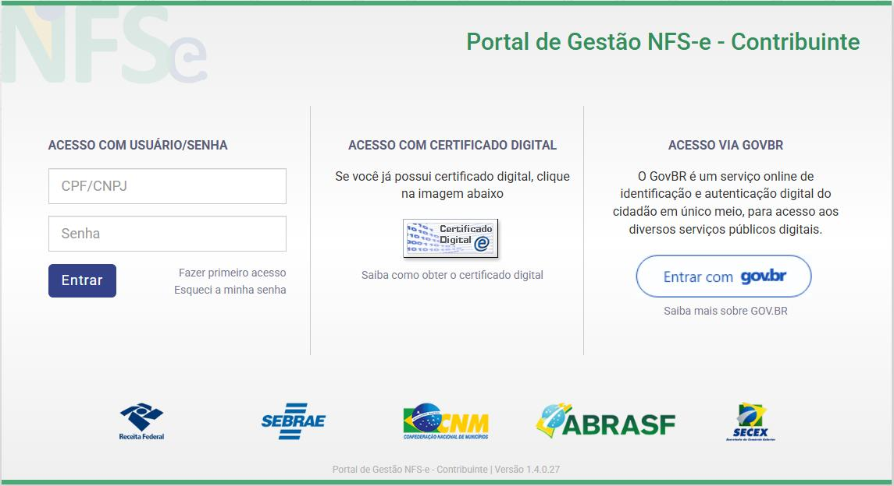
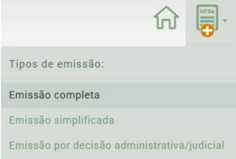
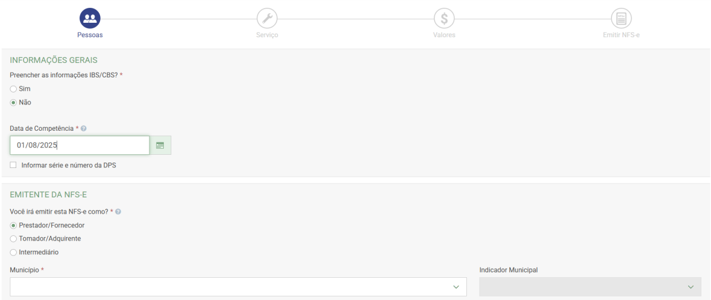
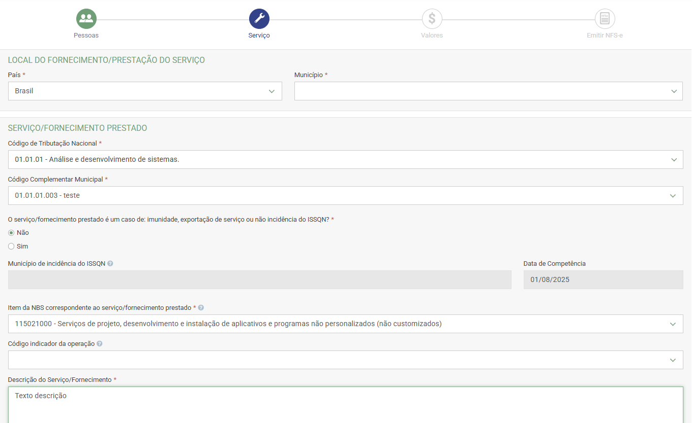
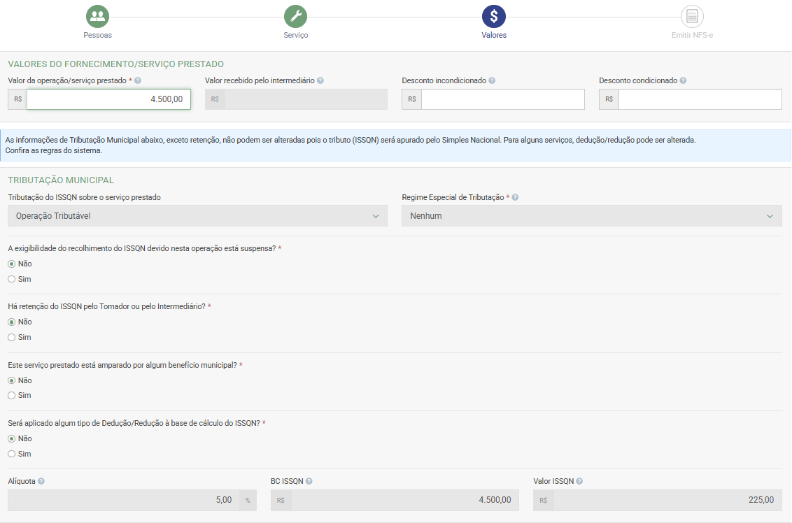
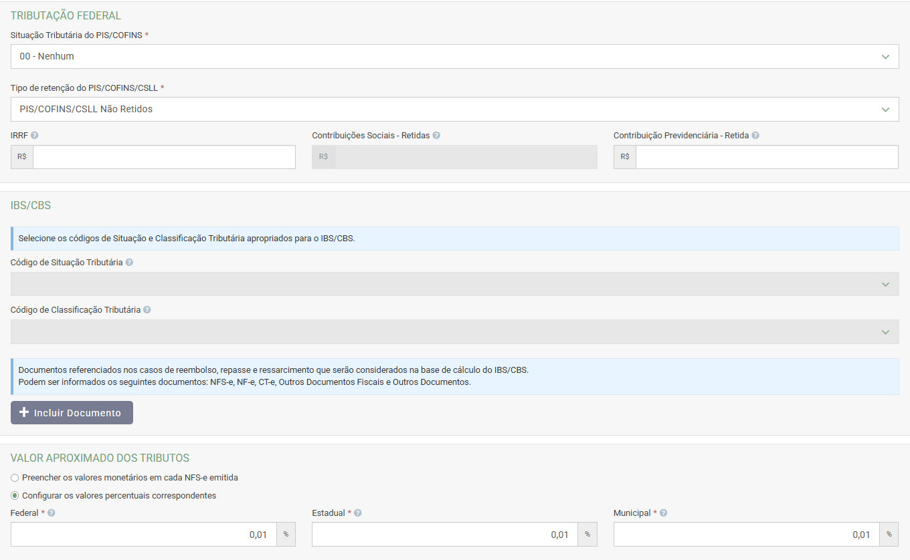

<!-- p.20 -->

# 2.2.2 Emissão de NFS-e sem Retenção de ISSQN

A seguir será feito um teste com a emissão de uma NFS-e completa como prestador/fornecedor, com ISSQN calculado a partir da alíquota vigente de um serviço, que já se encontra devidamente configurado nos parâmetros do convênio. Para isso, acessar o item “Emissão completa” do menu “Emissão”:

Na etapa “Pessoas”, selecionar “Não” para “Preencher as informações IBS/CBS?”, preencher os campos obrigatórios “Data de Competência”, escolher o emitente como “Prestador/Fornecedor”, selecionar o município, e selecionar “Tomador/Adquirente” e “Intermediário” como não informados, e clicar em “Avançar”.

<!-- p.21 -->Na etapa “Serviços”, preencher o “Município”, escolher o “Código de Tributação Nacional” como “01.01.01 - Análise e desenvolvimento de sistemas”, selecionar o “Código Complementar Municipal”, se houver, selecionar “Não” para “O serviço prestado é um caso de: imunidade, exportação de serviço ou não incidência do ISSQN?”, selecionar o “Item da NBS correspondente ao serviço/fornecimento prestado” (p. ex.: 115021000) e preencher algum texto no campo “Descrição do Serviço/Fornecimento”. Os demais campos, deixar em branco, e clicar em “Avançar”.

Na etapa “Valores”, preencher algum valor no campo “Valor do serviço prestado”, no campo “Regime Especial de Tributação” deixar como “Nenhum”, selecionar “Não” nos campos “A exigibilidade do recolhimento do ISSQN devido nesta operação está suspensa?”, “Há retenção do ISSQN pelo Tomador ou pelo Intermediário?”, “Este serviço prestado está amparado por algum benefício municipal?” e “Será aplicado algum tipo de Dedução/Redução à base de cálculo do ISSQN?”.

<!-- p.22 -->Ainda na etapa “Valores”, selecionar “Nenhum” e “PIS/COFINS/CSLL Não Retidos” nos campos “Situação Tributária do PIS/COFINS” e “Tipo de retenção do PIS/COFINS/CSLL”, respectivamente. No campo “Valor Aproximado dos Tributos”, selecionar “Configurar os valores percentuais correspondentes” e preencher algum valor nos campos “Federal”, “Estadual” e “Municipal”. Os demais campos, deixar em branco, e clicar em “Avançar”.

Na etapa “Emitir NFS-e”, verificar o resumo da nota e, estando tudo ok, clicar no botão “Emitir NFS-e” na parte inferior da página.

Dentro de alguns segundos, a NFS-e emitida será incluída na etapa de Pré-Apuração do MAN (o <!-- p.23 -->acesso às telas do MAN será explicado mais adiante), com o tipo de pré-apuração “ISSQN calculado em NFS-e – Próprio”, competência “08/2025”, e “ISSQN Pré-Apurado” de “R$ 225,00”.

A nota de exemplo em questão foi emitida com data de competência ajustada para “01/08/2025” e valor do serviço prestado de “R$ 4.500,00”. O serviço com código de tributação nacional “01.01.01 - Análise e desenvolvimento de sistemas” está configurado com alíquota de “5%” de ISSQN no convênio do município escolhido. O ISSQN pré-apurado então será o cálculo de 5% de R$ 4.500,00, totalizando R$ 225,00.
