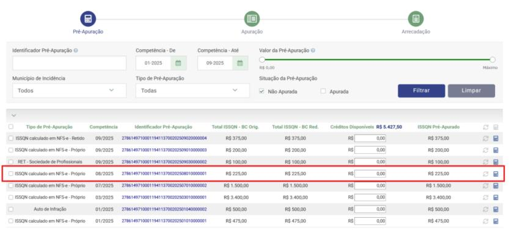
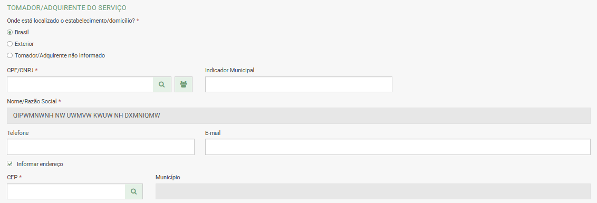
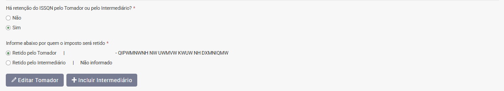
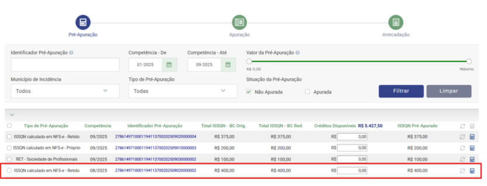

# 2.2.3 Emissão de NFS-e com Retenção de ISSQN

A seguir será feito um teste com a emissão de uma NFS-e completa com retenção do ISSQN para o Tomador/Adquirente. Para isso será utilizado um outro contribuinte com acesso ao emissor nacional, que irá emitir a nota como “Prestador/Fornecedor”, e irá informar o contribuinte de teste anteriormente utilizado como o “Tomador/Adquirente”. Dessa forma a nota seria incluída nas pré-apurações do Tomador/Adquirente na competência informada.

Fazer login no Emissor Nacional, acessar o item “Emissão completa” no menu “Emissão”.

Na etapa “Pessoas”, selecionar “Não” para “Preencher as informações IBS/CBS?”, preencher os campos obrigatórios “Data de Competência”, escolher o emitente como “Prestador/Fornecedor” e selecionar o município. No item “Tomador/Adquirente do Serviço”, selecionar “Brasil” para o campo “Onde está localizado o estabelecimento/domicílio?”, e preencher o CNPJ no campo “CPF/CNPJ” do tomador/adquirente. O “Nome/Razão Social” e dados de endereço do tomador/adquirente serão preenchidos automaticamente. Selecionar “Intermediário” como não informado e clicar em “Avançar”.

<!-- p.24 -->Na etapa “Serviços”, preencher o “Município”, escolher o “Código de Tributação Nacional” como “01.05.01 - Licenciamento ou cessão de direito de uso de programas de computação” (que foi previamente configurado para retenções na etapa “Configurar as Retenções do ISSQN”), selecionar o “Código Complementar Municipal”, se houver, selecionar “Não” para “O serviço prestado é um caso de: imunidade, exportação de serviço ou não incidência do ISSQN?”, selecionar o “Item da NBS correspondente ao serviço/fornecimento prestado” (p. ex.: 115021000) e preencher algum texto no campo “Descrição do Serviço/Fornecimento”. Os demais campos, deixar em branco, e clicar em “Avançar”.

Na etapa “Valores”, preencher algum valor no campo “Valor do serviço prestado”, no campo “Regime Especial de Tributação” deixar como “Nenhum”, selecionar “Não” nos campos “A exigibilidade do recolhimento do ISSQN devido nesta operação está suspensa?” e “Este serviço prestado está amparado por algum benefício municipal?” e “Será aplicado algum tipo de Dedução/Redução à base de cálculo do ISSQN?”.

No campo “Há retenção do ISSQN pelo Tomador/Adquirente ou pelo Intermediário?”, selecionar “Sim”, e escolher “Retido pelo Tomador”.

Ainda na etapa “Valores”, selecionar “Nenhum” e “PIS/COFINS/CSLL Não Retidos” nos campos “Situação Tributária do PIS/COFINS” e “Tipo de retenção do PIS/COFINS/CSLL”, respectivamente. No campo “Valor Aproximado dos Tributos”, selecionar “Configurar os valores percentuais correspondentes” e preencher algum valor nos campos “Federal”, “Estadual” e “Municipal”. Os demais campos, deixar em branco, e clicar em “Avançar”.

Na etapa “Emitir NFS-e”, verificar o resumo da nota e, estando tudo ok, clicar no botão “Emitir NFS-e” na parte inferior da página.

Dentro de alguns segundos, a NFS-e emitida será incluída na etapa de Pré-Apuração do MAN, com o tipo de pré-apuração “ISSQN calculado em NFS-e – Retido”, competência “08/2025”, e “ISSQN Pré-Apurado” de “R$ 400,00”.

A nota de exemplo em questão foi emitida com data de competência ajustada para “01/08/2025” e valor do serviço prestado de “R$ 8.000,00”. O serviço com código de tributação nacional “01.05.01 - Licenciamento ou cessão de direito de uso de programas de computação” está configurado com alíquota de “5%” de ISSQN no convênio do município escolhido. O ISSQN pré-apurado então será o cálculo de 5% de R$ 8.000,00, totalizando R$ 400,00.
