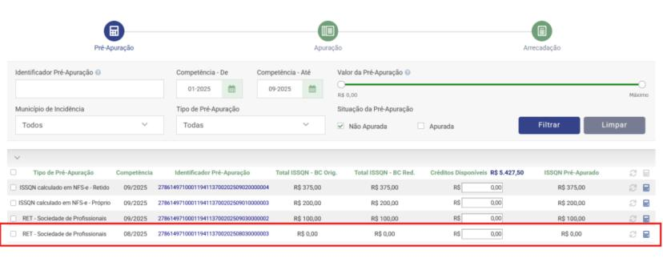
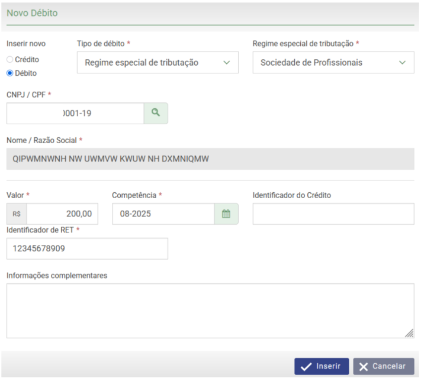

<!-- p.25 -->

# 2.2.4 Emissão de NFS-e com Regime Especial de Tributação

A seguir será feito um teste com a emissão de uma NFS-e completa como prestador/fornecedor, no entanto utilizando um regime especial de tributação, previamente configurado nos parâmetros do convênio, para o cálculo do ISSQN. Acessar o item “Emissão completa” no menu “Emissão”.

Na etapa “Pessoas”, selecionar “Não” para “Preencher as informações IBS/CBS?”, preencher os campos obrigatórios “Data de Competência”, escolher o emitente como “Prestador/Fornecedor”, selecionar o município, selecionar “Tomador/Adquirente” e “Intermediário” como não informados e clicar em “Avançar”.

Na etapa “Serviços”, preencher o “Município”, escolher o “Código de Tributação Nacional” como “01.06.01 - Assessoria e consultoria em informática” (que foi previamente configurado para utilizar regime especial de tributação do tipo “Sociedade de Profissionais” na etapa “Configurar os Regimes Especiais de Tributação”), selecionar o “Código Complementar Municipal”, se houver, selecionar “Não” para “O serviço prestado é um caso de: imunidade, exportação de serviço ou não incidência do ISSQN?”, e preencher algum texto no campo “Descrição do Serviço/Fornecimento”. Os demais campos, deixar em branco, e clicar em “Avançar”.

Na etapa “Valores”, preencher algum valor no campo “Valor do serviço prestado”, no campo “Regime Especial de Tributação” escolher “Sociedade de Profissionais”. Selecionar “Não” nos campos “A exigibilidade do recolhimento do ISSQN devido nesta operação está suspensa?”, “Há retenção do ISSQN pelo Tomador ou pelo Intermediário?”, “Este serviço prestado está amparado por algum benefício municipal?” e “Será aplicado algum tipo de Dedução/Redução à base de cálculo do ISSQN?”.

Ainda na etapa “Valores”, selecionar “Nenhum” e “PIS/COFINS/CSLL Não Retidos” nos campos “Situação Tributária do PIS/COFINS” e “Tipo de retenção do PIS/COFINS/CSLL”, respectivamente. No campo “Valor Aproximado dos Tributos”, selecionar “Configurar os valores percentuais correspondentes” e preencher algum valor nos campos “Federal”, “Estadual” e “Municipal”. Os demais campos, deixar em branco, e clicar em “Avançar”.

Na etapa “Emitir NFS-e”, verificar o resumo da nota e, estando tudo ok, clicar no botão “Emitir NFS-e” na parte inferior da página.

Dentro de alguns segundos, a NFS-e emitida será incluída na etapa de Pré-Apuração do MAN, com o tipo de pré-apuração “RET – Sociedade de Profissionais”, competência “08/2025”, e “ISSQN Pré-Apurado” de “R$ 0,00”.

A nota de exemplo em questão foi emitida com data de competência ajustada para “01/08/2025” e valor do serviço prestado de “R$ 9.000,00”. O serviço com código de tributação nacional “01.06.01 - Assessoria e consultoria em informática” foi configurado para permitir o uso de regime especial de tributação do tipo “Sociedade de Profissionais” no convênio do município escolhido, e este regime especial foi selecionado durante a emissão da nota, na etapa “Valores”.

O ISSQN pré-apurado inicialmente para notas emitidas com regime especial de tributação é de R$ 0,00, pois é necessário posteriormente criar um débito que será vinculado às notas dessa competência e regime especial de tributação específico para o contribuinte em questão.

<!-- p.26 -->O débito criado no Painel de Créditos e Débitos, através do Painel Municipal, pelo gestor do convênio do município escolhido, para esse contribuinte específico, deve ser gerado utilizando a mesma competência e mesmo tipo de regime especial da pré-apuração em questão. O valor informado para este débito, será então o valor do ISSQN vinculado na pré-apuração. Verificar como fazer a geração do débito na etapa anterior com o título “Inclusão de Débito”.

Após a inclusão de um débito no valor de R$ 200,00, competência “08-2025” e tipo de regime especial de tributação “Sociedade de Profissionais”, para o contribuinte, conforme imagem abaixo, a pré-apuração selecionada será exibida na lista de pré-apurações com o valor de “ISSQN Pré-Apurado”, atualizado então para o valor de R$ 200,00.

