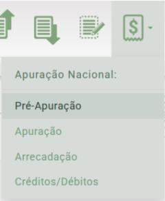
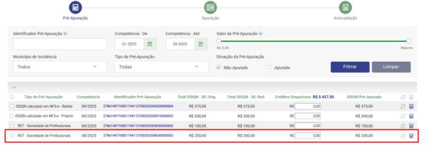
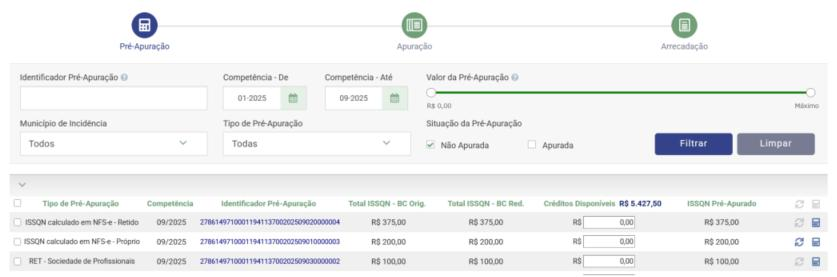

<!-- p.27 -->

# 2.2.5 Pré Apuração - Lista

Para começar a utilizar o Módulo de Apuração Nacional (MAN) e ter acesso à lista de pré-apurações já existentes para o contribuinte logado, acessar o menu “Apuração Nacional” e clicar em “Pré-Apuração”.

Será apresentada uma lista contendo as pré-apurações e alguns filtros de pesquisa, conforme imagem abaixo.

Serão exibidas na lista as pré-apurações definidas conforme os parâmetros informados pelo usuário. Pode-se, por exemplo, filtrar por “Município de Incidência”, “Tipo de Pré-Apuração”, “Competência – De”, “Competência – Até”, “Valor da Pré-Apuração”, “Identificador da Pré-Apuração”, e “Situação da Pré- Apuração”.

A lista também pode ser ordenada clicando-se nos títulos em verde das colunas, na linha abaixo <!-- p.28 -->do nome do município. No exemplo abaixo, ao clicar em “Total ISSQN – BC. Orig.” a lista foi ordenada de forma decrescente pelo valor total calculado de ISSQN pré-apurado pela base de cálculo original da NFS-e.

