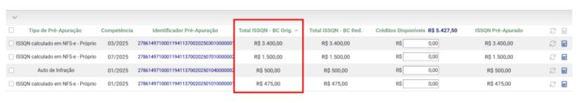
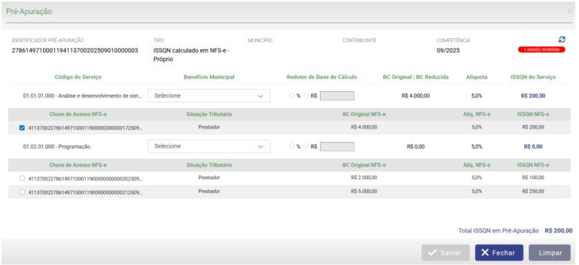
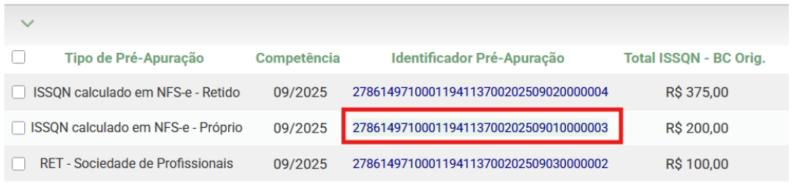
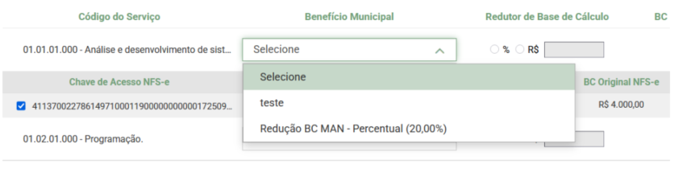
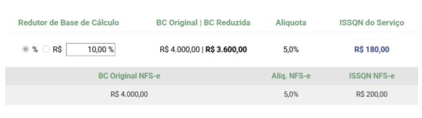
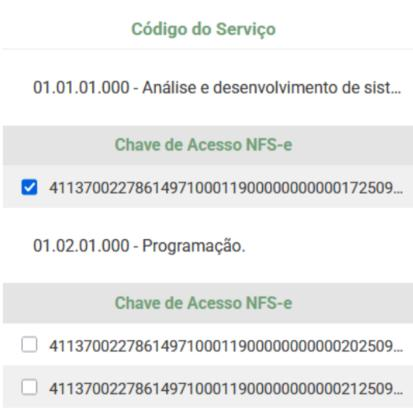
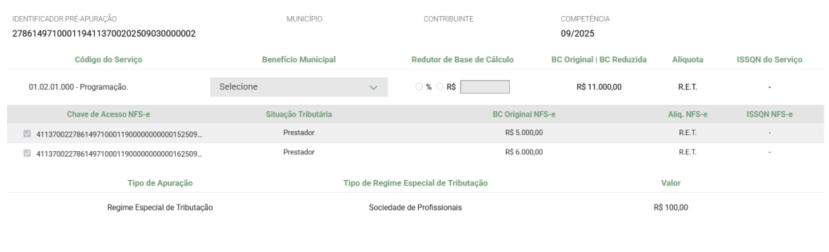

# 2.2.6 Pré Apuração – Detalhamento e Redução de Base de Cálculo

Para detalhar cada pré-apuração, mostrando as notas relacionadas, e demais informações referentes à mesma, como utilização de benefícios municipais e situação de inclusão de cada NFS-e na pré-apuração, basta clicar no link em azul na lista de pré-apurações, referente ao “Identificador da Pré- Apuração”, conforme imagem abaixo.

No caso de pré-apurações do tipo “ISSQN calculado em NFS-e – Próprio” e “ISSQN calculado em NFS-e – Retido”, é possível a utilização de benefícios municipais de redução de base de cálculo, de forma a reduzir o ISSQN devido pelo contribuinte. Os benefícios municipais devem estar previamente cadastrados, para o convênio, município, serviço e competência em questão, conforme a etapa anterior “Configurar os Benefícios Municipais para o MAN”.

Ao detalhar pré-apurações destes 2 (dois) tipos, irá aparecer uma tela conforme abaixo:

Caso haja benefícios municipais disponíveis para serem aplicados a algum dos serviços incluídos na pré-apuração, a caixa de seleção do benefício será habilitada, permitindo a sua seleção. No exemplo abaixo, para o serviço “01.01.01 - Análise e desenvolvimento de sistemas”, há disponíveis 2 (dois) benefícios municipais.

<!-- p.29 -->Após escolher um benefício municipal, a caixa “Redutor de Base de Cálculo” para informar o valor de redução, à direita dos itens % e R$, ficará habilitada e funcionará de acordo com o tipo de benefício.

Caso seja um benefício municipal de redução de base de cálculo do tipo “Percentual”, o campo “%” será automaticamente selecionado, permitindo a entrada de valores percentuais, até o limite máximo que foi definido na configuração do benefício (no caso do exemplo, foi definido o limite máximo de 20,00% de redução. Qualquer valor acima disso será considerado inválido pela aplicação, exibindo uma mensagem de erro). Caso seja um benefício municipal de redução de base de cálculo do tipo “Monetário”, o campo “R$” será automaticamente selecionado, permitindo a entrada de valores monetários e funcionando da mesma forma que o tipo anterior.

Ao informar um valor de “10,00%” no campo “Redutor de Base de Cálculo”, os campos “BC Original | BC Reduzida” e “ISSQN do Serviço” mostrarão os valores atualizados, de acordo com a redução de base de cálculo.

<!-- p.30 -->Nessa tela, também, é possível selecionar quais NFS-e serão incluídas ou excluídas na apuração, de acordo com os checkboxes (caixas de seleção) ao lado esquerdo dos campos “Chave de Acesso NFS-e”, conforme abaixo. Ao incluir e excluir notas, os valores de ISSQN da pré-apuração serão automaticamente recalculados.

Após editar os benefícios municipais dos serviços e modificar a inclusão/exclusão de NFS-e, o valor total de ISSQN da pré apuração será exibido no rodapé à direita da tela, próximo aos botões “Salvar”, “Fechar” e “Limpar”, disposto no campo “Total ISSQN em Pré-Apuração”. Para salvar as alterações da pré-apuração, clicar em “Salvar”.

O botão “Limpar” serve para remover todos os benefícios municipais e incluir novamente todas as notas na pré-apuração, desfazendo quaisquer modificações feitas anteriormente. É necessário salvar após acionar o botão “Limpar”.

O botão “Fechar” serve para descartar as alterações e fechar a tela, mantendo o estado salvo anteriormente da pré-apuração.

No caso de pré-apurações do tipo “RET – Regime Especial de Tributação”, a tela de detalhamento é bem semelhante às telas de pré-apurações do tipo “ISSQN calculado em NFS-e”, no entanto, não há opções de alteração, apenas consulta.

<!-- p.31 -->A pré-apuração pode já conter o valor de ISSQN apurado, caso o débito referente ao regime especial de tributação tenha sido gerado no Painel Municipal do convênio (para o mesmo contribuinte e competência da pré-apuração).

De outra forma, a tela de detalhamento virá com o ISSQN apurado de R$ 0,00, para regimes especiais de tributação, que estejam sem o débito vinculado, e irá aparecer o texto “O débito referente à ao Regime Especial de Tributação ainda não foi incluído na Pré-Apuração”.

No caso de pré-apurações do tipo “Auto de Infração”, ou “Outros Débitos do Município”, a tela de detalhamento consta basicamente do identificador do auto de infração ou débito, do valor, e de um texto de descrição, detalhando o débito ou infração. Esta tela também não tem opções de alteração, apenas consulta, conforme imagem abaixo.

