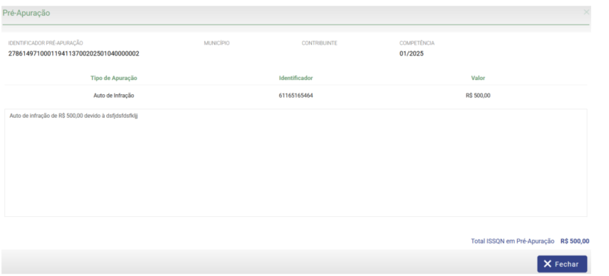
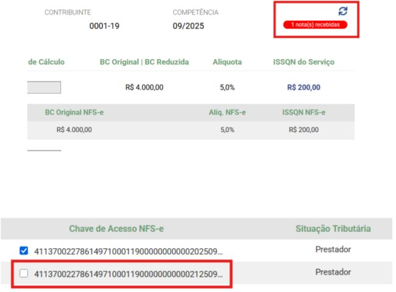
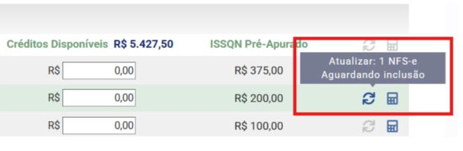
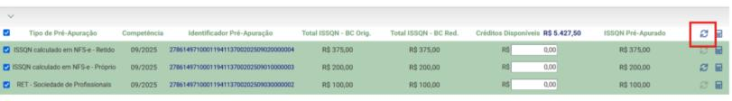

# 2.2.7 Pré Apuração – Atualização de notas

Durante a fase de pré-apuração, as notas são agrupadas pelo seu tipo e competência, e pode haver casos em que mais notas sejam geradas, com data dessa mesma competência, e possuindo o mesmo tipo (NFS-e com ISSQN Retido ou Próprio).

Quando isto ocorre, caso a pré-apuração não tenha sido modificada, com adição de benefícios municipais ou com a exclusão/inclusão de notas, as novas NFS-e que forem geradas na mesma competência e com mesmo tipo são incluídas automaticamente na pré-apuração.

Caso já tenha havido alguma modificação na pré-apuração, as novas notas são acrescentadas à pré-apuração existente, no entanto, ficam desmarcadas para o cálculo do ISSQN. O usuário pode manualmente incluí-las efetivamente na pré apuração, bastando para isso utilizar os checkboxes (caixas de seleção) à esquerda da “Chave de Acesso NFS-e” ou então clicar no ícone azul que aparece no canto superior direito da tela de detalhamento, conforme imagem abaixo, onde aparece escrito em vermelho, “1 nota(s) recebidas”.

<!-- p.32 -->Há, ainda, outra maneira de incluir as notas que foram recentemente adicionadas na pré-apuração, com a chegada de novas notas na mesma competência. Na lista de pré-apurações há um ícone azul que fica ao lado direito da tela, com o título “Atualizar: 1 NFS-e Aguardando Inclusão”, conforme imagem abaixo.

Também é possível selecionar todas as pré-apurações, com o primeiro checkbox (caixa de seleção) à esquerda do campo “Tipo de Pré-Apuração”, e em seguida clicar no ícone azul “Atualizar Todas” no canto superior direito.

<!-- p.33 -->Ao clicar em algum dos ícones de atualização, será exibida uma mensagem de confirmação conforme abaixo.

As notas que estiverem listadas na tela de detalhamento, mas não forem efetivamente incluídas, ou que tiverem sido excluídas da pré-apuração em uma determinada competência, serão colocadas em uma nova pré-apuração nessa mesma competência, quando a pré-apuração atual for concluída e gerar uma apuração.

Para os casos de pré-apurações do tipo “Regime Especial de Tributação”, as novas notas que forem geradas com o mesmo tipo de regime especial e competência, serão incluídas automaticamente na pré-apuração existente, até o momento em que ela for apurada, pois nesse caso não há opção de inclusão/exclusão de notas ou inclusão de benefícios municipais. Caso cheguem novas notas em uma competência que já tenha sido apurada, uma nova pré- apuração é gerada, nessa mesma competência.
