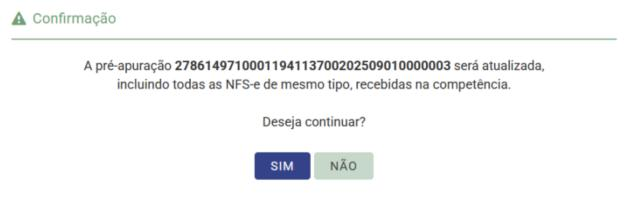
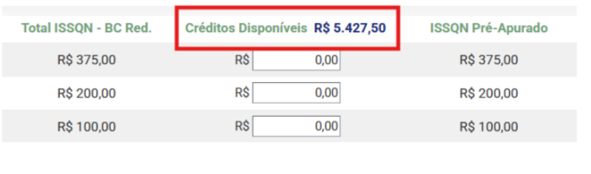
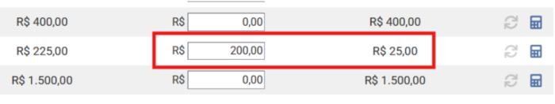
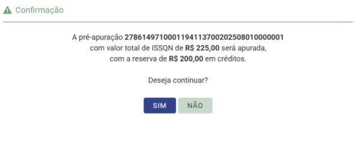
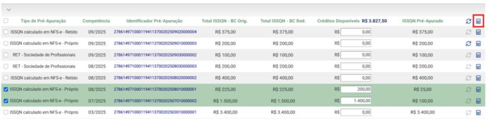

# 2.2.8 Pré Apuração – Utilização de Créditos e Apuração

Ao concluir as modificações em uma pré-apuração, é possível a utilização de créditos, que o contribuinte possa ter no município em questão, para reduzir o valor do ISSQN pré-apurado, antes de passar para a próxima etapa, e gerar a apuração.

O valor de créditos disponíveis para o contribuinte em cada município é exibido na coluna “Créditos Disponíveis”, no cabeçalho da listagem de pré- apurações, conforme imagem abaixo. Esse valor também pode ser consultado no painel de créditos e débitos no Painel Municipal, referente ao convênio deste município e contribuinte específico.

Para utilizar o crédito, ou parte do crédito em uma determinada pré-apuração, basta preencher a caixa onde é exibido inicialmente “R$ 0,00”, na coluna de créditos disponíveis, na mesma linha da pré-apuração ao qual se deseja utilizar o crédito. No exemplo abaixo, foi utilizado R$ 200,00 de crédito em uma apuração com valor inicial de ISSQN de R$ 225,00, restando R$ 25,00 de ISSQN pré-apurado.

<!-- p.34 -->Para concluir a pré apuração e gerar a apuração, basta clicar no ícone azul da calculadora na parte direita da lista. Nesse caso será exibida uma mensagem de confirmação conforme abaixo.

Também é possível concluir mais de uma pré-apuração simultaneamente. No exemplo abaixo, foram selecionadas 2 (duas) pré-apurações, que ficam destacadas em verde, sendo que na primeira optou-se por utilizar R$ 200,00 de créditos, para o total de ISSQN de R$ 225,00; e para a segunda optou-se por utilizar R$ 1.400,00 de créditos, para o total de ISSQN de R$ 1.500,00. Para gerar as 2 (duas) apurações simultaneamente, é necessário apenas clicar no botão azul da calculadora no topo à direita da lista, conforme marcado em vermelho na imagem abaixo.

<!-- p.35 -->Ao clicar no botão “Apurar Todas”, será exibida uma mensagem de confirmação, conforme imagem abaixo.

Clicando “Sim”, as 2 (duas) pré-apurações serão concluídas, gerando 2 (duas) novas apurações.
