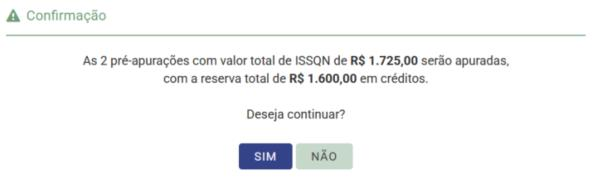

# 2.2.9 Apuração – Lista

À medida que as pré-apurações forem sendo concluídas, novas apurações passam a ser exibidas na etapa “Apuração”. Para isso, basta acessar o menu “Apuração Nacional” e clicar em “Apuração”. Ou então clicar no ícone de acesso fácil redondo ao centro, ao lado direito do ícone “Pré-Apuração”, no topo da tela de pré-apurações. Ou ainda, clicar no botão azul “Avançar” próximo ao rodapé da tela de pré-apurações. Será apresentada então uma lista contendo as apurações e alguns filtros de pesquisa, conforme imagem abaixo.

Os filtros são bem semelhantes aos da tela das pré-apurações, sendo a única diferença os campos da “Situação da Apuração”, que pode ser “Desvinculado” (sem vinculação a um DNA - Documento Nacional de Arrecadação), “Vinculado” (vinculado a um DNA, no entanto sem arrecadação) ou “Em DAN” (vinculado a um DNA já arrecadado e escriturado em uma Declaração de Arrecadação Nacional). A lista de apurações também pode ser reordenada, bastando para isso clicar nos títulos das colunas, da mesma forma que a lista de pré-apurações.
