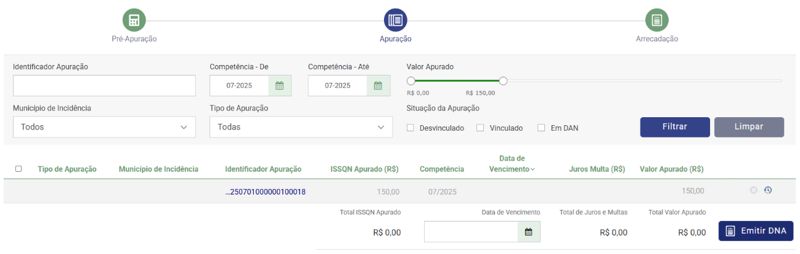

# 2.2.10 Apuração – Detalhamento

As telas de detalhamento das apurações são bem semelhantes às telas de detalhamento das pré-apurações, no entanto, sem a opção de edição, ou modificação de benefícios municipais ou inclusão/exclusão de notas.

<!-- p.36 -->A tela é apenas de consulta, apresentando todas as alterações realizadas na pré-apuração, como os benefícios municipais aplicados, além de constar também os valores de créditos utilizados ao concluir a pré-apuração. Um resumo dos valores aparecerá no rodapé da página, conforme imagem abaixo.

Caso a apuração já tenha sido incluída em um documento de arrecadação, e tenham sido gerados valores de Juros e Multas, estes valores também serão exibidos nas informações de valores do rodapé.
