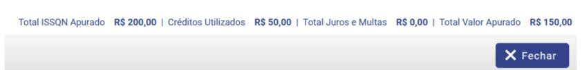
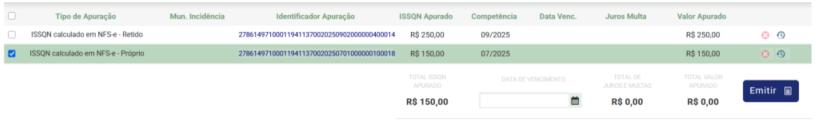
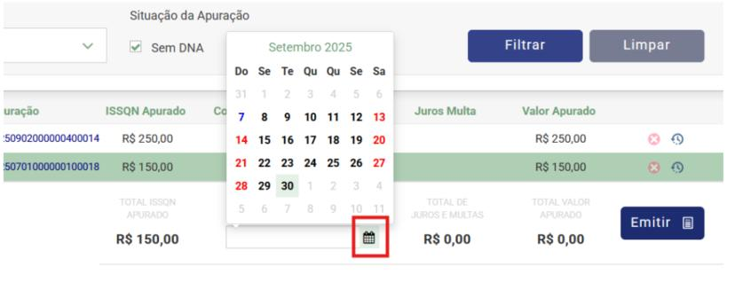
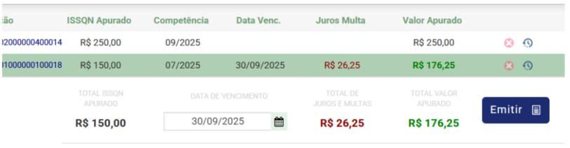
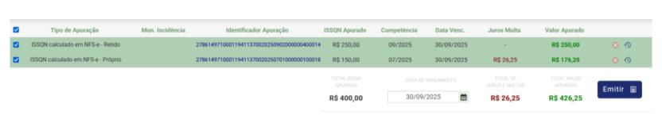
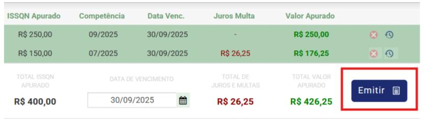
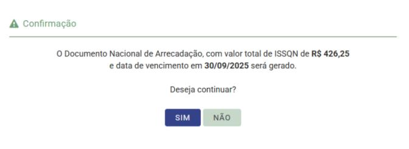

# 2.2.11 Apuração – Cálculo de Juros/Multa e Emissão

Para gerar o documento de arrecadação para recolhimento em atraso é necessário basicamente que sejam calculados os valores de juros e multa de cada apuração (com base em sua data de competência e valor de ISSQN apurado), e, conforme necessidade, concluir as apurações separadamente ou agrupá-las em um único documento de arrecadação.

No exemplo abaixo, iremos calcular os juros e multa de uma apuração com valor de ISSQN apurado de R$ 150,00 e competência 07-2025 (com 2 meses de atraso). Para isso, primeiro é necessário clicar no checkbox (caixa de seleção) à esquerda na lista, selecionando a apuração. A apuração ficará destacada em verde e o valor de R$ 150,00 irá aparecer no campo abaixo “Total ISSQN Apurado”, conforme imagem. Os valores de juros e multa e valor total apurado continuam ainda apresentando o valor R$ 0,00.

Em seguida, é necessário clicar no botão de data, quando um calendário será exibido, para que o contribuinte selecione o dia de vencimento da guia de arrecadação.

<!-- p.37 -->Supondo que seja escolhido o dia “30/09/2025” no calendário. Nesse momento é realizado um cálculo automático do valor dos juros e multa da apuração selecionada e os respectivos campos serão atualizados e exibidos em vermelho para os juros e multa e em verde para o valor total apurado, conforme imagem a seguir.

É possível também selecionar mais de uma apuração, clicando nos checkboxes (caixas de seleção) à esquerda dos campos “Tipo de Apuração”. Ao selecionar/alterar a data, ou incluir/excluir apurações, clicando nos checkboxes, os valores de juros e multa são recalculados.

Estando tudo ok, basta clicar no botão azul “Emitir DNA”, para gerar o documento de arrecadação com a data de vencimento escolhida.

Uma mensagem de confirmação será exibida e, ao clicar “Sim”, um documento de arrecadação será então gerado, contendo todas as apurações selecionadas.

