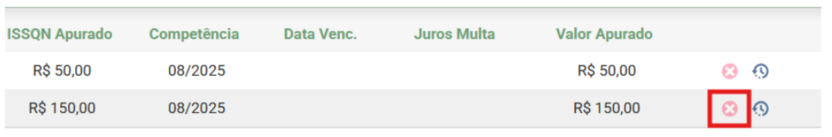
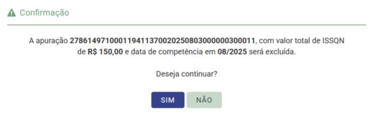

<!-- p.38 -->

# 2.2.12 Apuração – Exclusão de Apuração

Há a possibilidade de se excluir as apurações, antes que estas tenham sido concluídas com a geração do documento de arrecadação, de forma que retornem para a tela de pré-apurações. Dessa forma, é possível efetuar alterações na pré-apuração, como a inclusão/exclusão de notas, aplicação de benefícios municipais ou alteração no valor de créditos utilizados para redução do ISSQN apurado. Para isso, basta clicar no ícone vermelho “Excluir Apuração”.

Uma mensagem de confirmação é apresentada. Clicando em “Sim”, a apuração é excluída e os itens incluídos na apuração existente retornam a uma pré-apuração, na etapa anterior. Os créditos que foram utilizados na pré-apuração, e que haviam sido reservados para pagamento do ISSQN, são liberados e voltam também para o valor acumulado de créditos do contribuinte naquele município.

