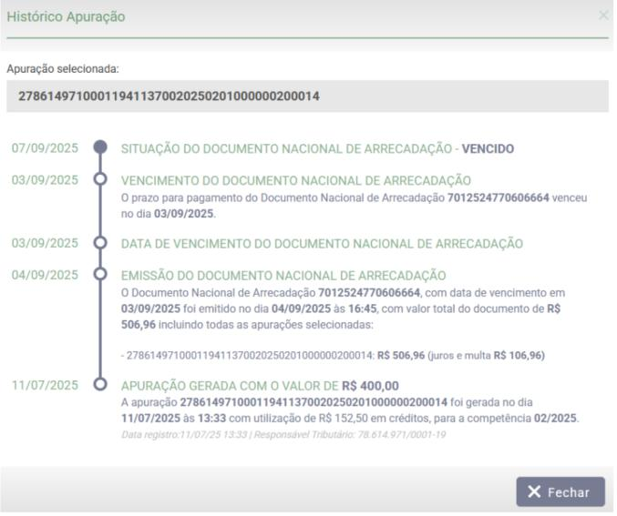

<!-- p.39 -->

# 2.2.13 Apuração – Histórico

Para visualizar o histórico do passo a passo de uma apuração, desde a sua geração, emissão do documento de arrecadação, data de vencimento e situação atual, basta clicar no botão “Histórico”, ao lado direito do botão “Excluir Apuração”. Será mostrada uma tela contendo as datas dos eventos em ordem decrescente e as informações referentes a cada etapa. Caso um documento de arrecadação tenha sido gerado, e contenha mais de uma apuração, todas as apurações incluídas serão listadas nas informações do histórico.

