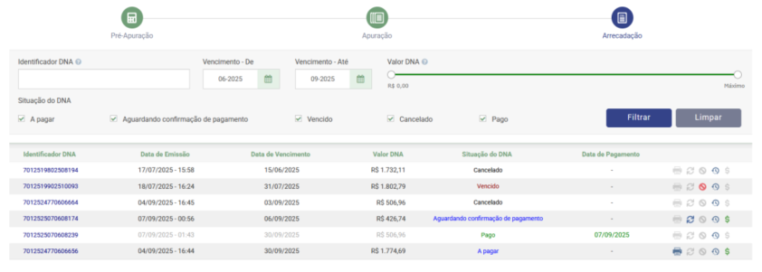
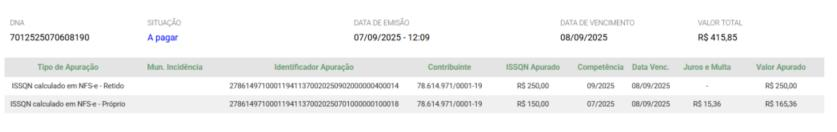
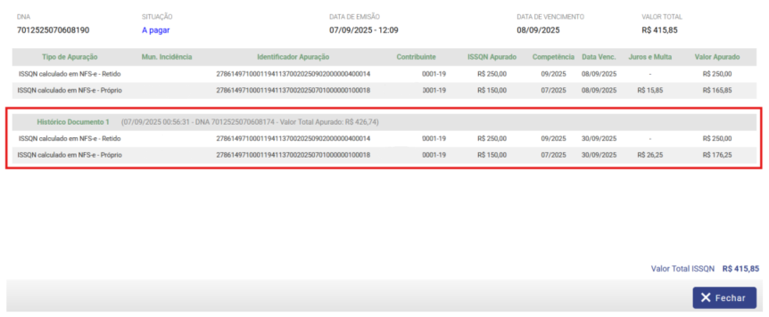
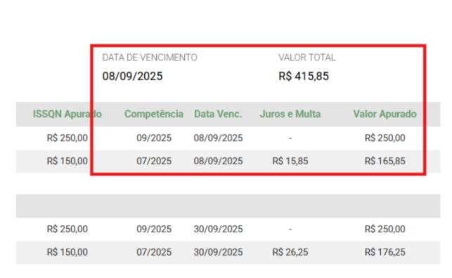

<!-- p.40 -->

# 2.2.15 Arrecadação – Detalhamento

Para detalhar cada documento de arrecadação, exibindo as apurações incluídas e demais informações referentes ao mesmo, como valores de juros e multas, município de incidência, tipo de cada apuração individual incluída, além de informações de histórico de reemissão do documento, basta clicar no link em azul na lista de documentos, na coluna “Identificador DNA”. Será mostrada uma tela conforme imagem abaixo.

Caso o documento de arrecadação tenha sido reemitido uma ou mais vezes, os históricos de juros e multa calculados anteriormente serão mostrados na parte inferior da tela, replicando as informações das apurações, mas apresentando os valores antigos.

<!-- p.41 -->Neste exemplo, é possível verificar que, devido à alteração na data de vencimento, ocorreu um novo cálculo de juros e multa, apresentando também o registro de histórico com o cálculo anterior, na parte inferior da tela.

