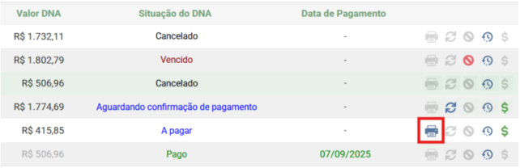
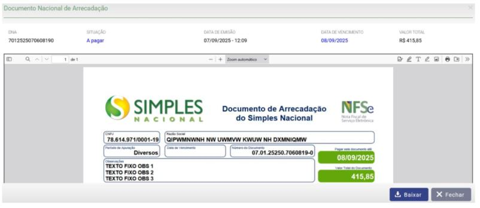

# 2.2.16 Arrecadação – Impressão

Para documentos de arrecadação que estejam com o status “A pagar”, fica habilitada a função de impressão do documento. Para isso basta clicar no ícone de impressora à direita na listagem de documentos, ao lado das demais ações. Ao clicar no ícone, uma janela para visualização, impressão e/ou download do documento em PDF será mostrada.

