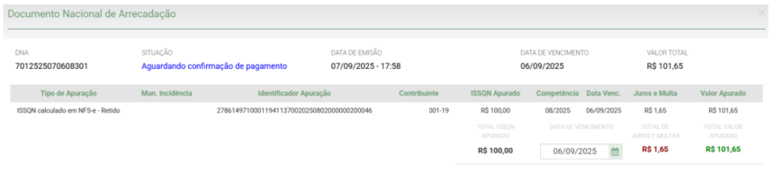
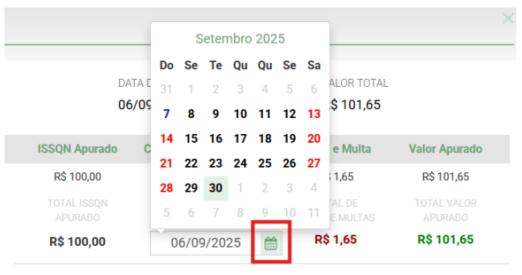

<!-- p.42 -->

# 2.2.17 Arrecadação – Reemissão

Para documentos de arrecadação que estejam com o status “Aguardando confirmação de pagamento”, fica habilitada a função de reemissão do documento. Para isso basta clicar no ícone “Reemitir” à direita na listagem de documentos, ao lado das demais ações. Ao clicar no ícone, uma janela para reemissão do documento será mostrada, solicitando o preenchimento de uma nova data de vencimento.

Este status ocorre por um prazo de 2 (dois) dias após a data de vencimento do documento de arrecadação para aguardar a compensação do banco e outras operações financeiras que possam atrasar a chegada da notificação de que o pagamento foi realmente efetuado. Caso por algum motivo o pagamento ainda não tenha sido feito, há então a opção de reemitir o documento, de forma que o mesmo conjunto de apurações incluídas originalmente no documento seja mantido, trocando apenas a data de vencimento, e com um novo cálculo de juros e multa. Se após esses 2 (dois) dias não chegar a notificação de confirmação do pagamento, o status do documento é alterado então para “Vencido”.

Para reemitir o documento nesta tela de detalhamento e reemissão, basta clicar no botão do calendário, para escolher então uma nova data de vencimento. Esta tela tem o funcionamento bem semelhante à tela de emissão original das apurações. Após escolher a data, será feito um cálculo automático dos novos valores de juros e multas e, após isso, basta clicar no botão azul “Reemitir DNA”, no rodapé da página.

Ao clicar no botão “Reemitir DNA”, será exibida então uma mensagem de confirmação, conforme imagem abaixo. Ao clicar “Sim”, um novo documento de arrecadação será reemitido, cancelando o documento com os valores originais.

<!-- p.43 -->Após a reemissão, ao abrir novamente a janela de detalhamento do documento de arrecadação, o documento atual será exibido na parte superior da tela, e o documento original com os valores e data de vencimento anteriores será exibido na parte inferior como “Histórico Documento 1”. Caso haja nova reemissão posteriormente, irá constar uma sequência com os documentos emitidos e cancelados, por exemplo “Histórico Documento 1”, “Histórico Documento 2”, etc.
