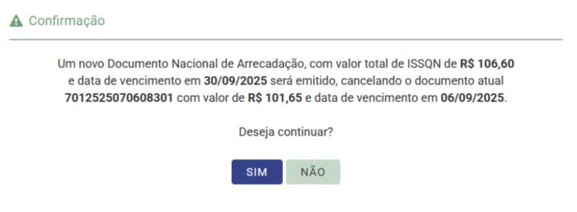
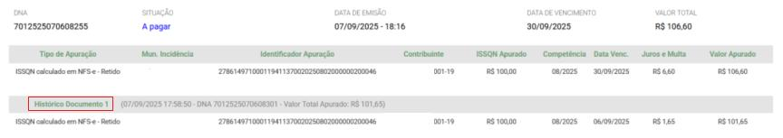

# 2.2.18 Arrecadação – Cancelamento

Para documentos de arrecadação que estejam com o status “Vencido”, fica habilitada a função de cancelamento do documento. Para isso basta clicar no ícone “Cancelar Documento” à direita na listagem de documentos, ao lado das demais ações.

Ao clicar no ícone de cancelamento, será mostrada então uma mensagem de confirmação, conforme imagem abaixo. Ao clicar “Sim”, o documento de arrecadação terá seu status modificado para “Cancelado”, liberando as apurações que nele estiverem contidas, retornando-as à etapa anterior “Apuração”, para que possam ser selecionadas novamente, e gerar novas guias de arrecadação. O documento cancelado continuará constando na etapa “Arrecadação”, para histórico, porém com o status “Cancelado”.

