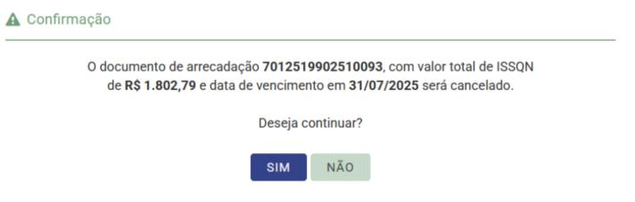

# 2.2.19 Arrecadação – Histórico

O ícone de “Histórico” na tela de “Arrecadação” tem o funcionamento bastante semelhante à tela de “Apuração”. Ao clicar no mesmo, é mostrada uma tela com o passo a passo de cada documento, desde as apurações, até a emissão, pagamento, vencimento, ou cancelamento, <!-- p.44 -->as datas dos eventos em ordem decrescente e as informações referentes a cada etapa. Caso o documento de arrecadação contenha mais de uma apuração, todas as apurações incluídas serão listadas nas informações do histórico. Por fim, se o documento de arrecadação tiver sido reemitido, apenas os eventos referentes ao documento atual, ou mais recente, será mostrado na tela de histórico, com os valores e datas de cada evento desde a apuração.

