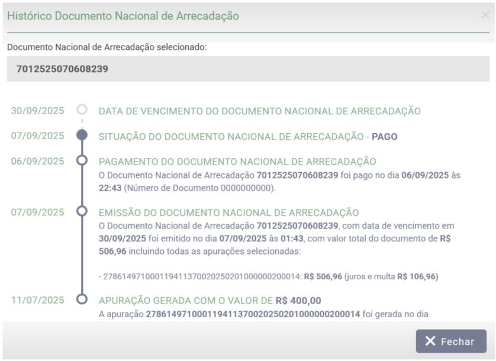
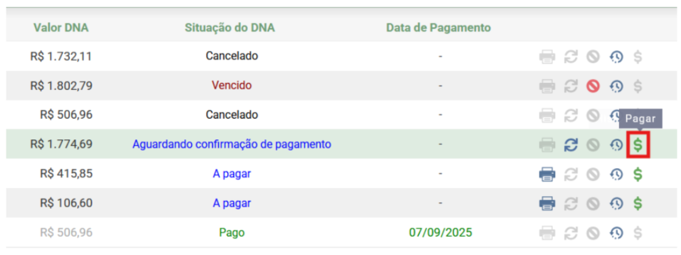

# 2.2.20 Arrecadação – Simulação de Pagamento

Para documentos de arrecadação que estejam com o status “A pagar” ou “Aguardando confirmação de pagamento”, fica habilitada uma função para simular o pagamento do documento, para fins de teste do sistema. Para isso basta clicar no ícone “Pagar” ($) à direita na listagem de documentos, ao lado das demais ações, conforme imagem abaixo.

Ao clicar no ícone de pagamento, será exibida então uma mensagem de confirmação. Ao clicar “Sim”, o documento de arrecadação terá seu status modificado para “Pago”, concluindo todo o processo de pré-apuração, apuração e arrecadação do ISSQN. No caso de confirmação de <!-- p.45 -->pagamento do documento de arrecadação, seja pelo ícone de simulação de pagamento, ou pelo recebimento da notificação de pagamento da guia pelo sistema, os créditos reservados pelo contribuinte para o pagamento do ISSQN serão efetivamente utilizados e os eventos de pagamento do imposto devido, referente às notas e apurações incluídas no documento de arrecadação, serão gerados.

