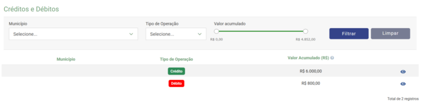
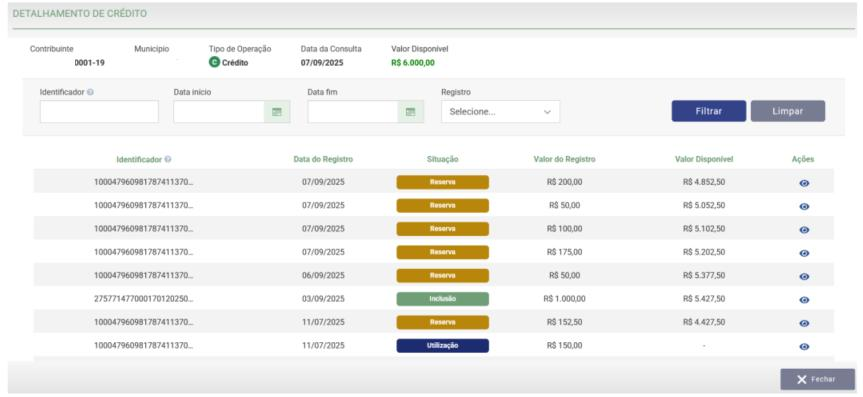
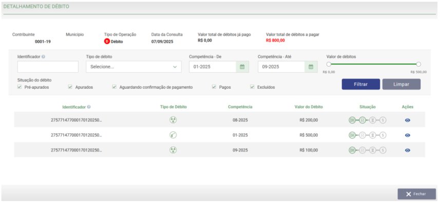

# 2.2.21 Créditos e Débitos – Consulta

No emissor nacional, há também um painel de Créditos/Débitos, semelhante ao existente no Painel Municipal. No entanto, ele serve apenas para consulta dos créditos e débitos relacionados ao CPF/CNPJ do contribuinte logado, para que este possa verificar o seu saldo em cada município ao qual é contribuinte. Para acessá-lo, basta abrir o menu “Apuração Nacional” e clicar em “Créditos/Débitos”. Será mostrada uma tela conforme a imagem abaixo.

O valor total de créditos e débitos do contribuinte em cada município aparece na coluna “Valor Acumulado (R$)”. Para consultar e detalhar os créditos ou débitos existentes, clicar na ação “Detalhar” (👁). Será exibida uma tela de detalhamento referente ao crédito ou débito selecionado, conforme as imagens abaixo.

<!-- p.46 -->

