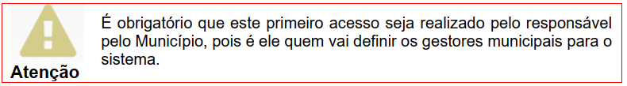
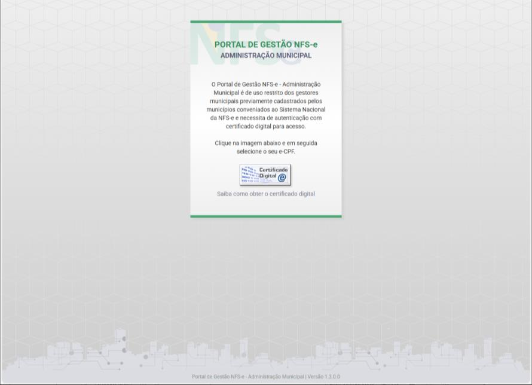

<!-- p.14 -->
# 1.3 Primeiro acesso municipal ao Sistema da NFS-e

O responsável pelo Município deverá acessar o endereço https://www.nfse.gov.br/PainelMunicipal/ com o seu certificado digital e realizar o login no sistema.

Para acessar o Painel Municipal deve-se usar o endereço:

a) Ambiente de testes - Produção Restrita: https://www.producaorestrita.nfse.gov.br/PainelMunicipal/Login?ReturnUrl=%2fPainelMunicipal%2f

b) Ambiente de Produção: https://www.nfse.gov.br/PainelMunicipal/Login?ReturnUrl=%2fPainelMunicipal .

Para acessar os Painéis é necessário o uso de certificado digital.

1) Clicar em **Certificado Digital** e inserir a autenticação com certificado digital;

*Figura 2: Página de autenticação para entrada no Painel Administrativo municipal*

O Painel Administrativo Municipal NFS-e fornece funcionalidades para que o município conveniado se "parametrize" no sistema nacional.

<!-- p.15 -->
---

Dentre os aspectos principais que o município conveniado deve parametrizar estão:

- possibilidade de criação de códigos tributários municipais (serviços da listagem municipal);
- indicação de atributos dos serviços (formas de dedução/redução, regimes especiais de tributação e alíquotas) para validação da DPS e emissão de NFS-e;
- habilitação e manutenção da situação cadastral do contribuinte no Cadastro Nacional de Contribuintes;
- gerenciamento de regras próprias referentes a Retenções do ISSQN e a Benefícios Municipais da legislação municipal; e
- consultas de documentos fiscais eletrônicos (DF-e) em que esteja envolvido.

---

A funcionalidade de parametrização de atributos municipais deve ser criteriosamente gerenciada pelos gestores municipais, pois é necessária para a correta emissão de uma NFS-e pelo contribuinte que utilize o Sistema Nacional da NFS-e (exemplos: alíquotas que podem variar entre 2% e 5% para os diversos tipos de serviços, prazos para cancelamento e substituição de NFS-e) e são necessárias para a correta validação da DPS e emissão de uma NFS-e.

Não serão criados atributos de parametrização restritos para um município ou outro especificamente. Os atributos possíveis de parametrização são aqueles comuns ao negócio do ISSQN para todos os municípios, cuja informação do atributo varia segundo a legislação interna de cada município.

---

Não existem atributos de parametrização particulares para um município especificamente.

---

O próprio módulo Painel Administrativo Municipal NFS-e gerencia o que deve ser parametrizado, para que o usuário (gestor municipal) não deixe de parametrizar informações que são necessárias para o correto funcionamento do sistema nacional de forma integrada.

As informações de parametrizações da legislação municipal do município serão utilizadas para validações em diversas regras quando da emissão da NFS-e. A depender da regra de negócio, as informações recuperadas serão do município emissor da NFS-e (município em que o emitente possui estabelecimento ou domicílio e que está habilitado a emitir NFS-e) ou podem ser recuperadas do município de incidência do ISSQN.

Fazem parte desta aplicação as funcionalidades:

1. Cadastros dos gestores municipais;
2. Cadastro de contribuintes municipais:

<!-- p.16 -->
   - Upload de arquivo com contribuintes municipais;
   - Gestão individualizada de contribuintes municipais;
3. Parametrizações municipais:
   - Lista de Serviços
     - Código de Tributação Municipal
     - Alíquota
     - Dedução/Redução
   - Retenções;
   - Outros Benefícios;
   - Regime Especial de Tributação;
   - Eventos de NFS-e.
