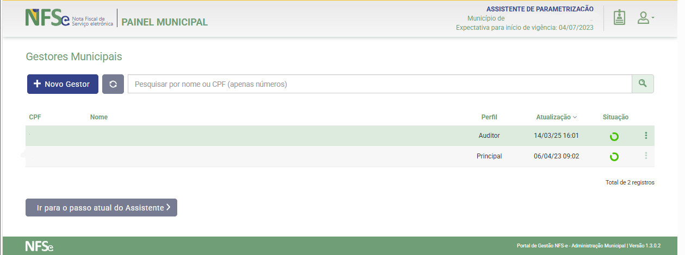
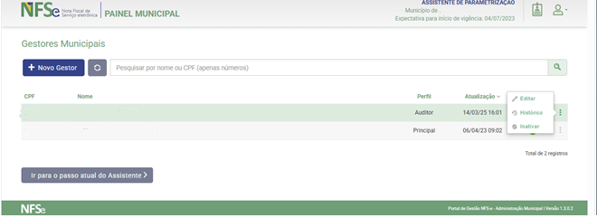

# 2.1 Consulta de Gestores Municipais

Na página inicial de "Gestores Municipais" há uma lista paginada com a relação de todos os gestores já cadastrados o Perfil, a data da atualização e a situação (Ativo ou Inativo) de cada um deles, pode-se pesquisar um gestor pelo nome ou pelo CPF. Há ainda a opção para incluir um novo gestor.

*Figura 4: Página de administração dos Gestores Municipais.*

Além disso, ao clicar nos 3 pontos ao final da linha, é possível editar, obter histórico ou Inativas um gestor já cadastrado.

<!-- p.19 -->

*Figura 5: Página de administração dos Gestores Municipais mostrando o menu lateral.*
