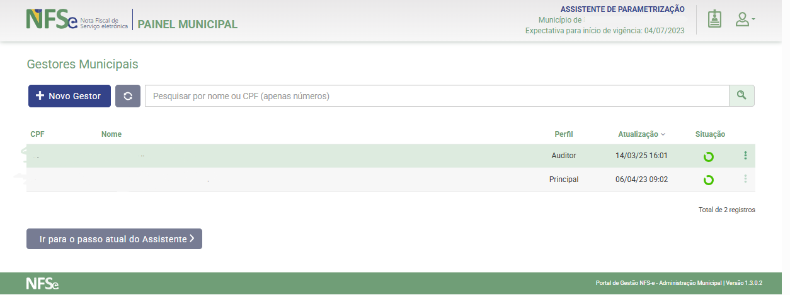
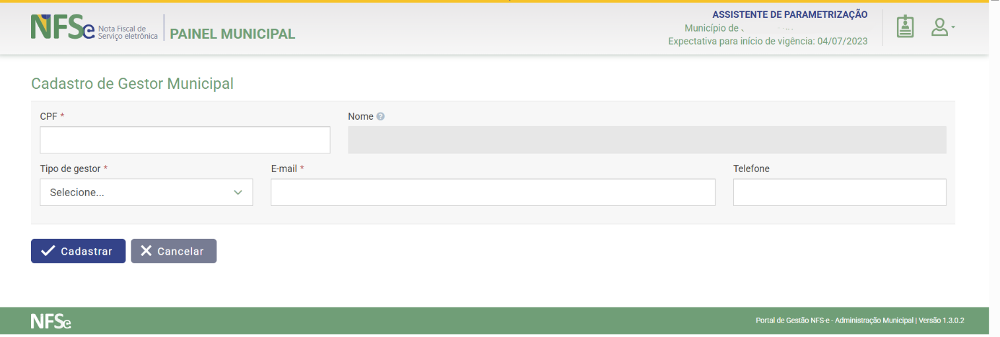
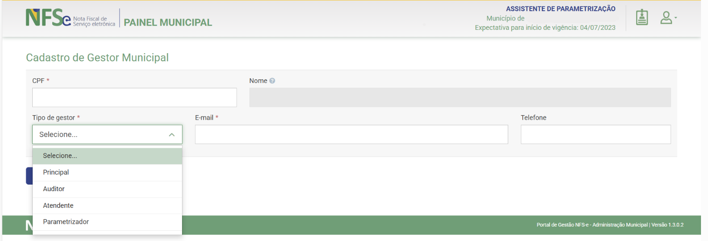

# 2.2 Inclusão de Gestores Municipais

Nesta tela é possível a inserção de um novo gestor, clicando em **Novo Gestor**.

*Figura 6: Página de administração dos Gestores Municipais.*

Com a inserção de um CPF, a ação de pesquisa busca pelo CPF informado no cadastro de pessoas físicas da RFB, recuperando o nome da pessoa. As demais informações devem ser preenchidas pelo cadastrador.

<!-- p.20 -->

*Figura 7: Informações solicitadas para o cadastramento de um novo Gestor Municipal*

Cada gestor será cadastrado com um perfil específico (Principal, Auditor, Atendente ou Parametrizador). Podem ser cadastrados vários gestores para cada um dos perfis, exceto o perfil Principal.

*Figura 8: Opções disponíveis para o tipo de gestor a ser cadastrado.*

**Níveis de Acesso às Funcionalidades para Gestores Municipais**

**Gestor Principal Municipal** – O perfil deste gestor tem acesso e permissão para executar todas as funcionalidades disponíveis no painel municipal, inclusive a funcionalidade de cadastramento dos demais perfis de gestores municipais além da sua própria substituição por outro Gestor Principal do Município.

**Gestor Auditor Municipal** – O perfil deste gestor tem acesso e permissão para executar todas as funcionalidades disponíveis no Painel Administrativo Municipal.

**Gestor Parametrizador Municipal** – O perfil deste gestor tem acesso e permissão para parametrizar as funcionalidades disponíveis no painel municipal.

**Gestor Atendente Municipal** – O perfil deste gestor tem acesso e permissão para executar apenas as funcionalidades de gerenciamento do cadastro de contribuintes do município, disponíveis no painel municipal.

<!-- p.21 -->
Um mesmo gestor municipal pode ser vinculado a mais de um município, desde que seu cadastro esteja ativo em apenas um município por vez em um mesmo período.

Ao final clicar em **Cadastrar** para prosseguir.
