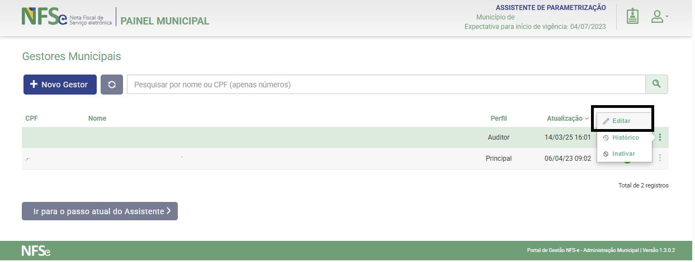
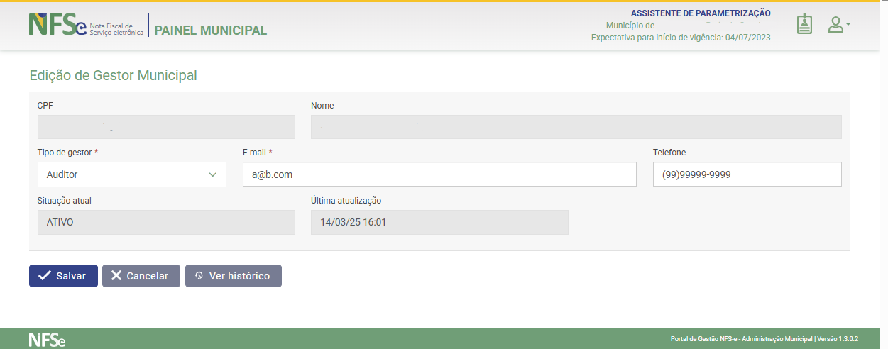
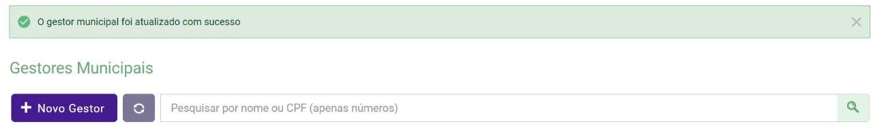
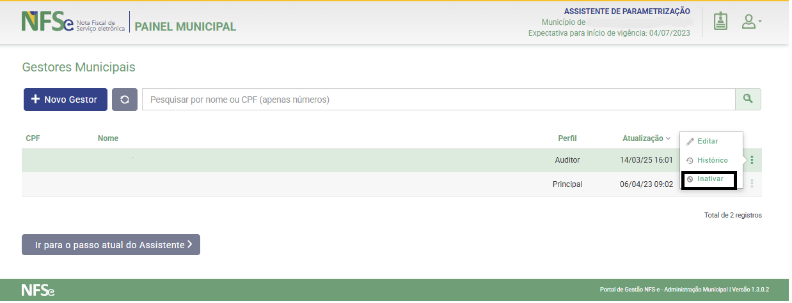
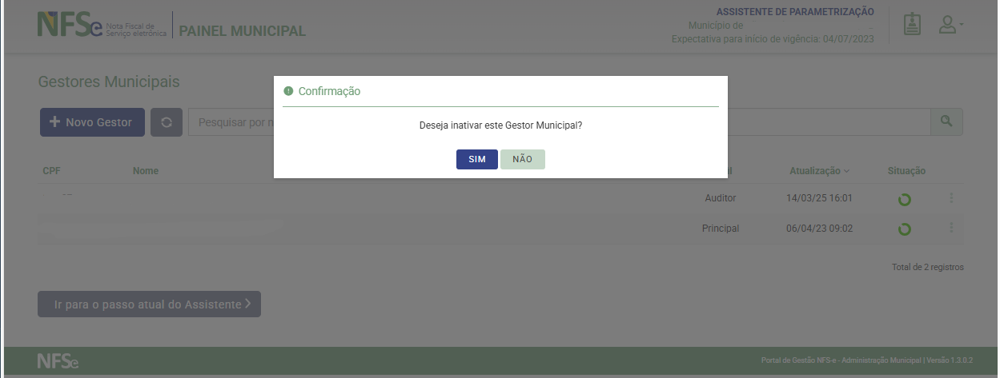

# 2.3 Alteração das Informações do Gestor Municipal

Os gestores municipais cadastrados poderão ter seus perfis alterados quanto às seguintes informações: tipo de gestor, e-mail e telefone. Para acessar esta funcionalidade, o gestor municipal deverá acessar a lista de gestores municipais cadastrados, identificar o perfil que deseja alterar e selecionar o ícone no canto direito da linha correspondente. Em seguida, a opção "Editar" deverá ser selecionada. As informações alteradas são registradas em uma tabela de Histórico.

*Figura 9: Lista de gestores cadastrados para o município e menu para administração de cada gestor.*

A seguinte página será exibida:

*Figura 10: Tela de edição das informações do gestor municipal.*

<!-- p.22 -->
As alterações deverão ser realizadas e depois salvas, clicando-se no botão **Salvar**.

Uma mensagem de confirmação das alterações é gerada na parte superior da página.

*Figura 11: Mensagem de confirmação das alterações realizadas.*

**Desativação/Reativação Gestor Municipal**

O Sistema da NFS-e Nacional não permite o descadastramento de um gestor, mas tão somente a inativação do perfil desejado.

Para ativar ou inativar um perfil, deve-se acessar a lista de gestores cadastrados e acessar o ícone de opções (⋮) e marcar a opção desejada (inativar ou reativar). Em seguida é exibida uma tela de confirmação da ativação/inativação solicitada: para confirmar a operação, o botão "Sim" deverá ser selecionado.

*Figura 12: Página de administração dos Gestores Municipais com a opção "Inativar".*

<!-- p.23 -->

*Figura 13: Tela para confirmação da inativação de um gestor municipal.*
