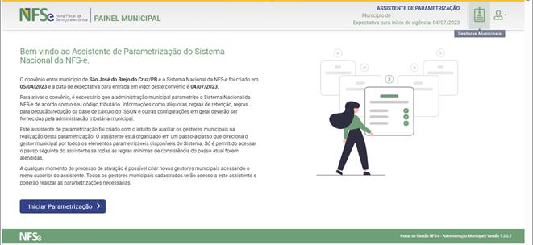

<!-- p.17 -->
# 2. Parametrização por Gestores Municipais

Após o cadastro do município no Sistema Nacional NFS-e, para o primeiro momento do município no Painel Administrativo Municipal, somente o Gestor Municipal Principal (Responsável pelo CNPJ do Município) terá acesso a ele. O Gestor Municipal Principal (Responsável pelo CNPJ do Município) acessará o Painel Administrativo Municipal NFSe e dará início à ativação ao Sistema Nacional da NFS-e através da assinatura eletrônica.

Este gestor poderá realizar ele mesmo a tarefa de parametrização e ativação do município ou cadastrar um ou mais Gestores Auditores Municipais para realizarem as parametrizações e ativação do município no Sistema Nacional NFS-e.

Ele poderá incluir outros atores da gestão municipal, conforme descrito no item Cadastro de Gestores Municipais deste manual, sendo eles:

1) o Gestor Municipal Parametrizador, tem permissão para realizar todo e qualquer parâmetro disponível para administração pelo município no Painel Administrativo Municipal;
2) o Gestor Municipal Atendente, não tem permissão para realizar nenhum tipo de parametrização do município no painel municipal, apenas lhe é permitido realizar a administração via web do Cadastro Nacional de Contribuintes NFS-e, conforme regras municipais próprias e caso o município utilize o cadastro próprio de contribuintes no sistema nacional (CNC NFS-e – Web).

O responsável pela parametrização do município no sistema nacional deve realizar a parametrização do município no sistema nacional e acionar o comando de conclusão da parametrização.

---

A ativação somente é possível se o Gestor Municipal competente para esta tarefa informar todos os parâmetros exigidos pelo painel municipal. O próprio sistema realiza o controle do que é obrigatório parametrizar e o que é opcional.

---

**Definição dos Gestores Municipais**

A funcionalidade de cadastro de gestores municipais permite o gerenciamento das pessoas que pertencem à gestão municipal realizarem funcionalidades disponíveis no painel municipal do Sistema Nacional NFS-e. A funcionalidade de gerenciamento dos gestores municipais permite Consultar, Incluir, Alterar e Excluir as informações de cada um dos registros do cadastro mantendo seu histórico de atividades no sistema. Segue abaixo as telas do gerenciamento do cadastro.

Após a entrada no painel, a primeira etapa a ser realizada deve ser a inclusão dos gestores do município.

<!-- p.18 -->
Clicando no ícone Gestores Municipais é possível a inclusão de novos gestores e o perfil que cada um deles.

*Figura 3: Página inicial do Painel Municipal antes da parametrização.*
