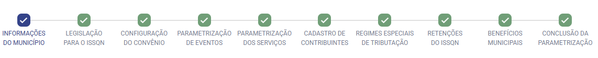
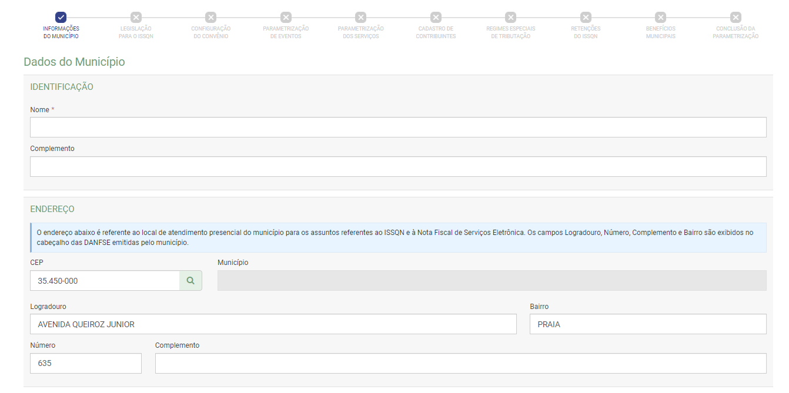
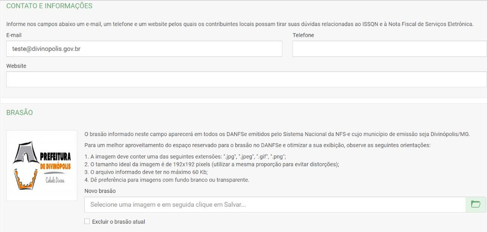
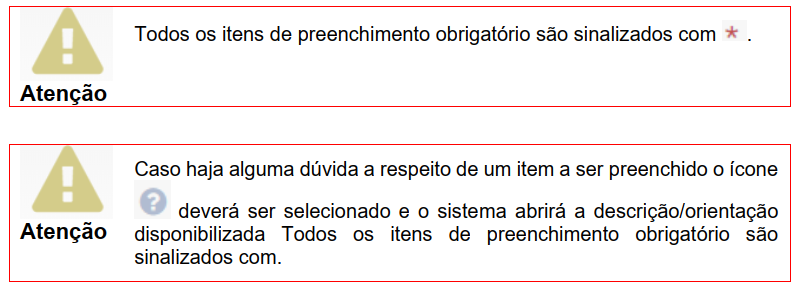

# 3.1 Informações do Município

O sistema será direcionado para a tela que contém as informações básicas relativas ao município como:

- **Identificação (Nome e Complemento)** – este campo é exibido no cabeçalho do DANFS-e, para identificação do Município. O tamanho máximo que pode assumir é de 56 caracteres e normalmente é preenchido com "Prefeitura Municipal de XXX";
- **Complemento** – neste campo, pode ser inserido para exibição no DANFS-e o nome do departamento responsável pela administração do ISSQN no município. O tamanho máximo que pode assumir é de 32 caracteres;

<!-- p.29 -->
- **Endereço** – caso seja interesse da ATM, o endereço para atendimentos relativos ao ISSQN e à NFS-e no município poderá ser informado e exibido no DANFS-e. Neste caso, a ATM deverá preencher os campos relativos são endereço: CEP, logradouro, número, complemento e bairro;
- **Contato e Informações** – poderão ser inseridos os dados relativos ao e-mail institucional, ao telefone e ao website que são disponibilizados aos contribuintes para entrarem em contato com a ATM para tirar dúvidas quanto ao ISSQN e à NFS-e; e
- **Brasão** – caso deseje, a ATM poderá inserir o brasão da prefeitura para exibição no DANFS-e. Para isso deverá selecionar a imagem do brasão através tela exibida quando da seleção do ícone de pasta.

- Preencher todas as informações requisitadas e, ao final, **Salvar e Avançar**.

*Figura 16 – Informações sobre o município, que serão exibidas na NFS-e.*

<!-- p.30 -->

*Figura 17 – Informações de contato e inserção do brasão da prefeitura no sistema.*

Caso a ATM deseje apenas excluir o brasão atual, deverá selecionar a caixa "Excluir o brasão atual".

Estas informações municipais serão utilizadas para compor a DANFSe (Documento Auxiliar de Nota Fiscal de Serviço Eletrônica), junto com as informações das NFS-e em que o município for emissor.

Uma vez realizadas todas as alterações, o botão "Salvar e continuar" disponibilizado ao final da página deverá ser selecionado. Será então exibida uma mensagem de confirmação das alterações e a página é atualizada.

