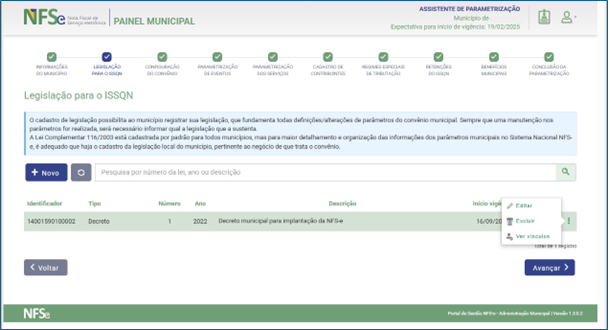

<!-- p.32 -->
# 3.2.1 Consultar Legislação

Na tela inicial da "Legislação para o ISSQN" há a lista paginada com a relação de todas as legislações já cadastradas anteriormente. Há ainda a opção para incluir uma nova legislação.

É possível realizar consultas sobre a legislação já cadastrada, informando, na barra de busca, o número da lei, o ano ou a descrição e clicando na lupa (ícone de pesquisa).

*Figura 19 – Tela de informações a respeito da Legislação do ISSQN com menu "Editar", "Excluir" e "Ver Vínculos".*
