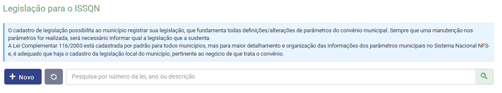
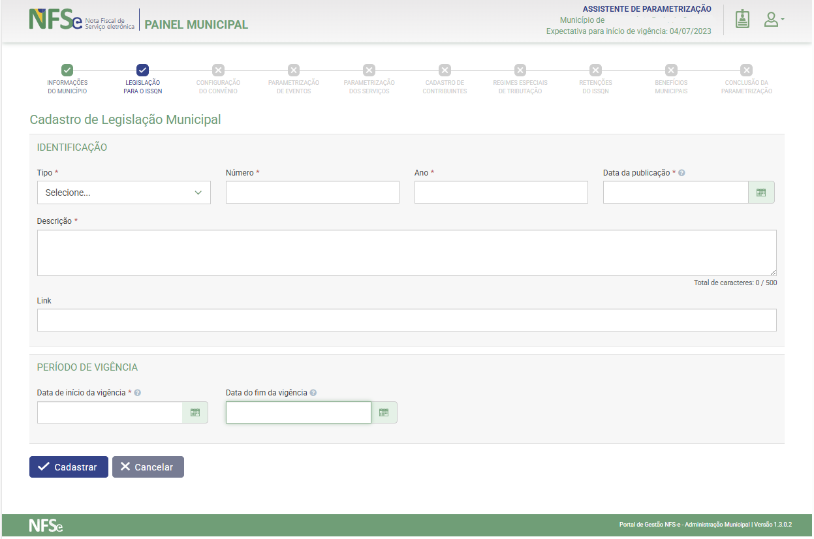
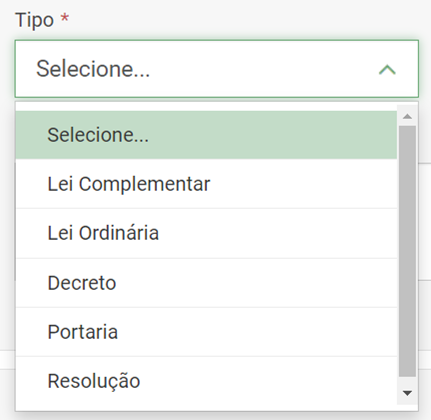
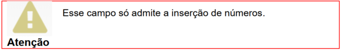
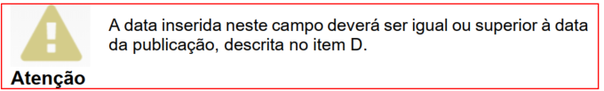
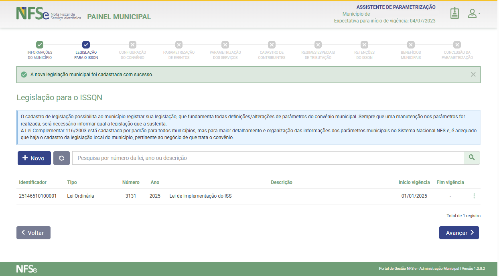

# 3.2.2 Incluir Legislação

Para iniciar a inclusão da legislação municipal ou uma nova legislação a qualquer momento, deve-se clicar em **Novo**. A Lei Complementar 116/2003 está cadastrada por padrão para todos os municípios, mas para maior detalhamento e organização das informações dos parâmetros municipais no Sistema Nacional NFS-e, é adequado que haja o cadastro da legislação local do município, pertinente ao negócio de que trata o convênio.

*Figura 20 – Tela de informações a respeito da Legislação do ISSQN.*

<!-- p.33 -->
Abrirá a página para o Cadastro de Legislação Municipal.

*Figura 21 – Página de cadastro de um novo ato normativo.*

**A) Tipo:** Ao selecionar esse campo, é disponibilizada uma lista de possíveis tipos de atos normativos a serem cadastrados. A ATM deverá selecionar o que deseja inserir no sistema.

*Figura 22 – Tipos de atos normativos disponíveis para seleção.*

**B) Número:** Uma vez selecionado o tipo do ato normativo, deverá ser inserido o seu número identificador. Por exemplo: ao cadastrar a Lei 9.430, o tipo selecionado deverá ser "Lei Ordinária" e o número, "9430".

<!-- p.34 -->

Além do número, o ano do ato deverá também ser editado para a sua correta identificação.

**D) Data da Publicação:** Nesse campo deverá ser inserida a data da publicação do ato nos meios de publicação oficiais do município.

**E) Descrição:** Nesse campo deverá ser inserida uma breve descrição sobre o assunto a que se destina o ato normativo. São essas informações que ficarão visíveis e permitirão a correta identificação do ato pela ATM e pelos contribuintes.

**F) Link:** Nesse campo poderá (campo não obrigatório) ser inserido o link para ter acesso à página na internet para acesso ao ato normativo que está sendo cadastrado.

**G) Data de início da vigência:** Nesse campo deverá ser inserida a data da efetiva entrada em vigor do ato normativo.

Para finalizar o cadastro, o botão **Cadastrar** deverá ser selecionado no final da página. Será então exibida uma mensagem de confirmação do cadastramento do ato e este já poderá ser visualizado na página de Legislação.

O painel retornará a página da Legislação para o ISSQN, clicar em **Avançar** para ir para a Configuração do Convênio, ou clicar em qualquer uma das opções da lista de parâmetros.

O sistema, por padrão, adotará um número identificador para cada legislação cadastrada, o qual será utilizado nas demais funcionalidades do sistema.

<!-- p.35 -->

*Figura 23 – Mensagem de confirmação do cadastramento do ato normativo e visualização da lista da Legislação cadastrada.*
