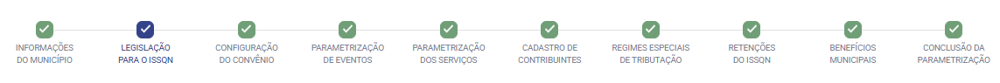
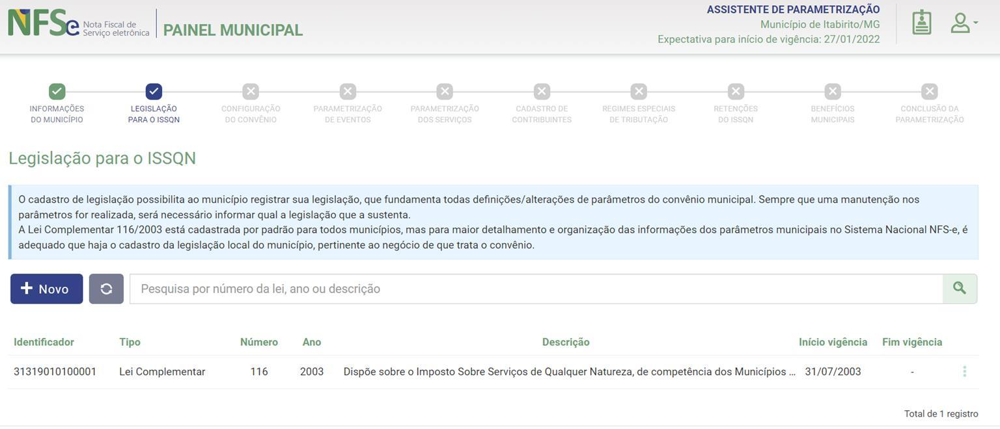

<!-- p.31 -->
# 3.2 Legislação para o ISSQN

O cadastro de legislação possibilita ao município registrar sua legislação, que fundamenta todas as definições/alterações de parâmetros do convênio municipal. Sempre que uma manutenção nos parâmetros for realizada, será necessário informar qual a legislação que a sustenta.

*Figura 18 – Tela de informações a respeito da Legislação do ISSQN.*

Esta funcionalidade permite que o parametrizador registre e catalogue a legislação tributária referente ao ISSQN. Por padrão o assistente de parametrização do painel municipal já vem com a LC 116/03 cadastrada para todo município conveniado.

O gestor municipal pode adicionar cada uma das suas normas tributárias locais referentes ao ISSQN em que estão descritos os itens de parâmetros que serão registrados na parametrização do painel municipal.

O sistema não realiza nenhuma consistência das informações acerca da legislação que for incluída no painel municipal bem como a correta utilização nos parâmetros que forem realizados pelo gestor municipal. A integridade e exatidão dos dados inseridos das legislações e o uso delas no registro dos parâmetros é responsabilidade do município.

Cada norma incluída no cadastro tem um identificador único. O identificador tem a seguinte regra de formação: 7 dígitos para o código do município, 2 dígitos para o tipo de parâmetro e 5 dígitos sequenciais únicos por município/parâmetro;

---

Sempre que uma manutenção nos parâmetros for realizada, será necessário informar qual a legislação que a sustenta.
