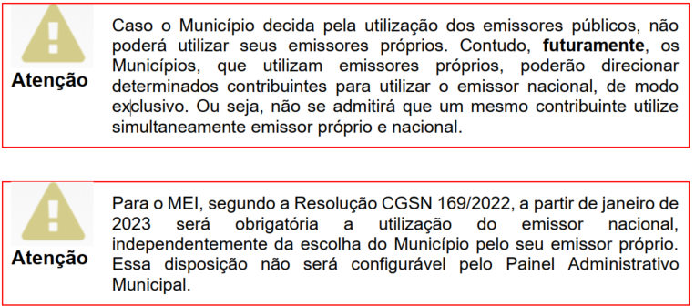

# 3.3.2 Emissores Públicos Nacionais (web, mobile, API)

Nesse campo o representante municipal deverá informar se o Município irá utilizar os emissores públicos disponibilizados pelo Sistema Nacional da NFS-e: versão web, aplicativo de dispositivos móveis e Application Programming Interface (API).

Ler com atenção cada uma das informações requisitadas e marcar todos os campos obrigatórios. O sistema verifica se as informações obrigatórias para a configuração do convênio foram preenchidas;

Feitas as devidas opções, basta selecionar o botão **Salvar e Avançar** no canto inferior direito da página.
