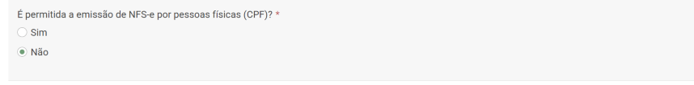
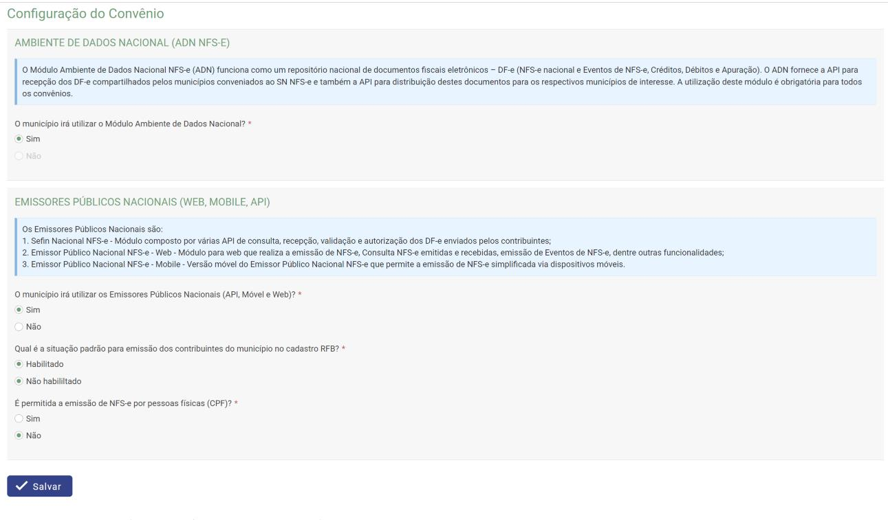

<!-- p.36 -->
# 3.3 Configuração do Convênio

As configurações do convênio municipal são relativas à aderência aos Módulos do Sistema Nacional da NFS-e, ou seja, o município irá informar sobre o uso do Sistema Nacional, informando como:

- O município irá utilizar o Módulo Ambiente de Dados Nacional?
- O município irá utilizar os Emissores Públicos Nacionais (API, Móvel e Web)?
- Qual origem das informações dos contribuintes o município irá utilizar - base de contribuintes (CNC ou Cadastros CPF/CNPJ da RFB)?
- O município irá utilizar o Módulo de Apuração Nacional?
- O município permite aproveitamento de Créditos disponíveis no Painel de Créditos?

Caso opte por não utilizar todos os módulos do sistema nacional ofertados, o município pode escolher alguns deles para uso, conforme possibilidades definidas no painel administrativo.

Se a opção for pelos cadastros RFB, somente os contribuintes cujos endereços estejam registrados no próprio município, nos cadastros CPF ou CNPJ, poderão emitir NFS-e pelo município.

Na primeira versão, os municípios podiam adotar o Sistema Nacional da NFS-e de duas formas:

3. Sistema próprio do município: emite a NFS-e localmente, converte para o layout nacional e compartilha com o Ambiente de Dados Nacional (ADN).
4. Emissor Nacional: emite diretamente no sistema nacional, com os dados sendo recebidos pelo ADN.

Até então, não era permitido o uso simultâneo dos dois sistemas para uma mesma competência por um município, o que impedia uma migração gradual. Essa limitação técnica havia sido definida para evitar conflitos na emissão de documentos fiscais.

Como consequência:

- Municípios não podiam migrar aos poucos para o Emissor Nacional.
- Isso poderia gerar dificuldades operacionais, dúvidas e sobrecarga de suporte.
- Também não era possível manter o compartilhamento de NFS-e anteriores à migração.

Diante disso, surgiu a necessidade de permitir uma adoção faseada, por grupos de contribuintes, mantendo o compartilhamento das NFS-e anteriores e reduzindo os impactos da mudança.

Uma nova funcionalidade foi criada para permitir que os municípios controlem quais contribuintes devem emitir a NFS-e em cada sistema (próprio ou nacional), em momentos distintos. Isso possibilita uma migração gradual e planejada, por fases, reduzindo impactos para os contribuintes e para a administração municipal.

<!-- p.37 -->
Como cada município pode adotar estratégias diferentes, serão apresentadas propostas específicas para cada cenário.

Poderão ser realizadas alterações na Configuração do Convênio e no cadastro de contribuinte local (ver item 3.7. Cadastro de Contribuintes).

No Painel Municipal da NFS-e, foram adicionados dois novos parâmetros ao grupo "EMISSORES PÚBLICOS NACIONAIS (WEB, MOBILE, API)", permitindo configurar e gerenciar essa transição de forma mais flexível:

*Figura 24 – Versão 1.1 - Página de configuração das informações a respeito do convênio municipal com a NFS-e.*

<!-- p.38 -->
Mais informações sobre cada campo podem ser encontradas colocando o cursor do mouse for colocado no ponto de interrogação (?).
