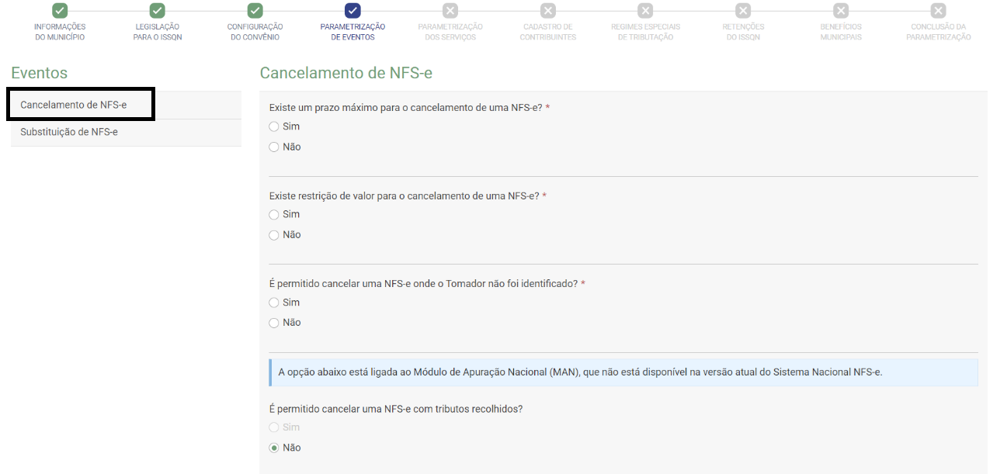
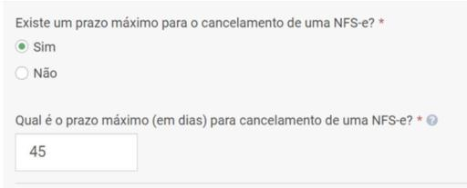
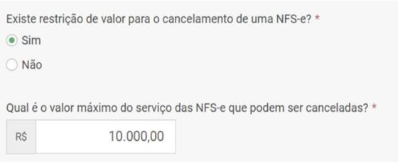
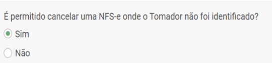
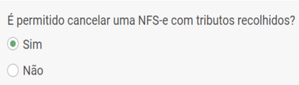

# 3.4.1 Cancelamento de NFS-e

A ATM deverá parametrizar no sistema todas as situações em que aceitará um pedido de cancelamento da NFS-e Nacional. Caso o pedido esteja de acordo com essa parametrização, a nota poderá ser cancelada de forma automatizada, via sistema.

Para as situações em que os parâmetros não sejam atendidos (exemplo: o prazo para solicitar foi ultrapassado), a nota não será cancelada automaticamente, sendo que o emitente deverá submeter um pedido de evento de análise fiscal para seu cancelamento. Por sua vez, se a ATM avaliar que é correto o pedido, poderá deferir o cancelamento a nota.”

*Figura 26 – Opções de parametrização sobre o cancelamento da NFS-e Nacional.*

As parametrizações variam conforme opção do município, devem ser definidas conforme abaixo:

1) Existe um prazo máximo para o cancelamento de uma NFS-e?

Se a ATM determinar um prazo máximo a partir da emissão da NFS-e em que ela possa ser cancelada, deverá selecionar a opção "Sim" e em seguida inserir o prazo, em dias.

<!-- p.41 -->

*Figura 27 – Inserção do prazo máximo admitido para o cancelamento da NFS-e Nacional.*

O prazo máximo admitido pelo sistema para o cancelamento da NFS-e é de 2 (dois) anos, ou seja, 730 dias. Se a ATM não estipular um prazo máximo para o cancelamento da NFS-e Nacional, deverá selecionar a opção "Não". Se a ATM não estipular um prazo máximo para o cancelamento do documento fiscal, este passará a ser o limite máximo admitido pelo sistema, qual seja, 2 (dois) anos, ou 730 dias.

2) Existe restrição de valor para o cancelamento de uma NFS-e?

Neste campo a ATM deverá indicar se aceita o cancelamento da NFS-e até determinado valor, ou seja, poderá inserir um valor máximo para o documento fiscal em que será aceito de modo automatizado o pedido de seu cancelamento.

*Figura 28 – Determinação do valor máximo da NFS-e em que se aceita o cancelamento.*

Se a ATM não estabelecer um valor máximo para o cancelamento da NFS-e, qualquer valor será aceito pelo sistema, desde que as outras condições parametrizadas sejam respeitadas.

3) É permitido cancelar uma NFS-e onde o Tomador não foi identificado?

Em determinadas condições, uma nota pode ser emitida sem a identificação do tomador dos serviços. No campo em análise, a ATM deverá indicar se aceitará o cancelamento das notas sem a identificação do Tomador do Serviço (deverá selecionar "Sim" caso aceite este tipo de cancelamento e "Não", em caso contrário).

<!-- p.42 -->

*Figura 30 – Opção de cancelamento da NFS-e sem identificação do Tomador.*

4) É permitido cancelar uma NFS-e com tributos recolhidos?

A ATM deverá indicar também se aceita o cancelamento de uma NFS-e em que os tributos declarados tenham sido pagos e recolhidos ao Fisco, podendo gerar restituições e compensações por parte da ATM.

Se a ATM aceitar o cancelamento supra descrito, a opção "Sim" deverá ser selecionada. Caso contrário, seleciona-se a opção "Não".

*Figura 31 – Opção de cancelamento da NFS-e com tributos recolhidos.*

Existem regras comuns e obrigatórias para todos os municípios relativas ao evento cancelamento de NFS-e.

1. Não é possível cancelar uma NFS-e que esteja marcada com bloqueio de cancelamento;
2. Não há restrição para cancelamento de ofício de NFS-e;

Ao completar a etapa, clicar em **Salvar e parametrizar próximo evento**.
