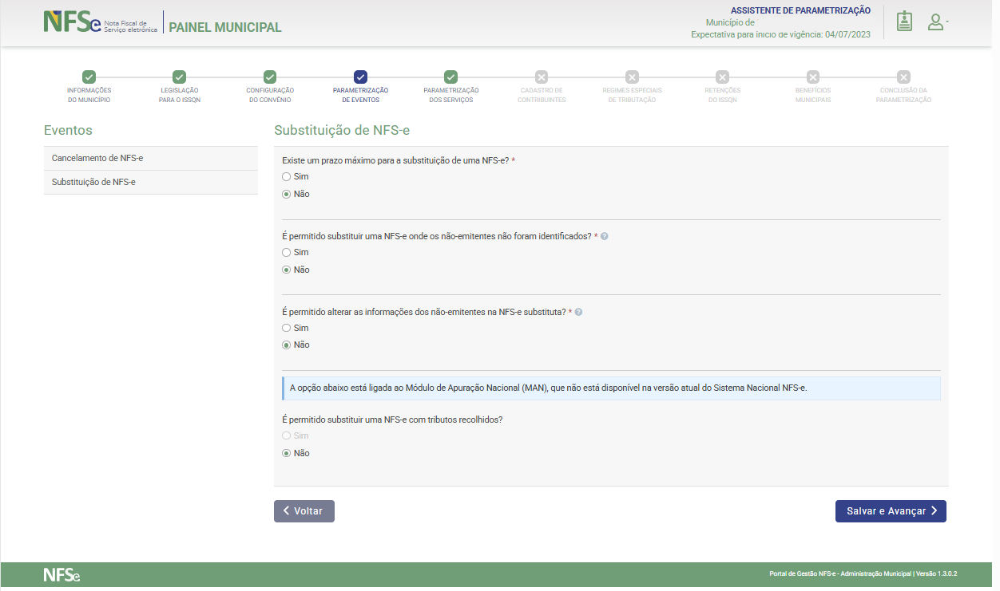
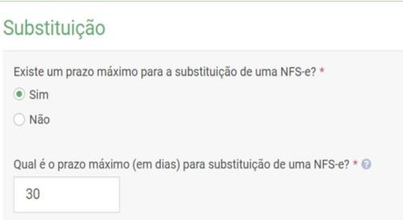
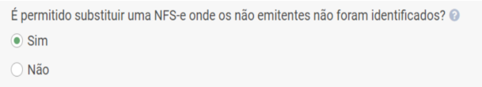
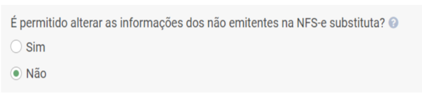
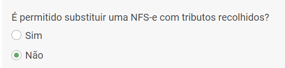
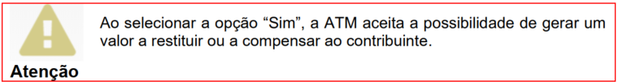

# 3.4.2 Substituição de NFS-e

Assim como nas configurações sobre cancelamento, a ATM deverá indicar as situações que aceitará a substituição da NFS-e Nacional.

A substituição de nota ocorre com a ação de substituição de NFS-e pelo envio de nova DPS indicando uma chave de acesso de NFS-e já existente no sistema. Ao receber uma DPS contendo uma chave de acesso a ser substituída, o sistema cancela a NFS-e existente e gera uma nota substituta, vinculando os documentos envolvidos (notas substituída e substituta).

Quando um contribuinte realiza a substituição de uma NFS-e, ocorrem duas ações por parte do Sistema da NFS-e Nacional: a NFS-e antiga é cancelada e substituída pela nova enviada ao sistema. Além das configurações parametrizadas por cada Município, o sistema possui regras gerais, comuns a todos os conveniados:

<!-- p.43 -->
1. É permitida a substituição nos casos de enquadramento/desenquadramento do Simples Nacional, sem limite de prazo;
2. Não é permitida a substituição das NFS-e que estejam canceladas (por qualquer motivo);
3. Não é permitida a substituição das NFS-e que estejam bloqueadas pela administração municipal.

A modelagem de substituição de NFS-e no sistema nacional ocorre em dois processos, a primeira é a substituição da NFS-e existente por uma substituta e a segunda o cancelamento da NFS-e substituída.

Um processo não existe sem o outro e as regras para substituição de NFS-e são a causa da realização ou não de um evento de cancelamento de NFS-e por substituição.

Dessa forma, as regras do município existentes para a substituição de NFS-e devem ser definidas para a substituição de NFS-e, que somente é concluída com o cancelamento por substituição de NFS-e, tratado como um evento no sistema nacional. Assim, amplia-se o conceito de substituição de NFS-e como um evento dentro do sistema nacional e o município deve definir suas regras na parametrização de eventos do painel municipal, conforme abaixo.

Uma vez acessada a página de configuração das regras sobre substituição as seguintes opções são mostradas na tela:

*Figura 32 – Informações exigidas a respeito da substituição da NFS-e.*

1) Existe um prazo máximo para a substituição de uma NFS-e?

Se a ATM determinar um prazo máximo a partir da emissão da NFS-e em que ela possa ser substituída, deverá selecionar a opção "Sim" e em seguida inserir o prazo, em dias.

<!-- p.44 -->

*Figura 33 – Parametrização do prazo admitido para a substituição de uma NFS-e.*

2) É permitido substituir uma NFS-e onde os não-emitentes não foram identificados?

Neste item a ATM deverá indicar se permitirá a substituição de documentos fiscais em que os não emitentes não são identificados.

Por exemplo, a ATM permitirá a substituição de uma NFS-e emitida pelo prestador em que o Tomador/intermediário não foram identificados? Se a resposta for positiva, a opção "Sim" deverá ser selecionada, caso contrário, "Não".

*Figura 34 – Opções sobre a substituição de NFS-e em que os não emitentes não foram identificados.*

3) É permitido alterar as informações dos não-emitentes na NFS-e substituta?

A ATM deverá indicar se permite que as informações relativas aos não emitentes da NFS-e sejam alteradas. Em caso positivo, a opção "Sim" deverá ser selecionada e viabilizará que determinadas informações sejam alteradas.

Caso não deseje permitir tais alterações, a ATM deverá selecionar a opção "Não".

*Figura 35 – Opções de alteração das informações dos não emitentes da NFS-e.*

<!-- p.45 -->
4) É permitido substituir uma NFS-e com tributos recolhidos?

Neste item a ATM deverá indicar se permite a substituição de NFS-e cujos tributos já tenham sido pagos e recolhidos. Caso tal evento seja permitido, deverá selecionar a opção "Sim" e caso contrário, "Não".

*Figura 36 – Opções de substituição de uma NFS-e com tributos recolhidos.*

Uma vez marcadas todas as opções, o botão **Salvar e Avançar** deverá ser acionado no final da página.
