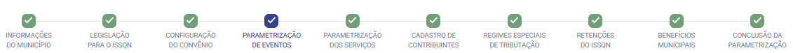
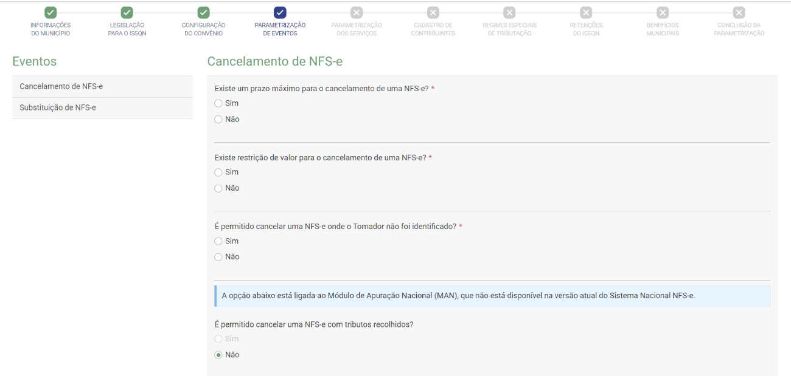

<!-- p.39 -->
# 3.4 Parametrização de Eventos

Esta página é dedicada à parametrização de Eventos de Cancelamento de NFS-e e Substituição de NFS-e.

*Figura 25 – Configuração de eventos da NFS-e de Nacional.*

A definição da parametrização de Eventos de NFS-e no painel municipal insere as regras da legislação municipal no que se refere ao "ciclo de vida" da NFS-e. Uma NFS-e pode ser cancelada ou substituída de acordo com a legislação municipal.

Todos os municípios conveniados deverão parametrizar os Eventos de Cancelamento de NFS-e no Sistema Nacional NFS-e.

Uma NFS-e que seja cancelada ou substituída no sistema próprio do município, para ser refletido este cancelamento no sistema nacional, deverá ter o cancelamento ou substituição transcritos para o leiaute de eventos padrão nacional e depois compartilhado com o ambiente de dados nacional. Este evento compartilhado pelo município reflete um aspecto do ciclo de vida da nota fiscal de serviço que ocorreu no município e foi, de alguma forma, aceito por ele. Cabe ao sistema nacional aceitar este documento realizando validações estruturais e de negócio conforme as parametrizações do município para o documento compartilhado. Uma vez validado o sistema irá consistir e refletir o cancelamento da NFS-e no sistema nacional para que a informação esteja de acordo com a realidade da legislação municipal parametrizada no sistema nacional. Caso a parametrização não esteja de acordo com os fatos ocorridos acerca do cancelamento da NFS-e ou o sistema próprio do município está permitindo o cancelamento em desacordo com sua própria legislação ou o município parametrizou equivocamente em relação à sua legislação. Será preciso analisar e <!-- p.40 -->realizar os ajustes necessários para que o documento seja novamente compartilhado e validado para ser consistido no ADN NFS-e, ou seja, o Evento de Cancelamento de NFS-e que for compartilhado por um município será rejeito pelo sistema nacional se estiver em desacordo com a parametrização vigente deste evento no momento do compartilhamento.
