<!-- p.51 -->

# 3.5.2 Parametrização na página da web

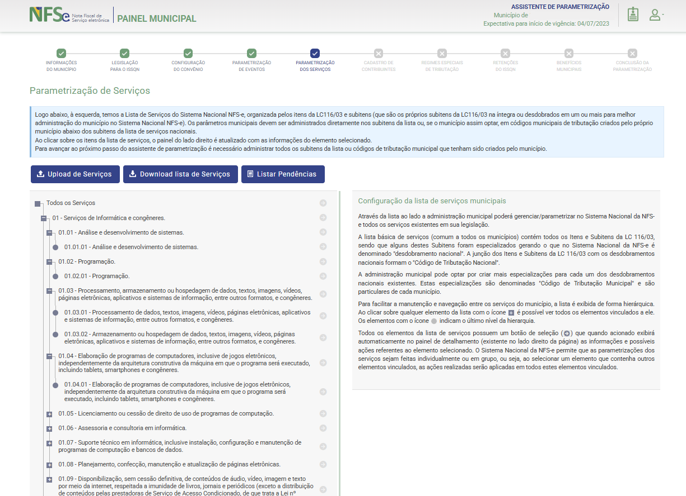

*Figura 38 – Tela de Parametrização dos Serviços.*

O Sistema Nacional da NFS-e permite que as parametrizações dos serviços sejam realizadas na página da web, conforme será explicado a seguir.

Através da lista de serviços a ATM poderá gerenciar/parametrizar no Sistema da NFSNacional todos os serviços existentes em sua legislação.

A lista básica de serviços, comum a todos os municípios conveniados, contém todos os Itens e Subitens da Lei Complementar 116 de 31 de julho de 2003 mais alguns outros desdobramentos derivados da especialização desses subitens, compondo assim o "Código de Tributação Nacional".

Se o código de serviço utilizado atualmente pelo Município for compatível com os códigos de tributação do Sistema Nacional, basta configurar as alíquotas de acordo com o item “19.3.2. Definição da alíquota” e a possibilidade de eventuais deduções ou reduções de base de cálculo conforme item “19.3.3. Dedução/Redução”, ambos desse manual.

<!-- p.52 -->

Entretanto, se o Município utiliza maiores desdobramentos para identificar determinados serviços de um mesmo subitem da lista, poderá então complementar a parametrização de serviços com a configuração do Código de Tributação Municipal conforme item a seguir.

## 3.5.2.1 Configuração do Código Original do Município

A administração municipal pode optar por criar mais especializações para cada um dos desdobramentos nacionais existentes. Estas especializações formam o "Código de Tributação Municipal" e são específicas de cada Município.

Para facilitar o gerenciamento e navegação entre os serviços do município, a lista de serviços é exibida de forma hierárquica. Ao clicar sobre qualquer elemento da lista com o ícone de expansão é possível ver todos os elementos vinculados a ele. Os elementos com o ícone de último nível indicam o último nível da hierarquia. É neste ponto que é permitido a criação de um “Código de Tributação Municipal”.

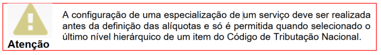

Ao clicar no elemento com o ícone de último nível será apresentada tela com opção para definir a alíquota e a opção para criar Código de Tributação Municipal.

Todos os elementos da lista de serviços possuem um botão de seleção que quando acionado exibirá automaticamente no painel de detalhamento (existente no lado direito da página) as informações e possíveis ações referentes ao elemento selecionado.

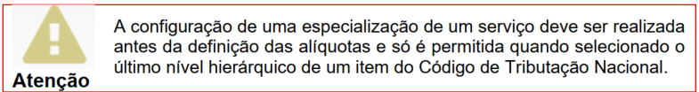

Nesta etapa é possível criar ou editar os Códigos Originais no Município (botão **Editar Código Original no Município**) e alterar a alíquota (botão **Alterar alíquota**).

1. Para criar um item especializado, selecionar o botão “Criar Código de Tributação Municipal”.

<!-- p.53 -->

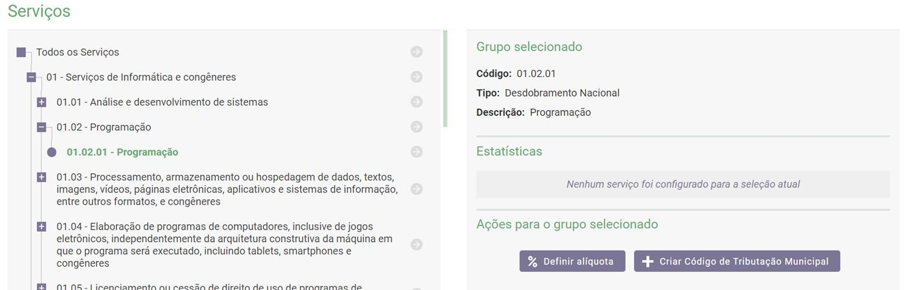

*Figura 39 – Seleção de um serviço da lista para especialização.*

O sistema então irá exibir a tela abaixo com três campos a serem preenchidos.

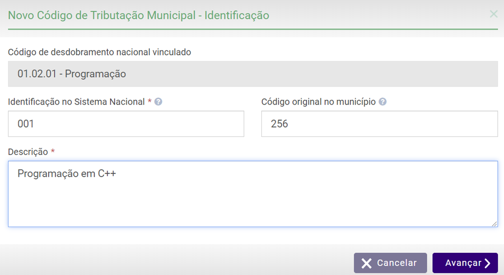

*Figura 40 – Configuração do código e do nome da especialização do serviço.*

O primeiro campo a ser preenchido diz respeito à Identificação do Serviço no Sistema Nacional. Nesse espaço deverá ser digitado um código de três dígitos que corresponderá ao Código Tributário Municipal. Só não pode ser utilizado aqui o código “000”.

Em seguida, passa-se à configuração do código original do serviço no município, nesse campo pede-se que a ATM insira no campo o código correspondente do serviço no município. Esse item poderá ser preenchido com letras e números e não tem uma quantidade de caracteres pré-determinada, apenas deverá ser preenchido.

No campo descrição deverá ser inserida a forma como o serviço definido nesse desdobramento deverá ser identificado na Lista Código de Serviços.

Uma vez realizada a configuração dos três campos explicados acima, deverá ser selecionado o botão “Salvar”. O novo desdobramento será mostrado na nova página do sistema carregada.

<!-- p.54 -->

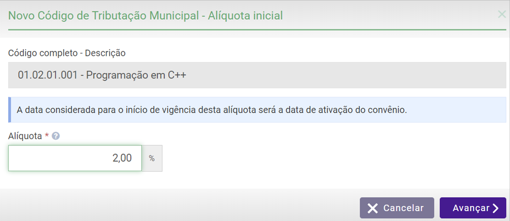

*Figura 41 – Tela de configuração da alíquota da especialização do serviço a ser criada.*

Uma nova tela é exibida, para a configuração da alíquota do código de serviço a ser criado. Nesse campo são respeitadas as mesmas regras para a definição das alíquotas, descritas no item 16 - Parametrização dos Serviços desse Manual.

As telas que são mostradas abaixo se referem às configurações de Dedução/Redução da Base de cálculo do ISSQN e dos Regimes Especiais de Tributação admitidos. Para a configuração desses campos, sugere-se a pesquisa dos itens 16 - Parametrização dos Serviços e 18 - Regimes Especiais de Tributação desse Manual.

<!-- p.55 -->

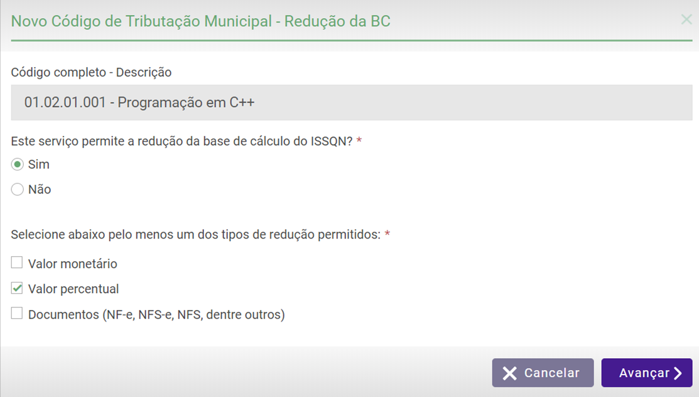

*Figura 42 – Tela de configuração de Dedução/Redução da base de cálculo para a especialização do serviço.*

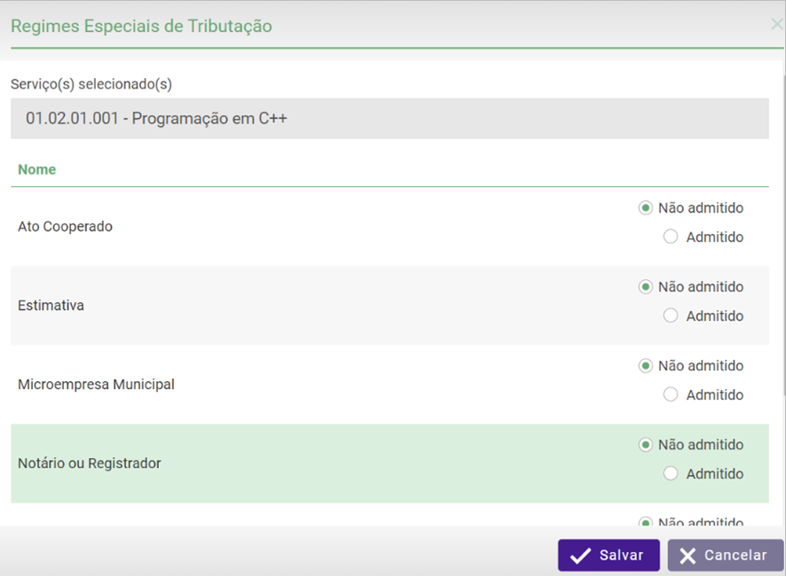

*Figura 43 – Tela de configuração dos Regimes Especiais de Tributação admitidos para a especialização do serviço criada.*

Uma vez preenchidos todos os campos solicitados, deve-se salvar as configurações realizadas. O sistema então irá mostrar a lista de serviços atualizada com o Código Tributário Municipal devidamente inserido e com as informações gerais referentes às alíquotas e opções de configuração.

<!-- p.56 -->

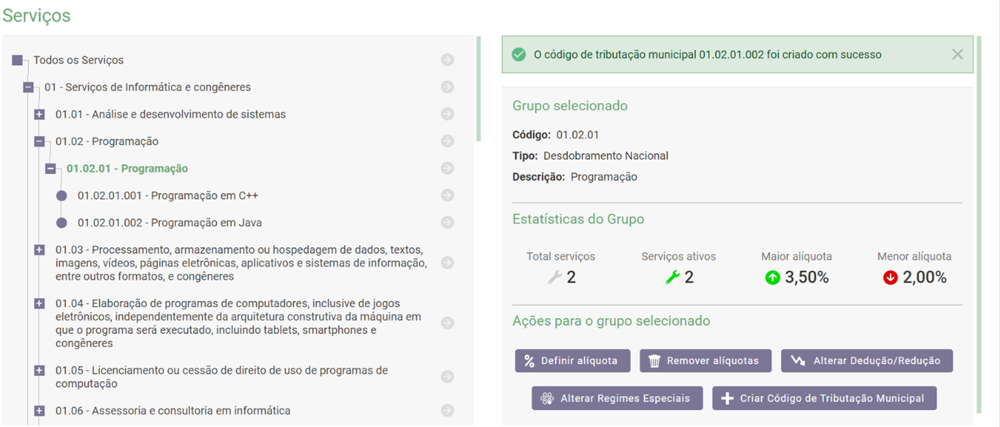

*Figura 44 – Lista de Serviços atualizada com o Código de Tributação Municipal.*

O Sistema Nacional da NFS-e permite que as parametrizações dos serviços sejam realizadas individualmente ou em grupo, ou seja, ao selecionar um elemento que contenha outros elementos subordinados a ele, as ações realizadas serão aplicadas em todos estes elementos vinculados.

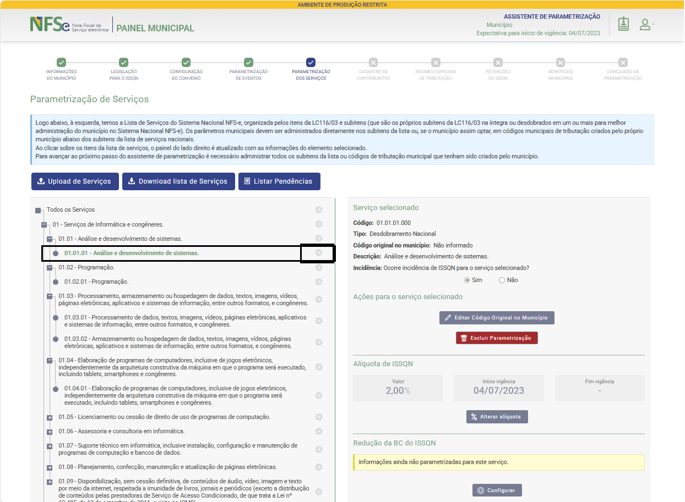

*Figura 45 – Seleção de todos os serviços para parametrização.*

<!-- p.57 -->

O código Original do Município pode ser editado usando o ícone “Editar Código Original do Município”.

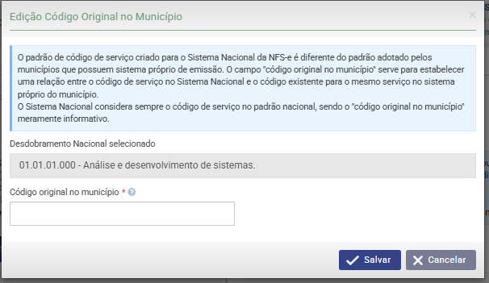

*Figura 46 – Tela para edição do código Original do Município.*

> **Atenção:** A edição ou exclusão de um desdobramento de serviço por meio de Código de Tributação Municipal, só será possível enquanto não for finalizada a parametrização dos serviços e ativado o convênio. Após ativação do convênio via painel, esse código não pode mais ser excluído, porém poderá ter sua vigência encerrada, ou seja, ele será mantido no histórico e poderá ser utilizado apenas nas emissões de NFS-e com competência dentro do período em que esteve vigente.

## 3.5.2.2 Definição de alíquotas para os serviços

O Sistema Nacional da NFS-e permite que as parametrizações dos serviços sejam realizadas individualmente ou em grupo, ou seja, ao selecionar um elemento que contenha outros elementos subordinados a ele, as ações realizadas serão aplicadas em todos estes elementos vinculados.

As alíquotas dos serviços existentes em um município conveniado ao sistema nacional devem ser definidas, assim como todas as demais parametrizações obrigatórias exigidas para a “Ativação” do município e o correto funcionamento do sistema. A alíquota pertence ao “desdobro” do subitem da lista de serviço nacional. O conceito de desdobro do subitem foi explicado anteriormente neste manual.

Através desta lista a administração municipal poderá gerenciar/parametrizar no Sistema Nacional da NFS-e todos os serviços existentes em sua legislação.

A lista básica de serviços (comum a todos os municípios) contém todos os Itens e Subitens da lista anexa à LC 116/03, sendo que alguns destes subitens foram especializados gerando o que no Sistema Nacional da NFS-e é denominado "desdobramento nacional" ou “desdobro” do subitem. A junção dos itens e subitens originais da LC 116/03 com os desdobramentos nacionais formam o "Código de Tributação Nacional" (como pode ser observado no leiaute DPS).

<!-- p.58 -->

A administração municipal pode optar por criar mais especializações para cada um dos desdobramentos nacionais existentes. Estas especializações são denominadas "Código de Tributação Municipal" e são particulares de cada município (também pode ser observado no leiaute DPS).

Para facilitar o gerenciamento e navegação entre os serviços do município, a lista é exibida de forma hierárquica. Ao clicar sobre qualquer elemento da lista com o ícone de expansão é possível ver todos os elementos vinculados a ele. Os elementos com o ícone de último nível indicam o último nível da hierarquia.

Todos os elementos da lista de serviços possuem um botão de seleção que quando acionado exibirá automaticamente no painel de detalhamento (existente no lado direito da página) as informações e possíveis ações referentes ao elemento selecionado. O Sistema Nacional NFS-e permite que as parametrizações dos serviços sejam feitas individualmente ou em grupo, ou seja, ao selecionar um elemento que contenha outros elementos vinculados, as ações realizadas serão aplicadas em todos estes elementos vinculados.

Para definir a alíquota para um determinado serviço, deve-se clicar na seta no final da linha descritiva de cada grupo/subgrupo:

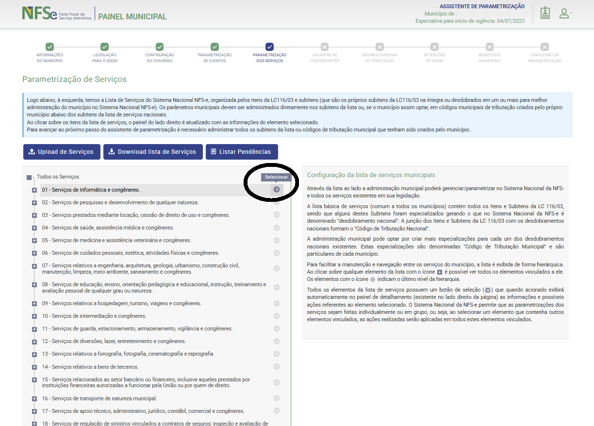

*Figura 47 – Seleção de todos os serviços para parametrização.*

Ao selecionar um grupo/subgrupo, uma janela com os detalhes do serviço selecionado será exibida no lado direito da tela para que sejam definidos: se ocorre incidência de ISSQN para os serviços do grupo selecionado, a definição da alíquota, se há Dedução/redução ou excluir Parametrizações.

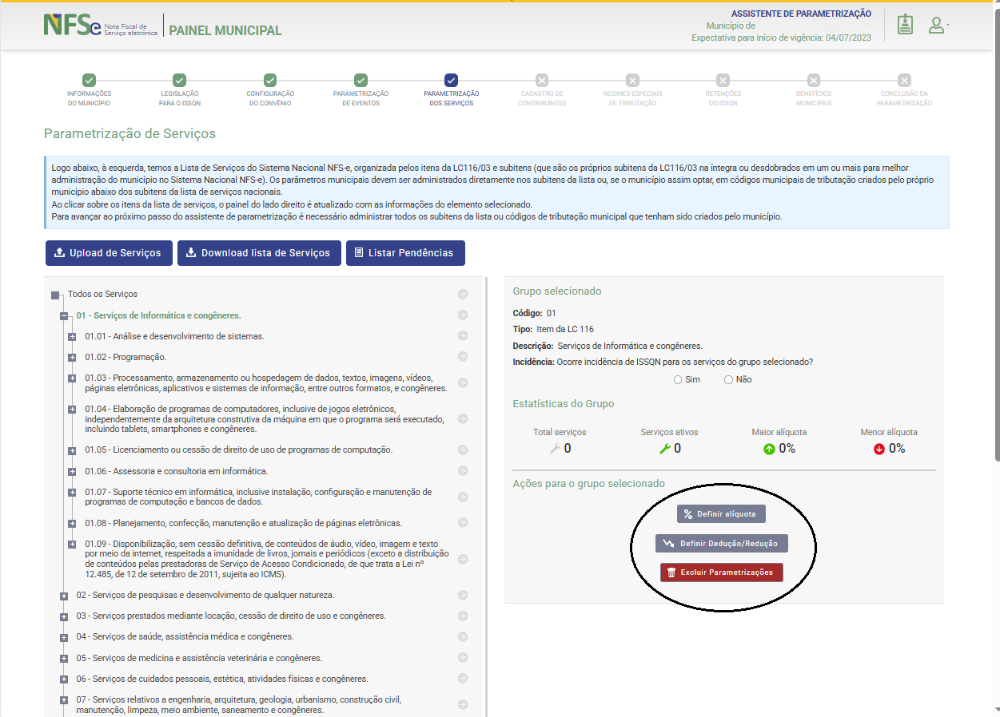

*Figura 48 – Alteração dos parâmetros de todos os serviços da lista selecionada.*

<!-- p.59 -->

> **Atenção:** Ao selecionar um item da lista, o nome do grupo ficará destacado na cor verde. Assim, sempre dá para confirmar para qual grupo/serviço a configuração será realizada.

Ao selecionar o botão “Definir alíquota” a seguinte tela é exibida:

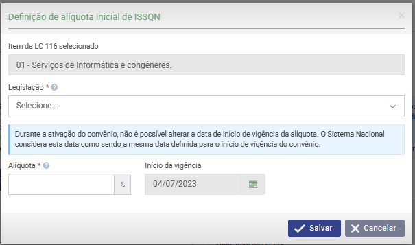

*Figura 49 – Tela de definição da alíquota aplicável a todos os serviços da lista.*

No campo “Legislação” deverá ser escolhida a legislação que determina a alíquota aplicável ao serviço selecionado. Essa Lei deverá ser previamente cadastrada no passo “Legislação para o ISSQN”.

A alíquota então deverá ser inserida no campo de mesmo nome. Como a mensagem exibida na tela orienta, durante a ativação do convênio não é possível alterar a data de início de vigência da alíquota, pois o sistema considerará a mesma data de início de vigência do convênio.

<!-- p.60 -->

> **Atenção:** Conforme estabelecido pela Lei Complementar 116/2003, o valor da alíquota tem que ser maior ou igual a 2% e menor ou igual a 5%, com exceção dos subitens 07.02, 07.05 e 16.01, casos em que poderão ser aceitos valores maiores que 0 e menores ou iguais a 5%, como determina a LC 116/2003.

Uma vez preenchido o campo da alíquota, basta selecionar o botão “Salvar”. Será então exibida uma tela demonstrando as informações salvas.

O sistema se comporta da mesma maneira quando um grupo menor de serviços é selecionado.

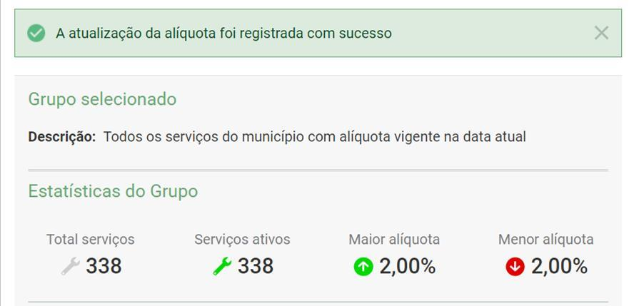

*Figura 50 – Tela de confirmação das alterações referentes à alíquota.*

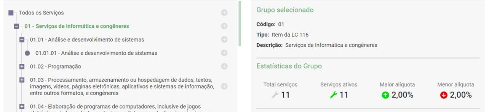

*Figura 51 – Seleção de um grupo para definição da alíquota.*

<!-- p.61 -->

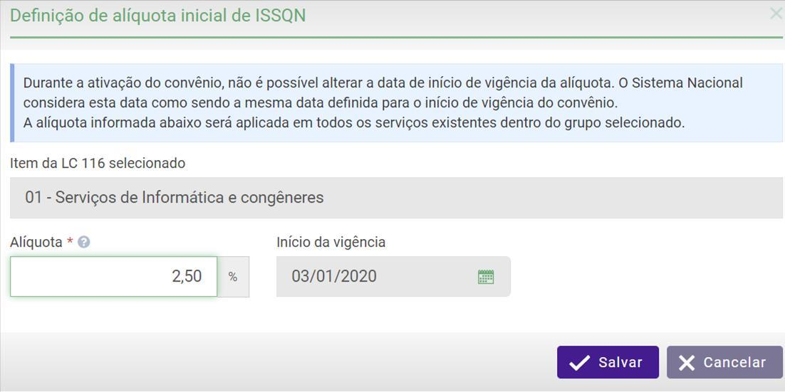

*Figura 52 – Tela de alteração da alíquota do grupo selecionado.*

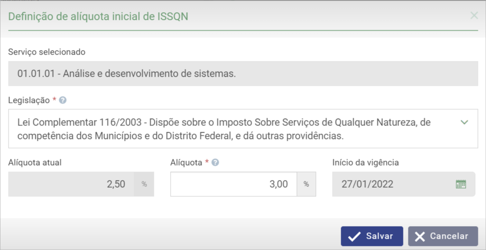

*Figura 53 – Tela de alteração da alíquota do item selecionado.*

<!-- p.62 -->

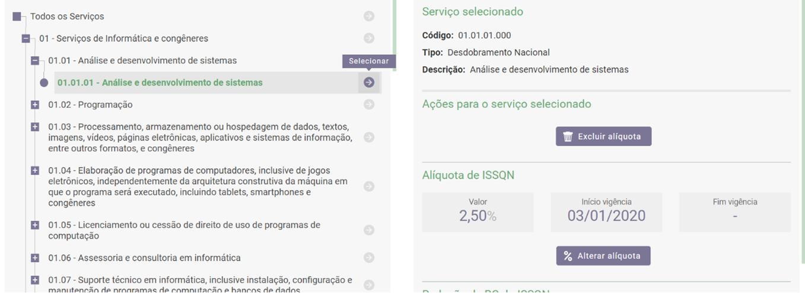

*Figura 54 – Seleção de um subitem da lista para definição de alíquota.*

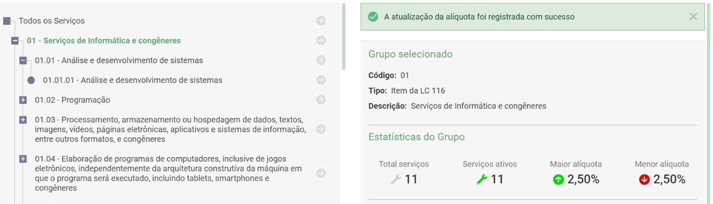

*Figura 55 – Confirmação da alteração da alíquota para todo o grupo selecionado.*

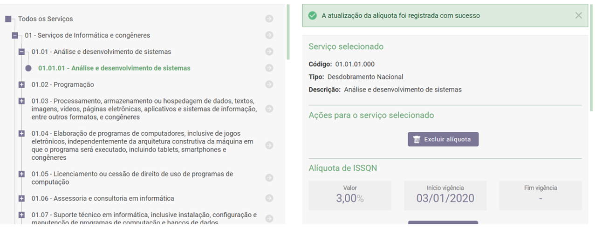

*Figura 56 – Confirmação da alteração da alíquota para o item selecionado.*

O Sistema da NFS-e Nacional permite ainda que se possa verificar as informações gerais das configurações até então realizadas. Ao selecionar “Todos os serviços” ou um grupo de serviços, o sistema mostra qual é a menor e a maior alíquota configurada, bem como a quantidade de serviços ativos.

<!-- p.63 -->

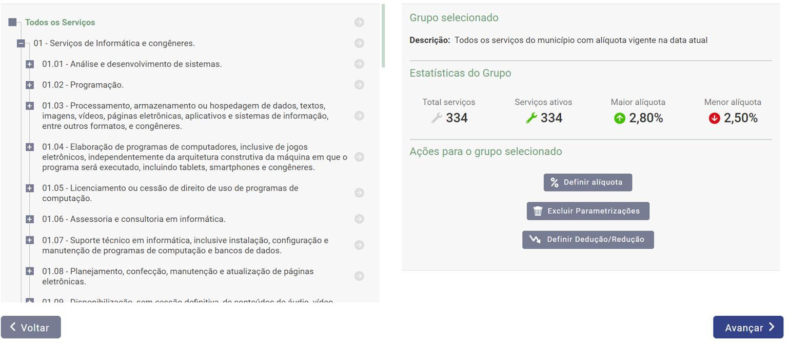

*Figura 57 – Tela que evidencia visão geral dos serviços parametrizados.*

## 3.5.2.3 Definição de Dedução / Redução

A definição de Dedução/Redução no caso refere-se a uma possibilidade de diminuição da base de cálculo para aferição do ISSQN. Os conceitos são idênticos, mas a terminologia é diferente para os subitens da lista de serviços.

O termo “Dedução” é utilizado para os grupos de serviços 07.02, 07.05, e seus desdobramentos, pois são alterações na base de cálculo permitidas pela Lei Complementar 116/2003. Já o termo “Redução” é utilizado para os demais serviços e caracterizam uma renúncia fiscal por parte do município.

A Dedução / Redução somente pode ser definidas após a definição da alíquota para um “desdobro” da lista.

Ao selecionar “Todos os serviços” ou um grupo de serviços, todas as configurações realizadas serão aplicadas aos itens subordinados hierarquicamente a eles. No exemplo abaixo, foi selecionado o grupo de serviços vinculados aos “Serviços de Informática e congêneres”.

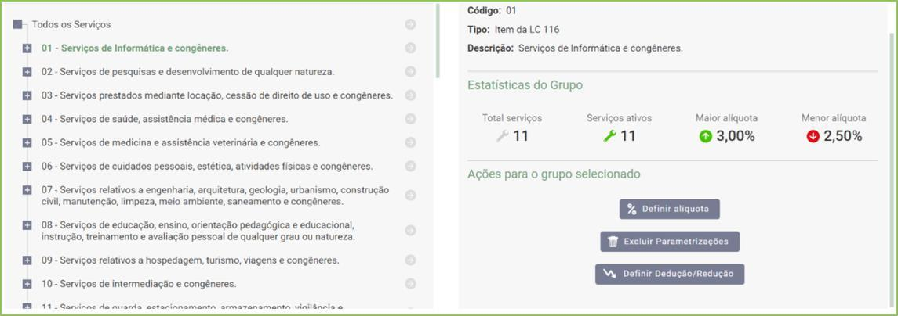

*Figura 58 – Exemplo de grupo de serviços vinculados.*

<!-- p.64 -->

Para definir se haverá dedução/redução, deve-se clicar em **Definir Dedução/Redução** e preencher os campos requeridos conforme indicado abaixo:

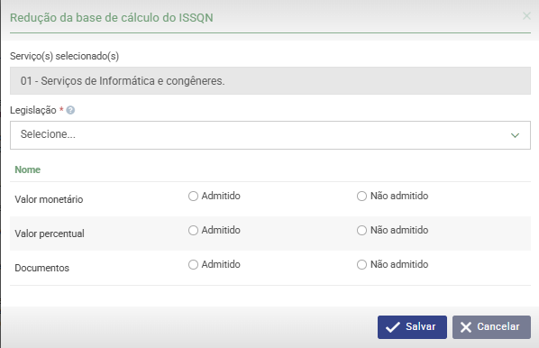

*Figura 59 – Opção do tipo de dedução/redução permitidos para os serviços selecionados.*

A tela acima é então exibida e deverá ser selecionada a legislação que suporta a dedução/redução da base de cálculo do ISSQN.

O município poderá então selecionar as seguintes opções:

- Valor monetário: dedução/redução por valor expresso em moeda;
- Valor percentual: dedução/redução por um valor percentual aplicado sobre a base de cálculo do imposto;
- Documentos: dedução/redução permitidos através de documentos anexados à NFS-e a ser emitida.

Poderão ser selecionadas uma ou mais dessas três opções disponíveis. Finalizada essa configuração, deve-se clicar no botão “Salvar”.

As configurações realizadas poderão ser conferidas ao selecionar cada serviço. No exemplo do grupo “Serviços de Informática e congêneres”, ao selecionar o item “01.01.01 – Análise e desenvolvimento de sistemas”, último nível hierárquico do grupo, as configurações aparecem salvas.

<!-- p.65 -->

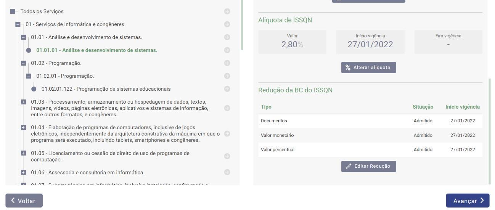

*Figura 60 – Informações de dedução e redução salvas para o serviço selecionado.*

> **Atenção:** As alterações realizadas para todos os serviços ou para um grupo de serviços de nível hierárquico superior sempre prevalecerão em todas as configurações. Portanto, deve-se tomar cuidado para que, ao fazer uma alteração mais abrangente não se desfaça as configurações realizadas para um serviço específico. Exemplo: No caso acima demonstrado, foi feita a configuração para o grupo de serviços “01 – Serviços de Informática e congêneres”, se posteriormente a essa configuração for realizada uma configuração para todos os serviços, as informações de dedução/redução desse grupo serão alteradas.

Uma vez realizadas todas as parametrizações na lista de serviços, o botão “Avançar” no canto inferior direito deverá ser acionado.

3. Se houver necessidade de excluir as parametrizações feitas anteriormente, deve-se clicar em “Excluir Parametrizações”, o que abrirá uma janela para confirmação da exclusão.

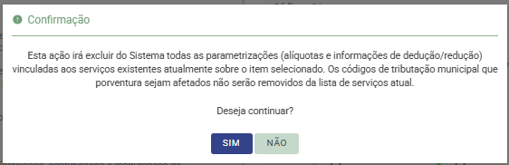

*Figura 61 – Tela de confirmação de exclusão das parametrizações.*

