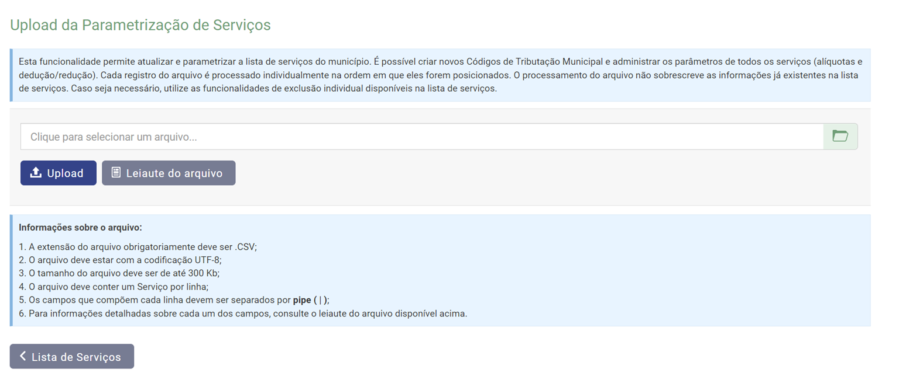
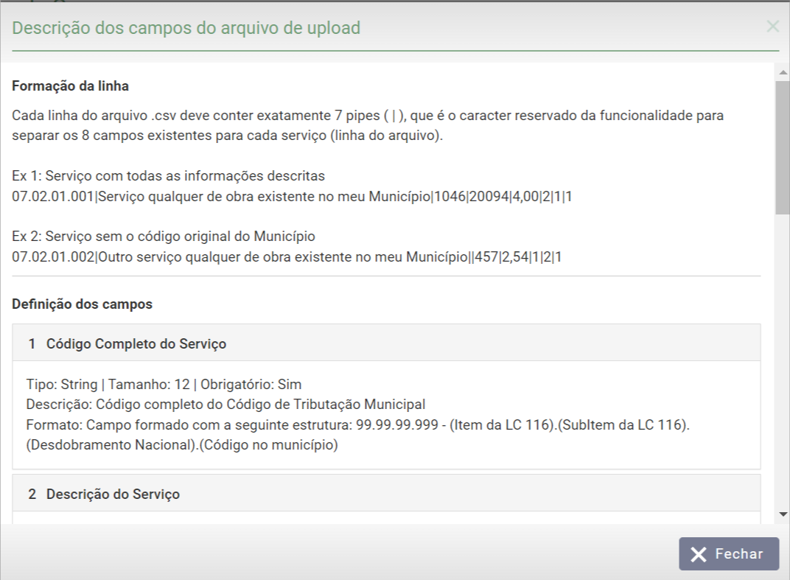
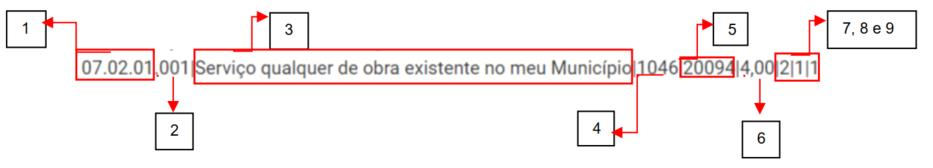

<!-- p.66 -->

# 3.5.3 Parametrização de Serviços através do Upload de um arquivo

Esta funcionalidade permite atualizar e parametrizar a lista de serviços do município através do upload de um arquivo. Ou seja, O gestor municipal poderá inserir um ou mais códigos de tributação municipal na lista de serviços nacional. É possível criar Códigos de Tributação Municipal e administrar os parâmetros de todos os serviços (alíquotas e dedução/redução). Cada registro do arquivo é processado individualmente na ordem em que eles forem posicionados. O processamento do arquivo não sobrescreve as informações já existentes na lista de serviços. Caso seja necessário, deve-se utilizar as funcionalidades de exclusão individual disponíveis na lista de serviços.

Ao acionar o botão “Upload de Serviços” na página de parametrização de serviços, uma nova página será aberta.

*Figura 62 – Página de upload da planilha de serviços.*

Ao acionar o botão de “Leiaute do arquivo”, é aberta uma tela informando como as informações deverão ser formatadas no arquivo para upload de forma que o sistema reconheça corretamente todos os dados.

<!-- p.67 -->

*Figura 63 – Tela informativa sobre leiaute para upload das informações.*

As informações disponibilizadas para o upload do arquivo de parametrização de serviços são as seguintes:

1. A extensão do arquivo obrigatoriamente deve ser .CSV;
2. O arquivo deve estar com a codificação UTF-8;
3. O tamanho do arquivo deve ser de até 300 Kb;
4. O arquivo deve conter um Serviço por linha;
5. Os campos que compõem cada linha devem ser separados por pipe ( | );
6. Para informações detalhadas sobre cada um dos campos, consulte o leiaute do arquivo disponível acima.

**Descrição dos campos do arquivo de upload**

**Formação da linha**

Cada linha do arquivo .csv deve conter exatamente 8 pipes ( | ), que é o caracter reservado da funcionalidade para separar os 9 campos existentes para cada serviço (linha do arquivo), ou 4 pipes ( | ) se o serviço não possuir incidência de ISSQN, deixando os últimos 4 campos em branco.

<!-- p.68 -->

**Ex 1: Serviço com todas as informações descritas**

`07.02.01.001|Serviço qualquer de obra existente no meu Município|1046|20094|1|4,00|2|1|1`

**Ex 2: Serviço sem o código original do Município**

`07.02.01.002|Outro serviço qualquer de obra existente no meu Município||457|1|2,54|1|2|1`

**Ex 3: Serviço com ISSQN não incidente**

`14.02.01.000|Assistência técnica||31005000100001|2`

**Definição dos campos**

**1 Código Completo do Serviço**

- Tipo: String | Tamanho: 12 | Obrigatório: Sim
- Descrição: Código completo do Código de Tributação Municipal
- Formato: Campo formado com a seguinte estrutura: 99.99.99.999 - (Item da LC 116).(SubItem da LC 116).(Desdobramento Nacional).(Código no município)

**2 Descrição do Serviço**

- Tipo: String | Tamanho: 500 | Obrigatório: Sim
- Descrição: Descrição completa do Código de Tributação Municipal
- Formato: Texto livre de até 500 caracteres

**3 Código Original no Município**

- Tipo: String | Tamanho: 50 | Obrigatório: Não
- Descrição: Código utilizado no município para identificar este mesmo serviço
- Formato: Texto livre
- Importante: Campo utilizado apenas para rastrear e vincular os códigos existentes no município aos códigos criados no Sistema Nacional da NFS-e

**4 Identificador da Legislação**

- Tipo: Número | Tamanho: 18 | Obrigatório: Sim
- Descrição: Identificador único da legislação vinculada à criação do serviço
- Formato: Número de até 18 dígitos
- Importante: Utilizar ID exibido para cada uma das legislações listadas na tela de legislações

**5 Incidência de ISSQN**

- Tipo: Número | Tamanho: 1 | Obrigatório: Sim
- Descrição: Determina se o serviço é ou não incidente do Imposto Sobre Serviços de Qualquer Natureza (ISSQN)
- Formato: 1 - Incidente; 2 - Não Incidente

<!-- p.69 -->

- Importante: Os demais 4 campos abaixo, "Alíquota do serviço" e "Dedução/Redução" devem ser preenchidos caso o serviço seja configurado como Incidente (1). Caso seja configurado como Não-Incidente (2), os 4 campos abaixo não precisam ser informados.

**6 Alíquota do serviço**

- Tipo: Número | Tamanho: 3 | Obrigatório: Não
- Descrição: Valor da alíquota definida para o serviço
- Formato: Número entre 2,00 e 5,00 com até 2 casas decimais
- Importante: As casas decimais devem ser informadas (quando existirem) utilizando vírgula como separador

**7 Dedução/Redução - Valor monetário**

- Tipo: Número | Tamanho: 1 | Obrigatório: Não
- Descrição: Determina se o serviço admite ou não a dedução/redução da Base de Cálculo do ISS utilizando valor monetário
- Formato: 1 - Não admite; 2 - Admite

**8 Dedução/Redução - Valor percentual**

- Tipo: Número | Tamanho: 1 | Obrigatório: Não
- Descrição: Determina se o serviço admite ou não a dedução/redução da Base de Cálculo do ISS utilizando valor percentual
- Formato: 1 - Não admite; 2 - Admite

**9 Dedução/Redução - Documentos**

- Tipo: Número | Tamanho: 1 | Obrigatório: Não
- Descrição: Determina se o serviço admite ou não a dedução/redução da Base de Cálculo do ISS utilizando documentos
- Formato: 1 - Não admite; 2 - Admite

Segue abaixo exemplos da formação da linha em um arquivo para upload de serviços.

Cada linha do arquivo .csv deve conter exatamente 7 pipes ( | ), que é o caracter reservado da funcionalidade para separar os 8 campos existentes para cada serviço (linha do arquivo). As informações deverão fazer parte de uma mesma célula na planilha, tendo as informações separadas por pipe (|). A sequência de informações a serem inseridas é a seguinte:

<!-- REVISAR p.67-69: a fonte indica “8 pipes / 9 campos” na formação da linha, mas em seguida “7 pipes / 8 campos” e os exemplos têm 8 campos (7 pipes); o texto foi transcrito como está -->

<!-- p.70 -->

1. Código Nacional de Serviços separado por ponto a cada dois dígitos.
2. Três dígitos que correspondem ao código municipal para identificação do serviço no Sistema Nacional da NFS-e. Caso não seja um serviço desdobrado pelo município esses dígitos deverão ser “000”.
3. Descrição Completa do Serviço. Caso haja desdobramento municipal o campo deve ser preenchido com a descrição que será utilizada para identificar o desdobramento do código.
4. Código original do serviço no município. Consiste no código de identificação do serviço no município, antes da NFS-e Nacional.
5. Identificador da legislação vinculada à criação do serviço. Corresponde à legislação cadastrada no sistema da NFS-e (o número pode ser consultado na Lista Legislação para o ISSQN).
6. Alíquota definida para o serviço.
7. Determina se o serviço admite ou não a dedução/redução da Base de Cálculo do ISS utilizando valor monetário: 1 - Não admite; 2 – Admite.
8. Determina se o serviço admite ou não a dedução/redução da Base de Cálculo do ISS utilizando valor percentual: 1 - Não admite; 2 – Admite.
9. Determina se o serviço admite ou não a dedução/redução da Base de Cálculo do ISS utilizando documentos: 1 - Não admite; 2 – Admite.

![Atenção – A indicação dos parâmetros de dedução/redução é que vão permitir, ou não, que o emitente indique um valor como serviço e um outro, menor, a título de redução ou dedução. No caso de valor monetário, será aberto apenas o campo de valor no subitem que estiver marcado como "admite". Para percentual, idem. Para a dedução/redução com documentos, apenas se o emitente incluir os dados desses documentos é que será possível a dedução ou redução da base de cálculo. Finalmente, para a maioria dos casos o sistema ainda faz o batimento da redução ou dedução com a regra da alíquota mínima efetiva de 2% (exceto para construção civil e transporte coletivo municipal de passageiros).](../../img/p001-085-fig-p070-205.png)

**Ex 1: Serviço com todas as informações descritas**

`07.02.01.001|Serviço qualquer de obra existente no meu Município|1046|20094|4,00|2|1|1`

<!-- p.71 -->

**Ex 2: Serviço sem o código original do Município**

`07.02.01.002|Outro serviço qualquer de obra existente no meu Município||457|2,54|1|2|1`

Com o arquivo no formato descrito acima, deve-se clicar na barra de upload ou clicar no ícone de pasta para buscar o arquivo em algum lugar armazenado no computador local.

Encontrado o caminho do arquivo, deve-se clicar no botão “Upload”.

