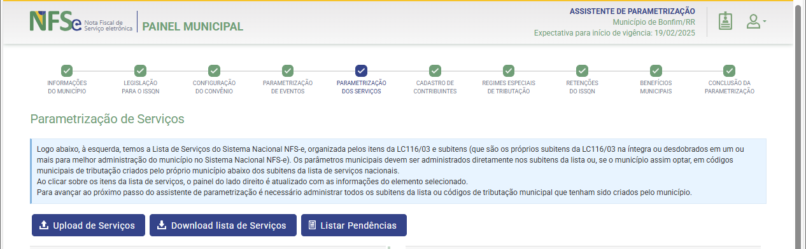
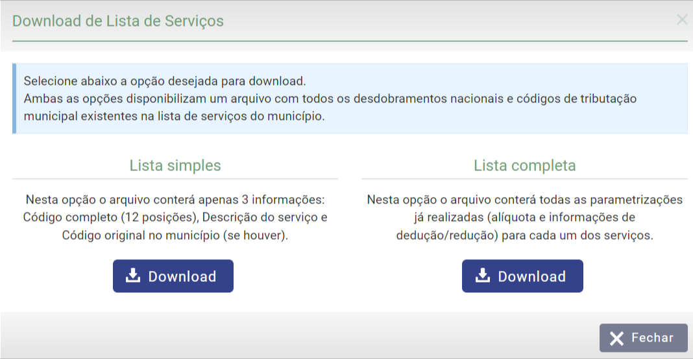
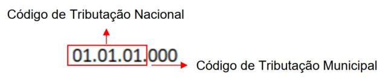
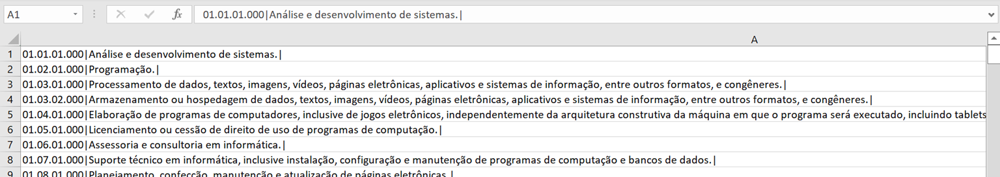
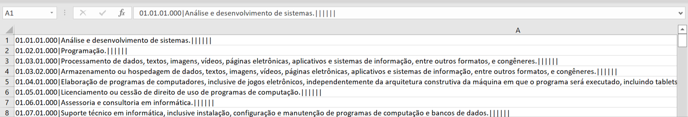

# 3.5.4 Download da lista de serviços

A ATM poderá realizar o download da lista de serviços através do botão “Download lista de Serviços”. Isto permite ao gestor municipal verificar a estrutura da lista atual do município. O sistema permite o download de dois tipos possíveis de formatos:

- Visão simplificada da estrutura da lista de serviços do município e facilita, por exemplo, a montagem dos códigos de tributação municipal de forma mais ágil. Nesta lista, o arquivo conterá apenas 3 informações: Código completo (12 posições), Descrição do serviço e Código original no município (se houver).
- Visão completa, ou seja, a lista com a estrutura dos códigos de tributação atuais com suas respectivas parametrizações. Nesta lista, o arquivo conterá todas as parametrizações já realizadas (alíquota e informações de dedução/redução) para cada um dos serviços.

Para fazer o download de todos os serviços cadastrados no sistema na tela ou fazer o download da lista de serviços (um arquivo .csv) no botão:

*Figura 64 – Tela de Parametrização dos Serviços.*

<!-- p.72 -->

Uma nova tela será aberta, com as seguintes opções:

*Figura 65 – Opções de download da lista de serviços.*

### 3.5.4.1 Lista Simples

Nesta opção é disponibilizada a lista de serviços apenas com o código e a descrição do serviço.

Ao fazer o download das informações, o arquivo gerado é no formato csv e as informações são disponibilizadas na seguinte formatação:

*Figura 66 – Leiaute do arquivo da lista de serviços simples.*

### 3.5.4.2 Lista Completa

É disponibilizada também a lista de serviços completa, contendo todas as parametrizações realizadas até o momento para o município e a formatação completa para um possível preenchimento pelo município, para posteriormente, fazer o upload do arquivo no sistema.

<!-- p.73 -->

*Figura 67 – Leiaute da lista de serviços completa.*

Uma vez realizado o download da lista de serviços ficará mais simples o preenchimento de todas as informações necessárias para o posterior upload do arquivo no sistema.

<!-- REVISAR p.71: a fonte diz “Visão simplificada/completa” no texto e “Lista simples/completa” na Figura 65; grafia do texto mantida -->
