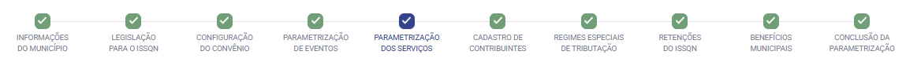
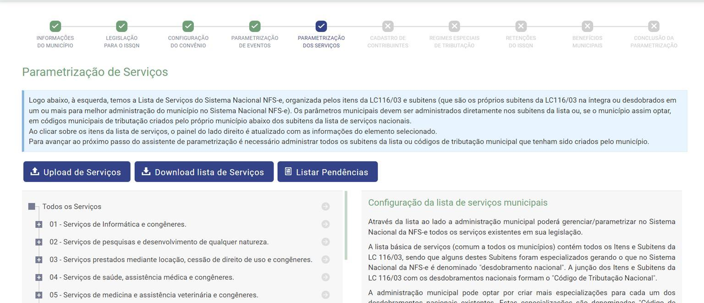

<!-- p.46 -->

# 3.5 Parametrização dos Serviços

Esta página possui a Lista de Serviços do Sistema Nacional NFS-e, organizada pelos itens da LC116/03 e subitens (que são os próprios subitens da LC116/03 na íntegra ou desdobrados em um ou mais para melhor administração do município no Sistema Nacional NFS-e). Os parâmetros municipais devem ser administrados diretamente nos subitens da lista ou, se o município assim optar, em códigos municipais de tributação criados pelo próprio município abaixo dos subitens da lista de serviços nacionais.

Na tela de parametrização dos serviços, os representantes municipais poderão parametrizar informações como alíquota, dedução/redução ou até mesmo acrescentar um código de tributação municipal na lista de serviços.

Para avançar ao próximo passo do assistente de parametrização é necessário administrar todos os subitens da lista ou códigos de tributação municipal que tenham sido criados pelo município.

*Figura 37 – Tela de Parametrização dos Serviços.*

Ao parametrizar a lista de serviços, o representante municipal poderá preencher as informações na web, na própria página de parametrização ou, caso prefira, poderá fazer o download do arquivo da lista de serviços (ver item 3.5.4), preencher as informações exigidas, e posteriormente fazer o upload do arquivo na web.

## Subseções

- [3.5.1 Lista de Serviços – Conceitos e Modelagem](03-05-01-conceitos-e-modelagem.md)
- [3.5.2 Parametrização na página da web](03-05-02-parametrizacao-na-web.md)
- [3.5.3 Parametrização de Serviços através do Upload de um arquivo](03-05-03-upload-de-arquivo.md)
- [3.5.4 Download da lista de serviços](03-05-04-download-lista-de-servicos.md)
- [3.5.5 Listagem de Pendências](03-05-05-listagem-de-pendencias.md)
