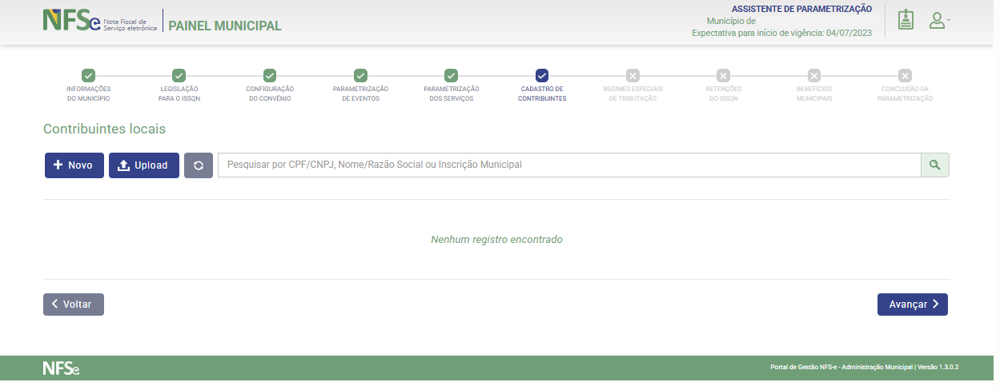
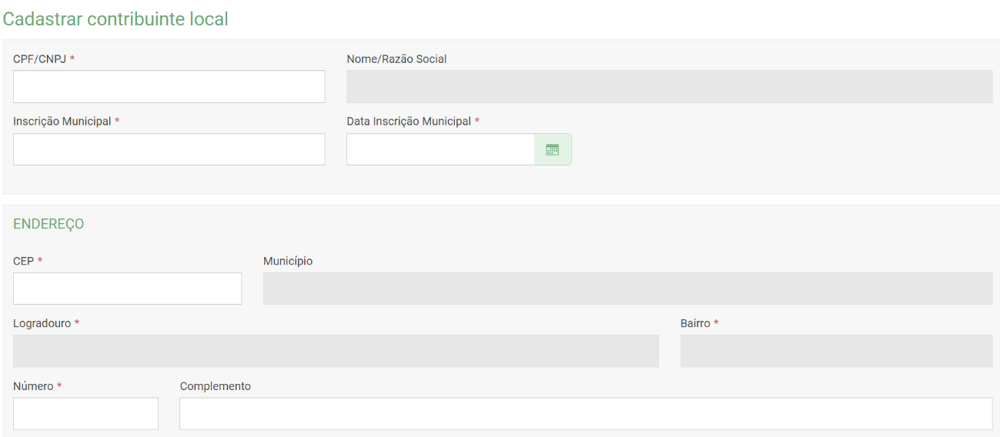
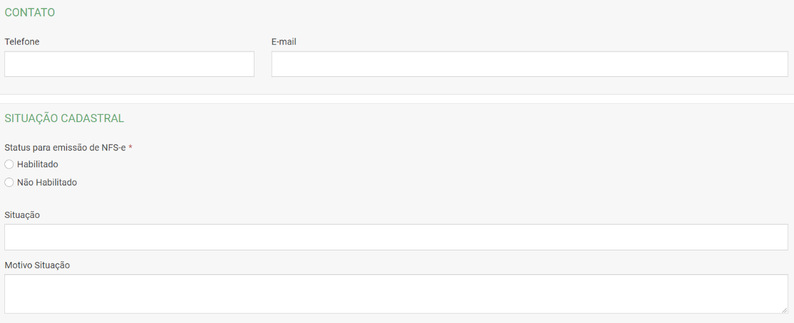
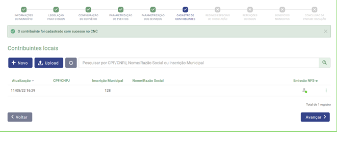
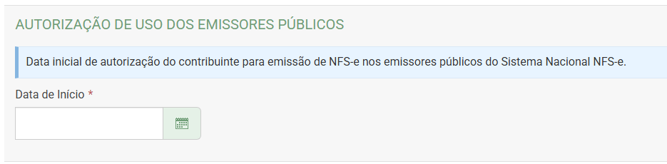
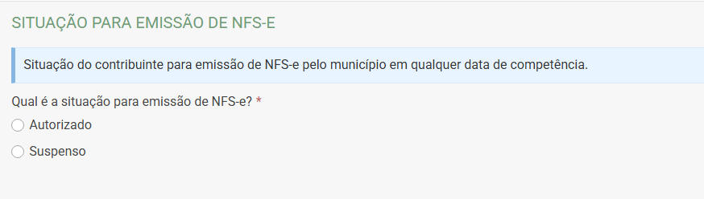
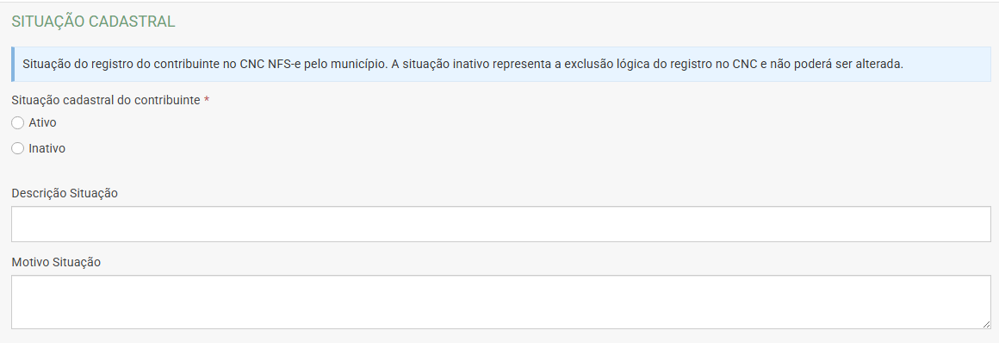

# 3.6.1 Cadastrar um Contribuinte Local na página Web

Neste item do menu é disponibilizada a possibilidade de cadastrar cada contribuinte individualmente, por meio da página na internet.

Na tela abaixo, clicar em “Novo”:

<!-- p.77 -->

*Figura 69 – Tela inicial do cadastro de Contribuintes.*

Ao selecionar essa opção, as seguintes informações são solicitadas pelo sistema:

*Figura 70 – Campos de preenchimento relativos à identificação do contribuinte e ao seu endereço.*

> **Atenção:** O CEP a ser inserido no cadastro dos contribuintes deverá pertencer ao Município.

- CPF/CNPJ: neste campo deverão ser digitados os algarismos referentes aos números de registros perante a Receita Federal do Brasil;
- Nome/Razão Social: este campo é carregado automaticamente pelo sistema quando do preenchimento do CPF/CNPJ, de acordo com as informações cadastradas na RFB;
- Inscrição Municipal: deverão ser digitados os algarismos da inscrição municipal do contribuinte que está sendo cadastrado;
- Data da Inscrição Municipal: a data da realização da inscrição municipal deverá ser inserida nesse campo, no formato DD/MM/AAAA;
- Informações de Endereço do contribuinte: primeiramente deverá ser incluído o número do CEP do endereço do contribuinte. O sistema automaticamente preencherá o campo “Município” e se disponíveis, as informações de logradouro e bairro. As demais informações deverão ser completadas pela ATM: número e complemento (este apenas se houver);
- Informações de contato: caso deseje, a ATM poderá preencher os campos de telefone e e-mail para contato com o contribuinte.

<!-- p.78 -->

*Figura 71 – Informações relativas ao contato com o contribuinte e à sua situação cadastral perante o município.*

> **Atenção:** Os campos “Situação” e “Motivo da situação” estão disponíveis apenas para registro de mera informação para uso da própria ATM, não tendo impacto nas funcionalidades do Sistema Nacional NFS-e.

- Informações de situação cadastral: a ATM deverá indicar se o contribuinte está habilitado ou não à emissão da NFS-e e se desejar, poderá incluir a situação cadastral do contribuinte e o motivo da situação;
- Situação: a ATM poderá indicar neste campo a situação em que se encontra o cadastro do contribuinte no município (por exemplo, “Atualizado”, etc).
- Motivo da situação: caso a situação exija algum esclarecimento, ele poderá ser realizado neste campo.

Uma vez realizadas todas as configurações, a ATM deverá **Salvar** as informações. Uma mensagem de confirmação será exibida no início da página e o contribuinte poderá ser visualizado na lista de contribuintes locais.

<!-- p.79 -->

*Figura 72 – Tela de confirmação da inserção do contribuinte.*

## 3.6.1.1 Autorização de uso dos Emissores Públicos

Esta funcionalidade foi desenvolvida para permitir que o município realize uma adoção faseada do Sistema Nacional da NFS-e, definindo quais contribuintes devem emitir o documento fiscal em cada sistema (próprio ou nacional), em momentos distintos.

Por meio dessa parametrização, é possível configurar individualmente o contribuinte, indicando qual sistema de emissão ele utilizará. Isso viabiliza uma migração gradual e planejada, por etapas, reduzindo os impactos tanto para os contribuintes quanto para a administração municipal.

Informar a data inicial de autorização do contribuinte para emissão de NFS-e nos emissores públicos do Sistema Nacional NFS-e.

A data informada deve ser igual ou superior à data do indicador municipal, que por sua vez deve ser maior ou igual a data de cadastro do contribuinte na RFB. Uma vez cadastrada, a data de autorização de uso dos emissores só poderá ser editada caso a data informada seja posterior a data atual.

*Figura 73 – Tela para inclusão da data da autorização de uso dos emissores públicos.*

## 3.6.1.2 Situação para emissão de NFS-e

Este parâmetro indica se o contribuinte está Autorizado ou Suspenso a emitir NFS-e.

<!-- p.80 -->

*Figura 74 – Tela para marcar a situação para emissão da NFS-e.*

## 3.6.1.3 Situação cadastral

Este parâmetro mostra a situação do registro do contribuinte no CNC NFS-e pelo município (Ativo ou Inativo). A marcação da situação inativo representa a exclusão lógica do registro no CNC e não poderá ser alterada.

Se Inativo, informar a “descrição e o motivo da situação”.

*Figura 75 – Tela para marcar a situação cadastral do contribuinte no CNC.*

Ao final do preenchimento, clicar em “Salvar” para confirmar a inclusão do contribuinte.

