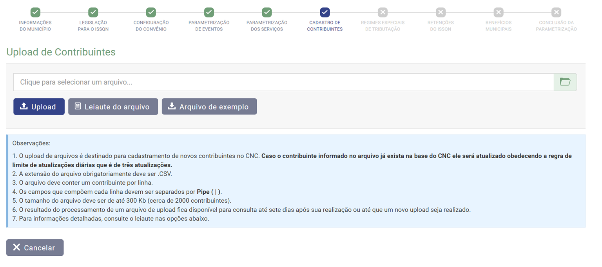
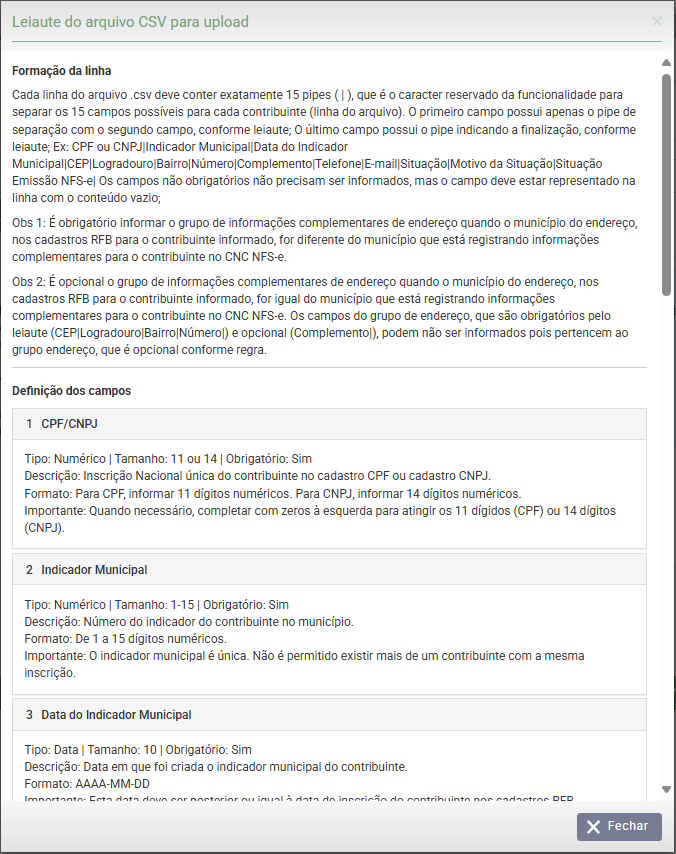
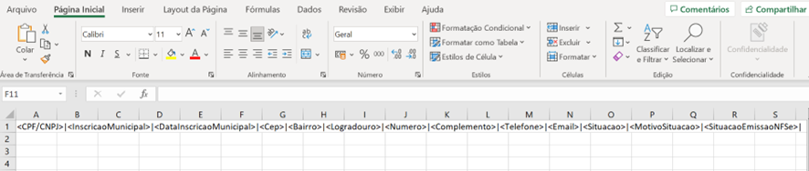

# 3.6.2 Upload de Arquivo de Contribuintes do Município

O sistema da NFS-e de Nacional permite que em um único procedimento a ATM inclua as informações de um ou mais contribuintes.

Para isso deverá ser carregado no sistema um arquivo seguindo o leiaute disponibilizado na página de upload.

<!-- p.81 -->

*Figura 76 – Página de upload do arquivo com os contribuintes cadastrados no município.*

A funcionalidade permite em um único procedimento incluir as informações de um ou mais contribuintes.

> **Atenção:** O arquivo a ser carregado pelo sistema deverá satisfazer às seguintes condições:
>
> - ✓ O upload de arquivos é destinado para cadastramento de novos contribuintes no CNC. Caso o contribuinte informado no arquivo já exista na base do CNC ele será atualizado obedecendo a regra de limite de atualizações diárias que é de três atualizações.
> - ✓ A extensão do arquivo obrigatoriamente deve ser .CSV.
> - ✓ O arquivo deve conter um contribuinte por linha.
> - ✓ Os campos que compõem cada linha devem ser separados por pipe ( | ).
> - ✓ O tamanho do arquivo deve ser de até 300 Kb (cerca de 2000 contribuintes).
> - ✓ O resultado do processamento de um arquivo de upload fica disponível para consulta até sete dias após sua realização ou até que um novo upload seja realizado.

Os campos não obrigatórios não precisam ser informados, mas o campo deve estar representado na linha com o conteúdo vazio.

Ao clicar em “Leiaute do arquivo” o sistema mostrará a descrição de todos os campos e a regra de formação de cada um deles, conforme tela abaixo:

<!-- p.82 -->

*Figura 77 – Descrição de todos os campos exigidos no leiaute do arquivo a ser carregado no sistema NFS-e.*

A captura da Figura 77 (leiaute do arquivo CSV para upload) mostra a seguinte descrição, na parte visível da janela:

**Formação da linha**: cada linha do arquivo .csv deve conter exatamente 15 pipes ( | ), que é o caracter reservado da funcionalidade para separar os 15 campos possíveis para cada contribuinte (linha do arquivo). O primeiro campo possui apenas o pipe de separação com o segundo campo, conforme leiaute; o último campo possui o pipe indicando a finalização, conforme leiaute. Ex: CPF ou CNPJ|Indicador Municipal|Data do Indicador Municipal|CEP|Logradouro|Bairro|Número|Complemento|Telefone|E-mail|Situação|Motivo da Situação|Situação Emissão NFS-e. Os campos não obrigatórios não precisam ser informados, mas o campo deve estar representado na linha com o conteúdo vazio.

**Obs 1**: é obrigatório informar o grupo de informações complementares de endereço quando o município do endereço, nos cadastros RFB para o contribuinte informado, for diferente do município que está registrando informações complementares para o contribuinte no CNC NFS-e.

**Obs 2**: é opcional o grupo de informações complementares de endereço quando o município do endereço, nos cadastros RFB para o contribuinte informado, for igual do município que está registrando informações complementares no CNC NFS-e. Os campos do grupo de endereço, que são obrigatórios pelo leiaute (CEP|Logradouro|Bairro|Número) e opcional (Complemento), podem não ser informados pois pertencem ao grupo endereço, que é opcional conforme regra.

**Definição dos campos**

**1 CPF/CNPJ**

- Tipo: Numérico | Tamanho: 11 ou 14 | Obrigatório: Sim
- Descrição: Inscrição Nacional única do contribuinte no cadastro CPF ou cadastro CNPJ.
- Formato: Para CPF, informar 11 dígitos numéricos. Para CNPJ, informar 14 dígitos numéricos.
- Importante: Quando necessário, completar com zeros à esquerda para atingir os 11 dígitos (CPF) ou 14 dígitos (CNPJ).

**2 Indicador Municipal**

- Tipo: Numérico | Tamanho: 1-15 | Obrigatório: Sim
- Descrição: Número do indicador do contribuinte no município.
- Formato: De 1 a 15 dígitos numéricos.
- Importante: O indicador municipal é única. Não é permitido existir mais de um contribuinte com a mesma inscrição.

**3 Data do Indicador Municipal**

- Tipo: Data | Tamanho: 10 | Obrigatório: Sim
- Descrição: Data em que foi criada o indicador municipal do contribuinte.
- Formato: AAAA-MM-DD
- Importante: Esta data deve ser posterior ou igual à data de inscrição do contribuinte nos cadastros RFB (texto cortado na captura).

<!-- REVISAR p.82: a captura da Figura 77 mostra apenas os campos 1 a 3 (a descrição continua fora da área visível); os campos 4 a 15 não aparecem nas páginas 82–83 da fonte -->

Ex:

`CPF/CNPJ|IndicadorMunicipal|DatadoIndicadorMunicipal|NomeFantasia|CEP|Bairro|Logradouro|Número|Complemento|Telefone|E-mail|Situação|Motivo da Situação|Situação Emissão NFS-e| Situação Cadastral do Contribuinte no CNC|Data de Autorização de Uso dos Emissores Públicos`

<!-- p.83 -->

Ao acionar o botão “Arquivo de exemplo” a ATM poderá fazer o download do arquivo configurado seguindo todas as regras impostas pelo sistema.

Para fazer o upload do arquivo na página, a ATM deverá acionar o botão, selecionar o arquivo desejado e em seguida “Upload”.

Em seguida é aberta uma página de resultado do upload do arquivo, em que pode ser verificada a data do upload, a quantidade de registros contidas no arquivo, quantos registros foram realizados com sucesso, qual o limite de atualização diária de registros e a quantidade de registros não processados.

*Figura 78 – Tela de resultado do arquivo escolhido para upload.*

*Figura 79 – Modelo de arquivo para upload.*

<!-- REVISAR p.83: a linha “Ex:” da fonte traz o cabeçalho do leiaute com “Nome Fantasia”, “Telefone” e demais campos sem correspondência com a numeração da Figura 77; transcrito como está -->
