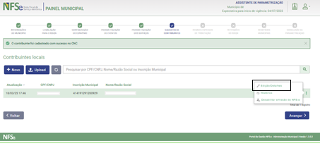

# 3.6.3 Editar Informações de um Contribuinte

Após a inclusão de um contribuinte, ao clicar nos três pontos, é possível fazer a Edição, visualizar detalhes, verificar o Histórico ou Desabilitar a emissão de NFS-e.

<!-- p.84 -->

*Figura 80 – Tela com a lista dos contribuintes cadastrados opção “Edição/Detalhes”.*
