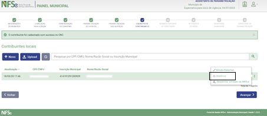

# 3.6.4 Visualizar Histórico de Alterações de Informações do Contribuinte

Para o contribuinte selecionado será apresentado seu CPF/CNPJ e respectivo Nome/Razão Social e uma linha do tempo com as alterações efetuadas evidenciando:

- O campo alterado;
- A informação anterior e a informação alterada (De “xxx” Para “YYY”);
- Data da alteração;
- Usuário responsável pela alteração (CPF).

*Figura 81 – Tela com a lista dos contribuintes cadastrados opção “Histórico”.*
