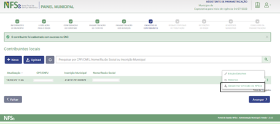
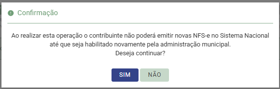

# 3.6.5 Desabilitar Emissão de NFS-e

Será apresentado texto informando que caso seja confirmada a solicitação, o contribuinte não poderá emitir mais NFS-e até que seja habilitado novamente pelo Gestor do município.

<!-- p.85 -->

*Figura 82 – Tela com a lista dos contribuintes cadastrados opção “Desabilitar emissão de NFS-e”.*

*Figura 83 – Tela para confirmação da desabilitação da emissão de NFS-e.*
