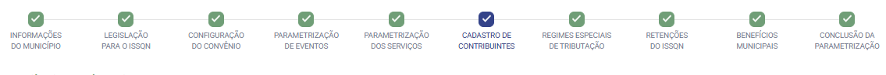
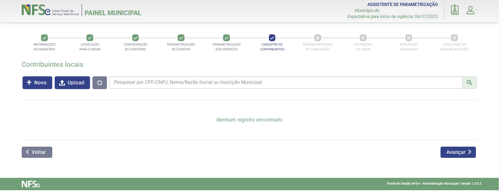

<!-- p.74 -->

# 3.6 Cadastro de Contribuintes

O Sistema Nacional NFS-e utiliza as bases RFB (CNPJ / CPF) como base principal de informações dos contribuintes para emissão de NFS-e. O município tem o Cadastro Nacional Complementar (CNC) NFSe, que é uma base de dados específica do sistema nacional para complementar informações de quaisquer contribuintes.

O Cadastro Nacional Complementar (CNC) NFS-e:

- É um dos módulos do Sistema Nacional NFS-e e estará disponível para os municípios que efetivarem convênio com o Sistema Nacional da Nota Fiscal de Serviços Eletrônica – SN NFS-e;
- É uma base de dados nacional de contribuintes do ISSQN, composta por informações de contribuintes que o município deseje complementar ou utilizar em detrimento às informações provenientes das bases RFB (CNPJ / CPF);
- É operado no âmbito do Sistema Nacional NFS-e e mantido pelos municípios, sendo cada município responsável pelo cadastramento e atualização das informações complementares dos contribuintes que forem registrados;
- Será composto pelas informações cadastrais complementares dos contribuintes que tiverem dados complementares informados pelos municípios conveniados ao Sistema Nacional NFS-e na situação “Ativo”, conforme ERNPAINELNACIONAL-SNNFSe.pdf.;
- Facilitará a distribuição de todas as informações cadastrais dos contribuintes que estiverem registrados no CNC NFS-e. Esta distribuição entre os municípios se faz independentemente do momento de ativação do convênio do município com o Sistema Nacional NFS-e. Cada município que estiver ativo no Sistema Nacional NFS-e poderá acessar todas as informações desde o início de funcionamento deste cadastro complementar;

Para o correto funcionamento do CNC NFS-e é indispensável o atributo de “Indicador Municipal (IM)” para cada registro de contribuintes CPF e CNPJ. Os valores e formatos atribuídos para os registros são abertos para que cada município estabeleça sua estrutura de IM, desde que seja formado por até 15 caracteres.

Por padrão, todo e qualquer contribuinte que constar nas bases CNPJ e CPF é um emitente do município que estiver registrado em seu endereço nestas bases. Através do CNC o município pode registrar uma informação complementar que impossibilitará o contribuinte de emissão de documentos fiscais (NFS-e) no Sistema Nacional NFS-e.

Através do Painel Administrativo Municipal o sistema permite que a administração tributária municipal gerencie seus contribuintes no CNC por duas funcionalidades:

<!-- p.75 -->

- Gerenciar informações complementares de um contribuinte por vez e;
- Gerenciar informações complementares de um ou mais contribuintes através do Upload de Arquivo com informações complementares;

**Definições do Sistema**

- É importante ressaltar que todo o sistema está orientado para usar informações de uma tríade constituída por Código do Município, CNPJ/CPF e Indicador Municipal (IM) de um estabelecimento, informados pelo município. Desta maneira, ao longo deste documento, todas referências a tríade “Município/CNPJ/IM” ou “Município/CPF/IM” devem ser levadas no contexto de que o par CNPJ/IM ou CPF/IM foi informado por um determinado Município.
- O mesmo CNPJ/CPF pode ser informado por mais de um município e em um mesmo município, desde que tenha inscrições municipais diferentes.
- O CNC NFS-e possibilita o gerenciamento das informações permitindo a inclusão e alteração de informações complementares. Uma das informações é a situação cadastral do contribuinte no CNC, que permite a exclusão lógica do contribuinte do cadastro, finalizando assim as informações complementares para este contribuinte neste município no CNC.
- Para a emissão de uma NFS-e, de um contribuinte, por um determinado município emissor, que tenha o registro deste contribuinte no CNC, mas com a informação complementar que representa a exclusão lógica, como definido anteriormente, serão consideradas as informações básicas provenientes dos cadastros RFB (CNPJ/CPF).
- O município será responsável pelo envio das informações complementares respeitando as regras do LEIAUTE_CNC do documento ANEXO_III-CNCSNNFSe.xlsx, para cada tipo de manutenção (inclusão, alteração).
- Será gerado histórico para cada alteração enviada e realizada no CNC NFS-e.
- Importante ressaltar que todo o Sistema Nacional da NFS-e leva em consideração a vigência das informações como por exemplo, alíquotas, benefícios, reduções e etc. Para as movimentações de alteração o mesmo conceito será utilizado.
- A “Exclusão Lógica” (Situação Cadastral no CNC – Ativo/Inativo) não considera períodos de vigência pois uma vez inativado o registro complementar do contribuinte deixa de existir no CNC e o sistema passa a utilizar os dados provenientes dos cadastros RFB para um determinado CNPJ/CPF.
- Para o processamento das solicitações de movimentação de um contribuinte o CNC NFS-e irá considerar a chave única formada pelo código do município, o CNPJ/CPF e a IM do contribuinte informados.
- É de responsabilidade do município a definição da necessidade de envio das movimentações relativas aos seus contribuintes. O CNC NFS-e deverá fazer os processamentos das solicitações tão logo as receba.

<!-- p.76 -->

O envio do CNC é opcional, porém se o município tiver interesse em cadastrar o indicador municipal (inscrição municipal, por exemplo) para todos os seus contribuintes, deverá enviar o CNC para todos eles e realizar as atualizações quando necessárias.

*Figura 68 – Tela de cadastro do CNC quando a opção de Cadastro da RFB é selecionada no passo “Configuração do convênio”.*

> **Atenção:** Após a ativação do convênio, o Painel Administrativo Municipal continuará tendo disponível todas as funcionalidades de gestão relativas aos cadastros de contribuinte, compreendendo a inclusão de novos contribuintes, a edição de dados dos contribuintes existentes e a habilitação/desabilitação para emissão de NFS-e.

É possível o cadastro de cada contribuinte individualmente ou o upload de um arquivo com uma lista.

## Subseções

- [3.6.1 Cadastrar um Contribuinte Local na página Web](03-06-01-cadastrar-contribuinte-na-web.md)
- [3.6.2 Upload de Arquivo de Contribuintes do Município](03-06-02-upload-contribuintes.md)
- [3.6.3 Editar Informações de um Contribuinte](03-06-03-editar-contribuinte.md)
- [3.6.4 Visualizar Histórico de Alterações de Informações do Contribuinte](03-06-04-historico-alteracoes.md)
- [3.6.5 Desabilitar Emissão de NFS-e](03-06-05-desabilitar-emissao.md)
