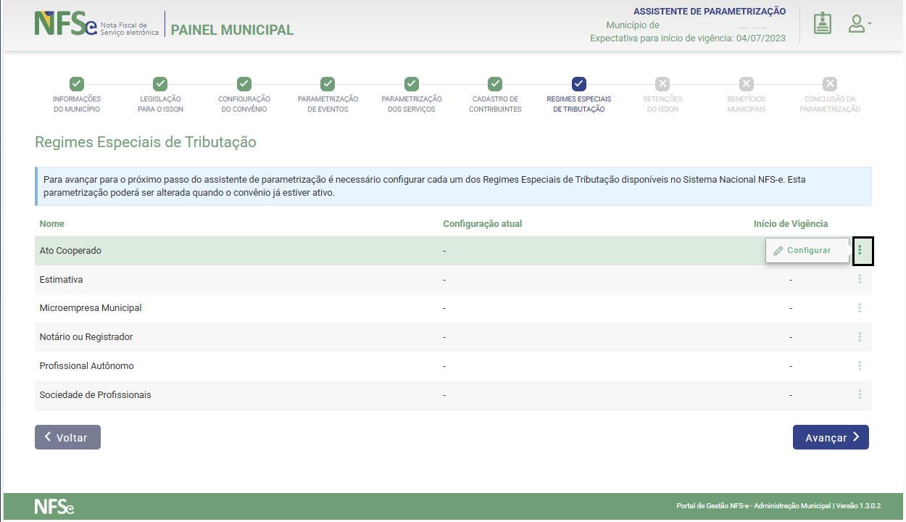
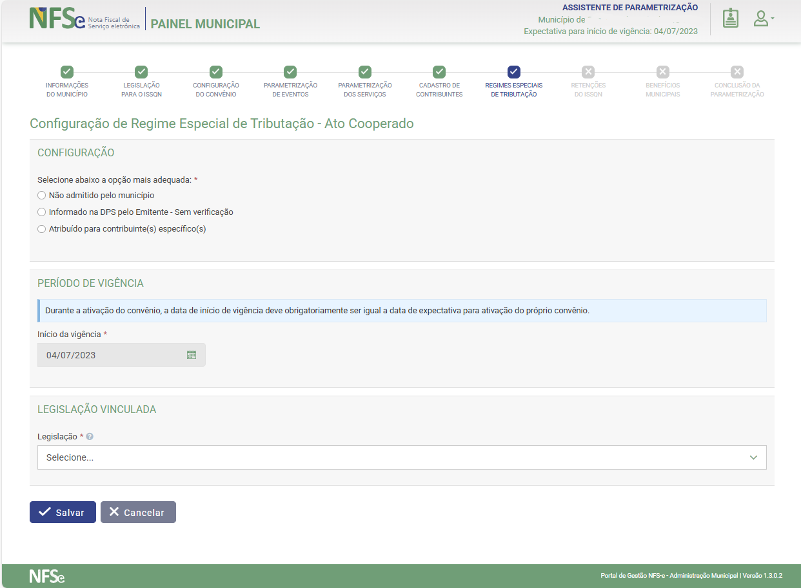
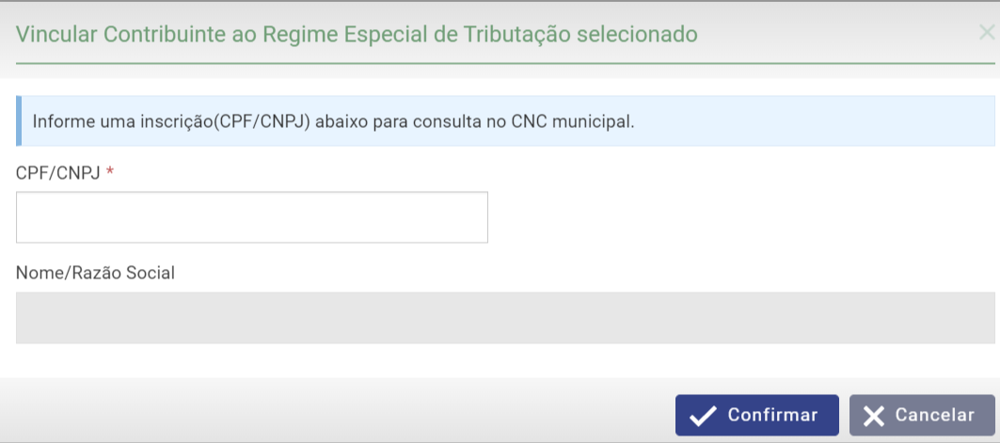
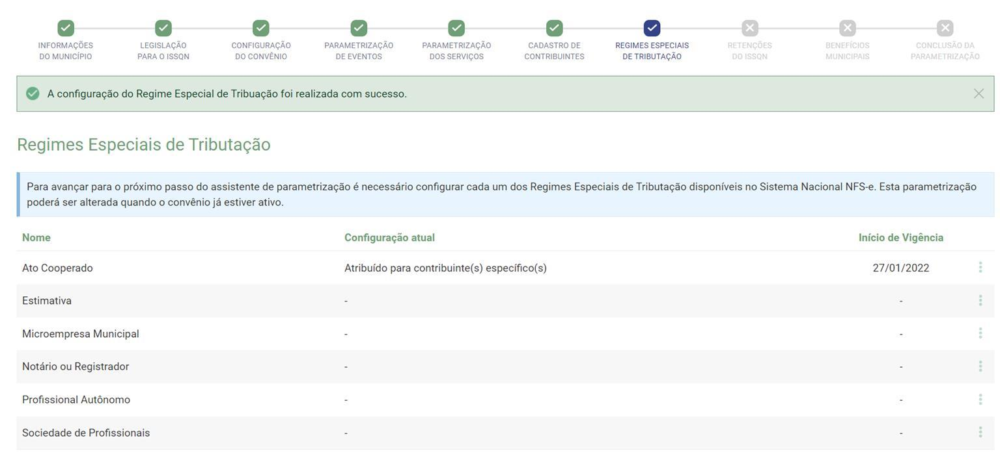
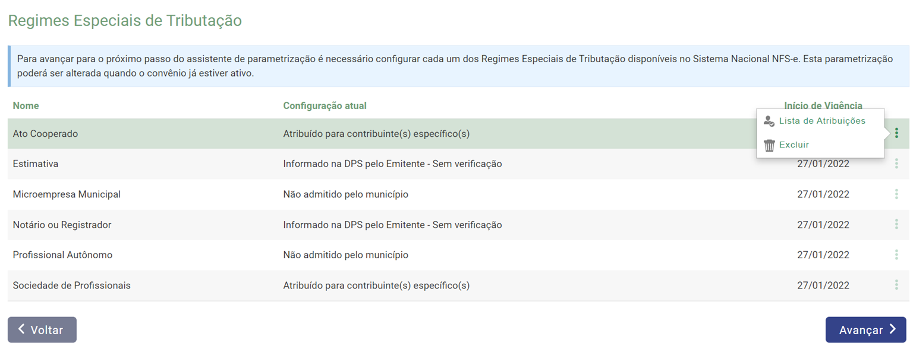
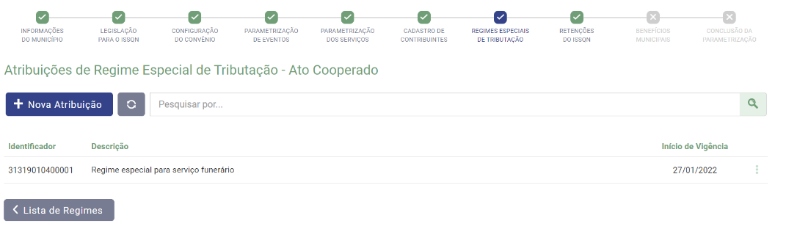

# 3.7.1 Configuração de Regimes Especiais de Tributação no painel

Ao clicar nos 3 pontos, no final de cada um dos regimes cadastrados, é possível selecionar a opção “Configurar” para cada uma das opções exibidas na tela:

- Ato Cooperado
- Estimativa
- Microempresa Municipal
- Notário ou Registrador
- Profissional Autônomo
- Sociedades de Profissionais

<!-- p.88 -->

*Figura 85 - Seleção da configuração de cada item dos Regimes Especiais de Tributação.*

Para cada um dos regimes especiais mencionados anteriormente, a ATM deverá preencher:

*Figura 86 - Configuração dos regimes especiais de tributação.*

- **Configuração:** nesse campo deverá ser selecionado se o município não admite o tipo de regime em questão, se o admite por meio apenas da informação na DPS pelo emitente (sem verificação) ou se admite apenas para determinados contribuintes e/ou serviços específicos.

Para a opção “Informado na DPS pelo Emitente – Sem verificação”, o sistema sempre permitirá que qualquer emitente indique esse tipo de regime especial na emissão de uma NFS-e, ou seja, não haverá

<!-- p.89 -->
validação por parte do Sistema Nacional da NFS-e em relação ao regime, sendo aceita a declaração do contribuinte.

Ao selecionar a última opção, no final da página são abertos três campos: identificação, contribuintes vinculados e serviços vinculados. No primeiro deverá ser inserida uma descrição do Regime para facilitar a identificação do regime no sistema posteriormente. No campo de contribuintes, ao selecionar o botão “+Incluir” o sistema abre uma nova janela em que o CPF/CNPJ do contribuinte deverá ser digitado no sistema e confirmado em seguida.

> **Atenção:** Caso a ATM tenha optado por utilizar o CNC como fonte de cadastro, os contribuintes inseridos nos regimes especiais de tributação deverão necessariamente ter sido cadastrados previamente no sistema.

*Figura 87 - Inserção de um contribuinte específico no regime especial configurado.*

A configuração também poderá ser realizada por serviço, especificamente. No campo serviços vinculados o botão “+Incluir” deverá ser selecionado. O sistema abrirá então uma tela com a lista de serviços para a escolha pela ATM.

> **Atenção:** Quando nenhum serviço é selecionado especificamente, as configurações realizadas são aplicadas a todos os serviços cadastrados no sistema.

- **Período de vigência:** deverá ser indicado quando iniciará a vigência do regime configurado. Enquanto o convênio não estiver ativado, o início da vigência coincide com a data da expectativa para ativação do convênio.
- **Legislação vinculada:** deverá ser selecionada a legislação que permite a aplicação do regime especial em questão.

Uma vez inseridas todas as informações exigidas no sistema, o botão “Salvar” deverá ser selecionado.

<!-- p.90 -->

*Figura 88 - Tela de confirmação da configuração do regime especial de tributação.*

Uma vez realizadas as configurações, para cada regime as opções disponibilizadas são:

*Figura 89 - Opções disponibilizadas depois de configurados os regimes.*

- **Lista de atribuições:** é exibido todo o histórico de configurações realizadas para o regime especial selecionado.

*Figura 90 - Histórico de configurações do regime especial selecionado.*

<!-- p.91 -->
Caso a ATM deseje, poderá alterar a configuração do regime especial selecionado acrescentando contribuintes ou serviços, mas não poderá alterar as demais informações.

- **Excluir:** enquanto o convênio não é ativado, as configurações realizadas para um determinado regime especial poderão ser excluídas. Depois da ativação do convênio, um regime não mais poderá ser excluído, ele pode apenas encerrar a exigência.

> Na hipótese de regimes com controle por contribuinte específico, que sejam criados vários regimes do mesmo tipo, para serviços e contribuintes distintos, ou seja, podem ser criados regimes de sociedade de profissional só para serviços de advocacia, de medicina, de engenharia, e assim por diante, vinculando apenas o código de serviço específico e os CNPJs específicos em cada grupo (nesse cenário, um CNPJ somente poderá gerar a NFS-e com indicação de regime de sociedade de profissionais para o serviço que foi correlacionado para seu CNPJ, se for emitir NFS-e para outro tipo de serviço, ele será calculado conforme o preço do serviço e a alíquota.

Ao finalizar a configuração de todos os regimes especiais, o botão “Avançar” deverá ser acionado no canto inferior direito da página.
