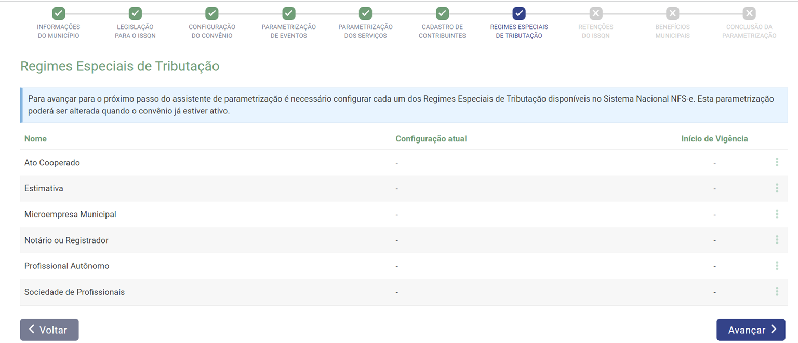

<!-- p.86 -->
# 3.7 Regimes Especiais de Tributação

Neste passo da parametrização, serão inseridas no sistema informações a respeito dos regimes especiais de tributação que são admitidos pela ATM.

Para o Sistema NFS-e, a expressão “regime especial de tributação” se aplica a notas que serão geradas pelos emitentes indicados sem o cálculo do ISS no documento, uma vez que a eventual base de cálculo do imposto, nessas situações, pode não ser o preço dos serviços (exemplo: profissionais autônomos pessoa física e sociedade de profissionais) ou cujo cálculo será realizado por outra via ou método (notário ou estimativa).

Além disso, em relação aos optantes do Simples Nacional, esse regime se sobrepõe aos demais regimes especiais aqui descritos, ou seja, a opção pelo SN prevalece, não sendo possível indicar um segundo regime por ocasião da geração da NFS-e, ainda que o mesmo tenha sido cadastrado na parametrização descrita neste tópico (exceção feita à sociedade de serviços contábeis, por conta da regra do SN que permite recolher o ISS por fora do regime nacional das ME e EPP, de acordo com a legislação do Município).

Os Regimes Especiais de Tributação somente podem ser definidos após a definição da alíquota para um “desdobro” da lista. Assim como os outros parâmetros tratados até agora, exceto código de tributação municipal, a administração destes parâmetros é realizada nos desdobros dos subitens da lista de serviços nacional.

Importante explicitar que, para os municípios com opção de utilização de informações cadastrais através da RFB, os regimes especiais de tributação serão definidos por subitens da lista de serviços no momento da parametrização da lista de serviços.

Para os municípios com opção de cadastrar seus contribuintes pela funcionalidade CNC, os regimes especiais de tributação deverão ser parametrizados no momento da inclusão desse contribuinte.

Cada regra de parametrização de regimes especiais de tributação incluídas tem um identificador único. O identificador tem a seguinte regra de formação: 7 dígitos para o código do município, 2 dígitos para o tipo de parâmetro e 5 dígitos sequenciais únicos por município/parâmetro;

<!-- p.87 -->

*Figura 84 - Regimes Especiais de Tributação a serem configurados.*
