# 3.8.1 Configuração de Retenções

## 3.8.1.1 Retenções estabelecidas na legislação municipal

A ATM poderá configurar no Sistema Nacional da NFS-e as retenções estabelecidas por sua legislação específica, independentemente da habilitação das retenções permitidas pela LC 116/2003 (item B).

> **Atenção:** A inserção das informações acerca das retenções é opcional. Portanto, caso não deseje inserir nenhuma informação no sistema nesta página, a ATM poderá avançar para a etapa posterior.

> **Atenção:** Operacionalmente, nesse momento inicial do uso do padrão, a regra de retenção consistirá em um dado de consulta, informativo, para busca das regras de retenção de um Município (para utilização na emissão de NFS-e por sistemas próprios de contribuintes (web service) ou de outros Municípios). No emissor público será apresentado um alerta de que o Município de incidência indicou que a operação deve ser objeto de retenção por parte do tomador ou do intermediário, conforme o caso. Assim, a regra não será aplicada de modo a rejeitar uma nota emitida em desacordo, mas, obviamente, vai permitir ao Município identificar os casos em que ela não for cumprida.

Ao clicar em **+ Nova Retenção**, será aberta uma janela para a inclusão das seguintes informações de uma retenção municipal:

- Descrição;

<!-- p.97 -->
- Legislação;
- Início da vigência;
- Configuração da Retenção Municipal
- Selecione o(s) responsável(eis) pela retenção do ISSQN\*
  - Retido pelo Tomador
  - Retido pelo Intermediário
- Serviços vinculados a Retenção Municipal; e
- Responsáveis Tributários vinculados a Retenção Municipal

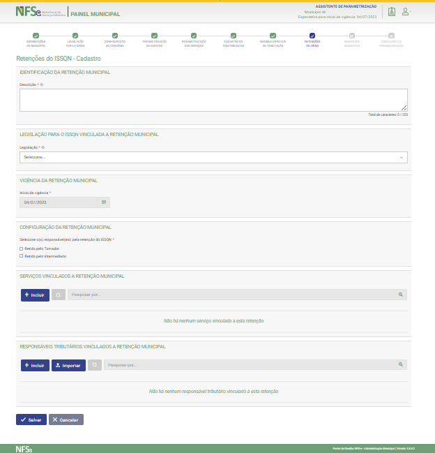

*Figura 96 - Tela inclusão das seguintes informações de uma retenção municipal.*

A primeira informação a ser inserida é a descrição da retenção. Essa informação aparecerá na lista de retenções e deve ser descrita de modo a ser possível distinguir facilmente cada uma das retenções cadastradas no sistema da NFS-e Nacional.

<!-- p.98 -->
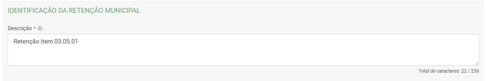

*Figura 97 - Descrição da retenção a ser cadastrada: esses dados servirão para identificar na lista de retenções municipais qual é a retenção abrangida.*

A próxima informação requisitada é sobre a legislação municipal que estabelece a retenção a ser cadastrada.

> **Atenção:** Um pré-requisito para a configuração das retenções estabelecidas pela legislação municipal é a sua inserção no Sistema Nacional da NFS-e, configuração explicada no item 19 deste manual.

Ao selecionar o campo para preenchimento, será mostrada toda a lista da legislação cadastrada para o município. A ATM deverá então identificar e selecionar o ato correspondente.

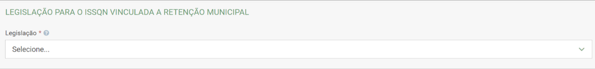

*Figura 98 - Seleção da legislação que estabelece a retenção no município.*

Uma vez selecionada a legislação, o sistema preencherá os campos de início e, se for o caso, o final da vigência, de acordo com as informações salvas pela ATM na legislação municipal.

Em seguida, será requisitada a informação sobre o início da vigência da retenção municipal no Sistema Nacional da NFS-e.

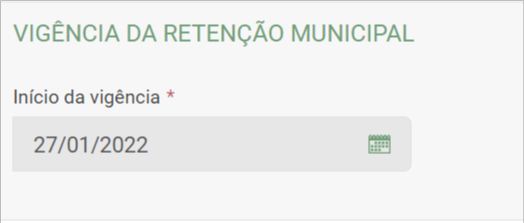

*Figura 99 - Inserção da data do início da vigência da retenção municipal.*

<!-- p.99 -->
> **Atenção:** A data de início de vigência da retenção deve ser igual ou superior à data de início de vigência do convênio municipal.

> **Atenção:** A data de início de vigência da retenção deve ser maior que a data de início de vigência da legislação municipal.

> **Atenção:** Enquanto não ativado o convênio municipal, a data de vigência da retenção fica definida como a data de início da vigência do convênio.

Em seguida, a ATM deverá indicar quem é o responsável por fazer a retenção a ser cadastrada. O sistema disponibiliza duas opções:

- O Tomador do serviço;
- O Intermediário da prestação do serviço

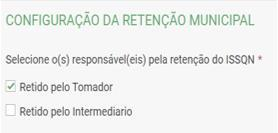

*Figura 100 – Configuração da Retenção Municipal.*

> **Atenção:** Para o cadastramento de uma retenção a seleção de serviços na lista e a inserção de responsáveis específicos pela retenção não são campos de preenchimento obrigatório, mas ao menos um dos dois campos deverá ser preenchido.

Uma vez escolhidos os serviços, a seleção deverá ser realizada por meio do botão “Confirmar”.

<!-- p.100 -->
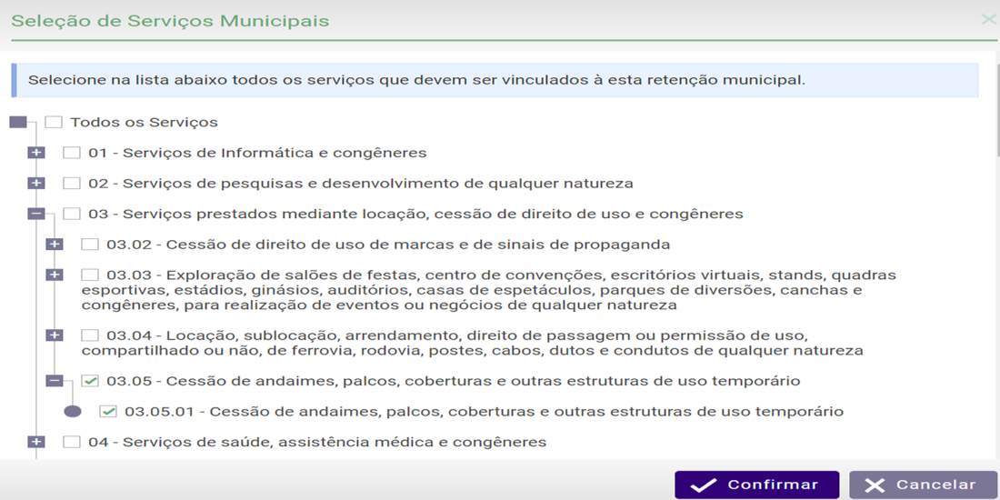

*Figura 101 - A lista de serviços é disponibilizada para seleção.*

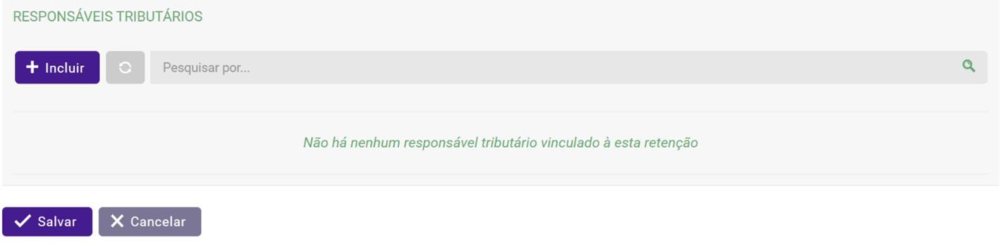

*Figura 102 - Seleção da inclusão dos responsáveis tributários.*

Outra parametrização disponível é a dos responsáveis tributários específicos pela retenção a serem cadastrados. Para acessar a tela de inclusão, deve-se selecionar o botão “Incluir”.

> **Atenção:** A inclusão de responsáveis tributários na retenção implica em que apenas os contribuintes discriminados pela ATM nesse cadastramento poderão selecionar a retenção do ISSQN no processo de emissão da NFS-e de Nacional.

O sistema irá solicitar os CPF’s ou CNPJ’s dos contribuintes vinculados à retenção em questão. A ATM deverá digitar os dados, conferir as informações carregadas na tela e confirmar.

> **Atenção:** Apenas poderão ser inseridos como responsáveis pela retenção, contribuintes cadastrados na jurisdição do Município em questão.

<!-- p.101 -->
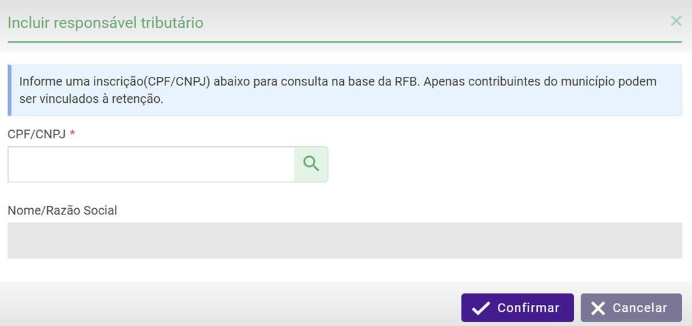

*Figura 103 - Informações para inclusão dos responsáveis tributários.*

Uma vez sendo inseridas todas as informações, estas deverão ser salvas, acessando o botão “Salvar” no final da página.

A página de retenções é novamente exibida, mostrando a retenção salva.

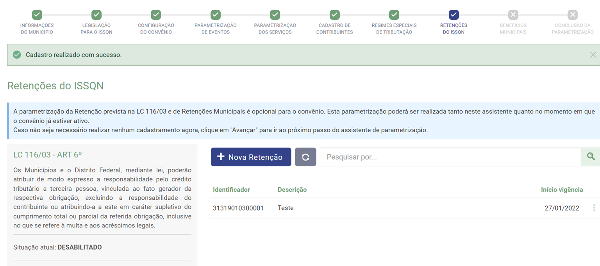

*Figura 104 - Confirmação do cadastro da nova retenção.*

## 3.8.1.2 Retenções previstas na Lei Complementar 116/2003

Inicialmente o sistema tem as parametrizações de retenção segundo a LC 116/2003 desabilitadas.

Para habilitar a inserção de retenções de acordo com a LC 116/2003, a ATM terá que acessar o botão “Detalhes/Edição”.

<!-- p.102 -->
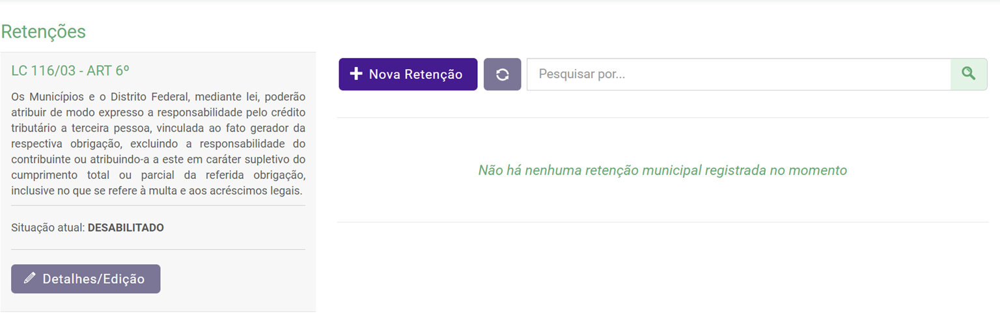

*Figura 105 - Página para habilitação das configurações relativas às retenções municipais.*

A página de habilitação é então exibida e basta acionar o botão “Habilitar” para ativar as retenções propostas pela Lei Complementar 116/2003.

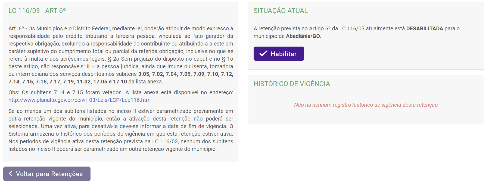

*Figura 106 - Página de habilitação das configurações relativas às retenções municipais.*

> **Atenção:** Caso haja alguma retenção previamente cadastrada para qualquer serviço da lista definida pela Lei Complementar 116/2003, ela deverá ter a sua vigência previamente encerrada. Apesar desta ser uma premissa do sistema, ele não impede que as retenções da LC 116/2003 sejam habilitadas mesmo que haja retenções municipais cadastradas para um mesmo serviço. Dessa forma, cabe à ATM gerenciar as retenções ativas.

Enquanto não ativado o convênio municipal, fica definida como data de início da vigência a data de início da vigência do convênio. Em seguida o botão “Habilitar” deverá ser acionado.

<!-- p.103 -->
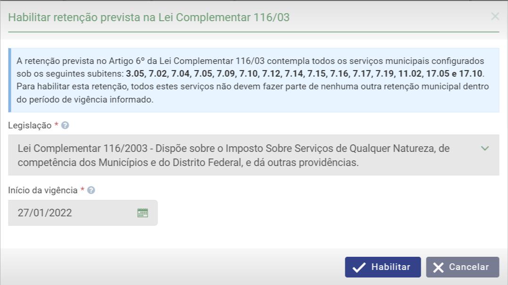

*Figura 107 - Tela de configuração da vigência da retenção prevista pela Lei Complementar 116/2003.*

> **Atenção:** Uma vez ativado o convênio, a data de início da vigência inserida deverá ser maior que a data de início do convênio municipal com o Sistema Nacional da NFS-e e maior que a data final da vigência da retenção anterior, caso haja uma.

## 3.8.1.3 Exclusão de uma retenção

Enquanto não ativado o convênio uma retenção poderá ser excluída. Para excluir uma retenção, a ATM deverá acessar a página de configuração das retenções e selecionar o ícone na linha da retenção que deseja realizar o encerramento. E em seguida, selecionar a opção “Excluir”.

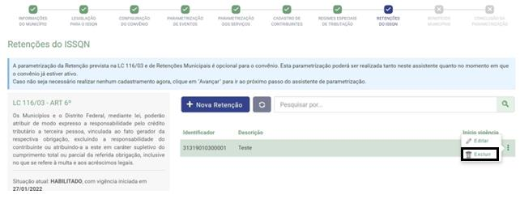

*Figura 108 – Opção de excluir uma retenção cadastrada.*

<!-- p.104 -->
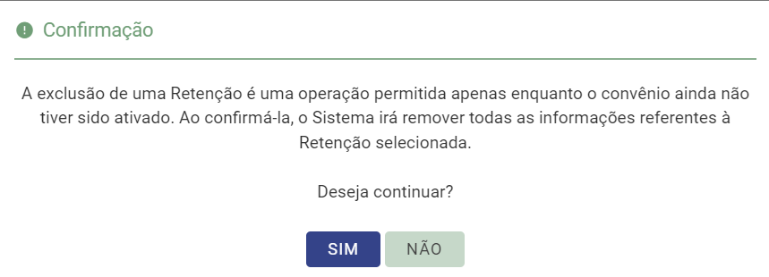

*Figura 109 - Mensagem de confirmação da exclusão da retenção selecionada.*
