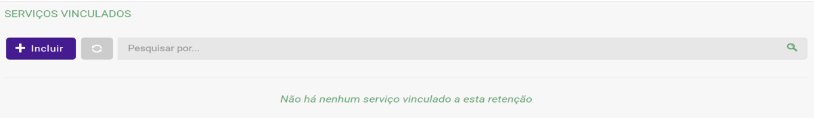

# 3.8.2 Upload de Arquivo dos contribuintes vinculados às Retenções do ISSQN

A ATM poderá então selecionar o(s) serviço(s) na lista ao(s) qual(is) se vincula(m) a retenção. Basta então selecionar o botão “Incluir” e a lista de serviços será disponibilizada.

A funcionalidade permite em um único procedimento incluir as informações de um ou mais contribuintes. As regras gerais estão descritas no site web da funcionalidade.

*Figura 110 - Seleção da inclusão de um serviço vinculado à retenção a ser cadastrada.*

1. Todos os campos do arquivo de entrada do arquivo CSV devem estar preenchidos, conforme leiaute do arquivo CSV.

   `<CPF/CNPJ>|<IndicadorDaManutenção>|<Data>|<IdentificadorLegislação>|`

   - a. `<CPF/CNPJ>` - 14 dígitos (preencher com 000 à esquerda quando se tratar de um CPF);
   - b. `<IndicadorDaManutenção>` - 0 - Finalizar Vigência; 1 - Iniciar Vigência;
   - c. `<Data>` - Formato da data DD-MM-AAAA;
   - d. `<IdentificadorLegislação>` - 14 digitos;

2. O arquivo CSV com o resultado do processamento ficará disponível para download na mesma tela de upload. Este arquivo conterá as mesmas informações linha a linha acrescidas com a mensagem do resultado do processamento.
3. A data informada deve ser maior ou igual à data de início da parametrização.
4. Verificar se já existe CPF/CNPJ cadastrado na parametrização. Se não existir é possível cadastrar nova vigência. Se já existir, deve-se verificar se o registro possui data final de vigência preenchido. Se existir data final de vigência, então pode-se ser incluída uma nova vigência para o registro. Se não existir data final de vigência, então pode-se apenas finalizar a vigência do registro nesta parametrização, desde que a data informada no upload deste registro seja maior que a data de final de vigência do último registro de parametrização deste CPF/CNPJ.
5. Pode haver mais de um registro por CPF/CNPJ em um mesmo arquivo CSV, ressaltando que o processamento será realizado na sequência em que os registros forem listados no arquivo.
6. O upload dos beneficiários via CSV deve estar disponível antes e depois da ativação do município no Painel Municipal.

<!-- p.105 -->
7. Manutenção da parametrização a ser realizada:

   - 0 - Finalizar Vigência;
   - 1 - Iniciar Vigência;

8. Verificar se o identificador da legislação pertence ao município que está realizando a manutenção da parametrização. (Verificar se os 7 primeiros dígitos do identificador da legislação correspondem ao código do município informado).

- A extensão do arquivo obrigatoriamente deve ser .CSV.
- O arquivo deve conter um registro por linha.
- Os campos que compõem cada linha devem ser separados por Pipe ( | ).
- O tamanho do arquivo deve ser de até 300 Kb (cerca de 2000 contribuintes).
- Para informações detalhadas, consulte o leiaute nas opções abaixo.
