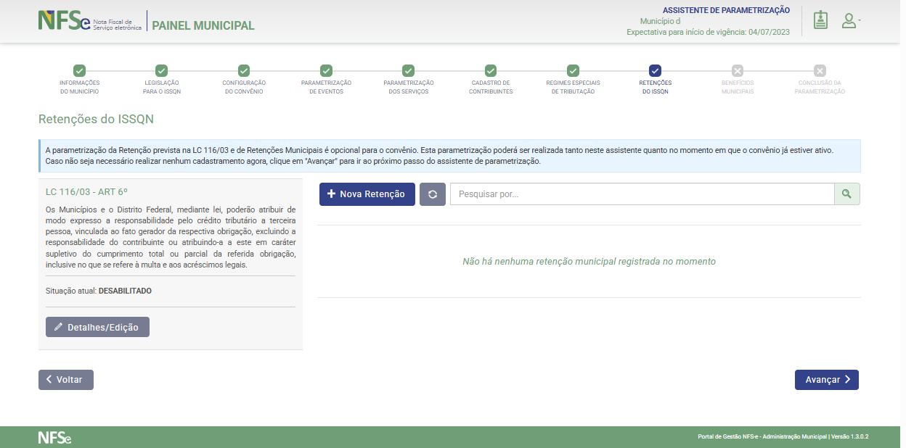

<!-- p.95 -->
# 3.8 Retenções do ISSQN

Os parâmetros para retenções definem critérios de quem e/ou para quais serviços o município de incidência do ISSQN define a ocorrência da retenção do tributo para recolhimento pelo tomador e/ou intermediário de serviços.

O sistema nacional permite opcionalmente para o município duas possibilidades de parametrização de retenção do ISSQN:

a) A primeira opção define as regras de retenção do município conforme os casos de retenção do Artigo 6º, §2º, II da LC 116/03;

b) A segunda opção permite ao município definir suas próprias regras de retenção, realizando as parametrizações conforme os casos de retenção que estiverem descritos em sua própria legislação municipal, observando que, o sistema não abrange todos os possíveis itens que foram adotados especificamente por alguns municípios para definir os casos de retenção, que estão descritos nas diversas legislações municipais dos municípios do país (como área de terreno e valor por exemplo). O sistema nacional abrange aqueles itens que são utilizados mais comumente nas legislações municipais para configurar os casos de retenção (subitens da lista de serviço, tomador/intermediário, localidade do prestador de serviço).

É obrigatório fazer a parametrização da retenção, sendo que o município pode realizar a parametrização dos dois modos de retenção combinados. Enquanto a retenção definida no Artigo 6º, §2º, II da LC 116/03 estiver vigente, a retenção combinada proveniente de uma legislação municipal pode também estar vigente, desde que não seja conflitante com as situações de retenção da LC 116/03.

O inverso também é válido. Um município pode realizar primeiramente a parametrização de retenções previstas na sua legislação municipal. Caso queira realizar os casos de retenção previstos da LC 116/03, não poderá conflitar com os casos já parametrizados e vigentes de sua legislação local.

Para realizar a alteração entre uma e outra ou as duas combinadas, deve encerrar a vigência dos casos que sejam conflitantes daquela parametrização que estiver vigente primeiro, para em seguida iniciar a vigência da outra.

Lembrando que, a opção de parametrização do Artigo 6º, §2º, II da LC 116/03 só pode ser realizado integralmente. Caso o município tenha somente algumas situações idênticas ao Artigo 6º, §2º, II da LC 116/03, previstas em sua legislação local, deve optar pela parametrização caso a caso refletindo a sua legislação local.

Cada regra de parametrização de retenções incluídas tem um identificador único. O identificador tem a <!-- p.96 -->seguinte regra de formação: 7 dígitos para o código do município, 2 dígitos para o tipo de parâmetro e 5 dígitos sequenciais únicos por município/parâmetro;

*Figura 95 - Tela de configuração das retenções.*
