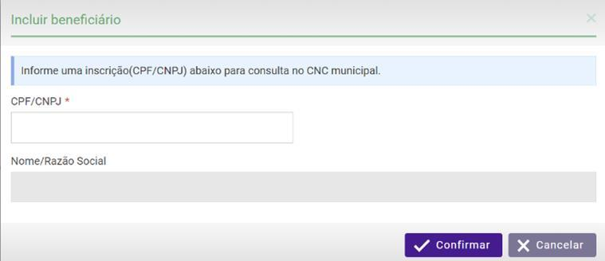

# 3.9.1 Vinculação individual de contribuinte ao benefício

É possível a vinculação individual de um contribuinte ao benefício selecionado. Clicar no botão “+ Incluir”, o painel exibirá uma janela para inclusão do CPF/CNPJ.

O sistema exibirá então a tela para inserção do CPF/CNPJ em questão. Uma vez digitadas as informações, o botão “Confirmar” deverá ser selecionado.

*Figura 123 - Inserção do CPF/CNPJ do contribuinte beneficiário.*

Mais de um contribuinte poderá ser inserido para um mesmo benefício, basta que os procedimentos descritos neste subitem sejam repetidos.
