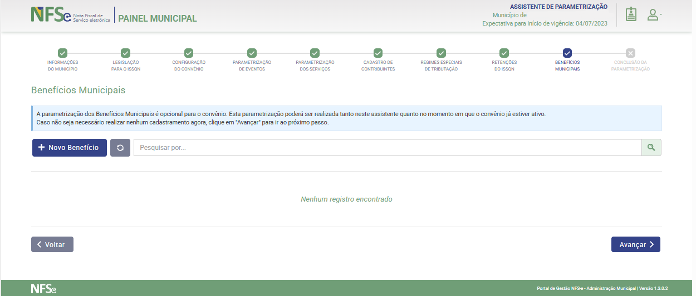
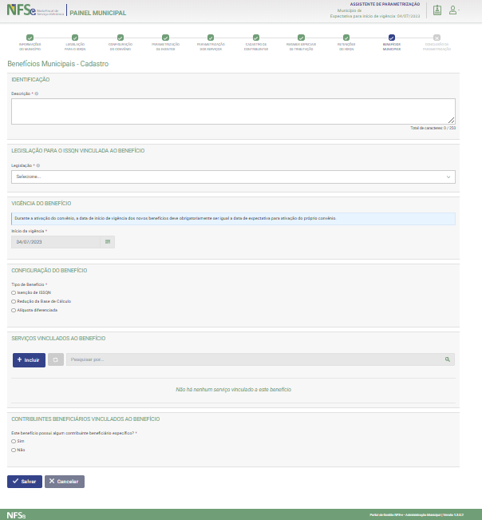
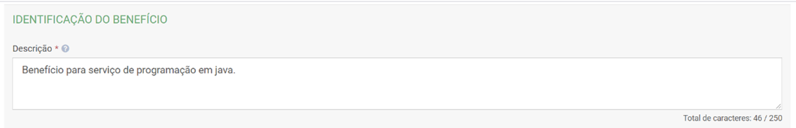
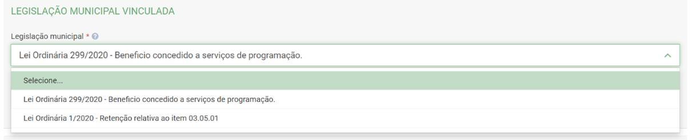
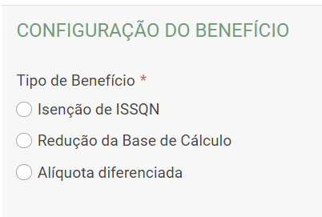
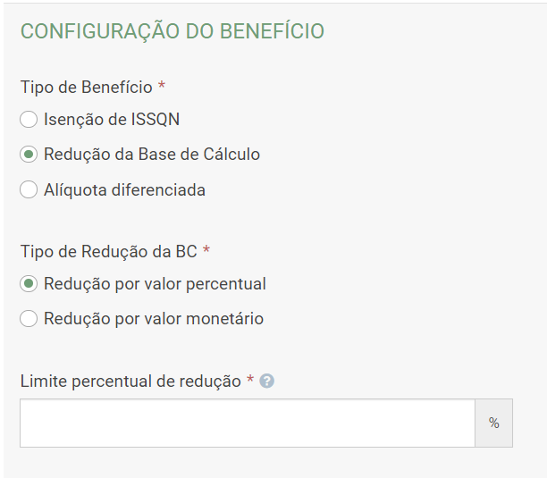
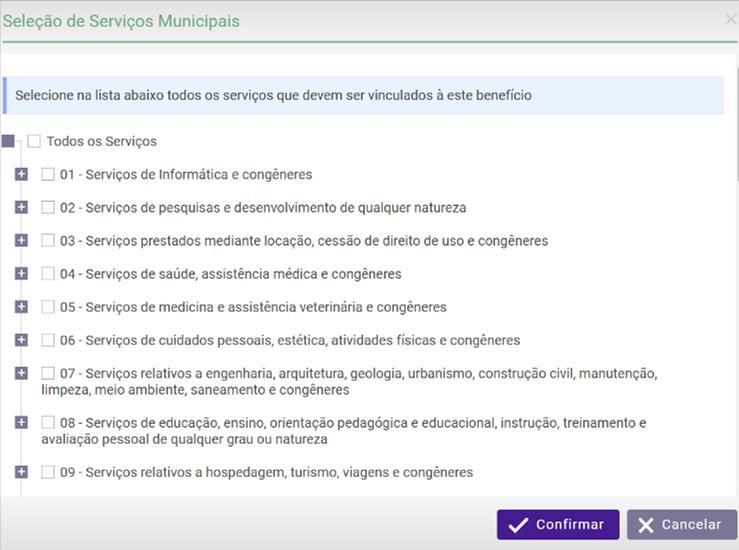
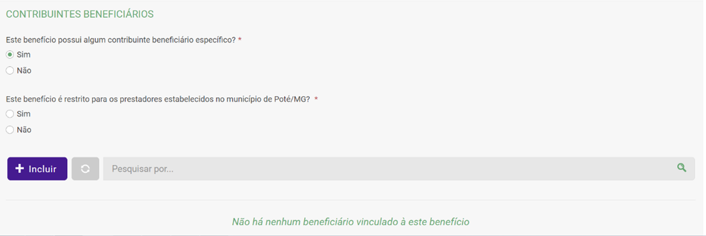

<!-- p.106 -->
# 3.9 Benefícios Municipais

Os Municípios poderão parametrizar benefícios estabelecidos pela legislação municipal, não previstos na Lei Complementar 116/2003, mas com ela compatíveis. Para o sistema NFS-e Nacional, uma regra de isenção resulta em não haver cálculo do ISS para a operação tributável. Em respeito à regra da alíquota mínima efetiva (art. 8º-A da LC 116/2003), apenas os serviços com códigos equivalentes à construção civil e transportes coletivos serão passíveis de serem indicados como isentos (subitens 7.02, 07.05 e 16.01 da Lista Anexa à LC 116/2003, respectivamente).

Para benefícios parciais, deve-se utilizar os benefícios de redução de base de cálculo ou a alíquota diferenciada. Para eventuais outros benefícios que se traduzam em valores sobre uma possível totalização de receitas (que não dizem respeito ao cálculo de uma nota em si), poderá ser utilizado, quando disponível, o MAN, com a inclusão de valores para abatimento de uma totalização de notas selecionadas para pagamento.

Para inclusão de um novo benefício, clicar em “+ Novo Benefício”:

*Figura 111 – Tela inicial para parametrização de Benefícios Municipais.*

Ao clicar em “Novo Benefício”, será uma tela para a inclusão das informações necessárias.

*Figura 112 - Seleção para adicionar um novo benefício municipal.*

Serão solicitados diversos campos para preenchimento pela ATM.

<!-- p.107 -->

*Figura 113 –Cadastro do benefício municipal.*

- **Descrição;** neste campo é exigida a descrição do benefício: o texto que será exibido na lista dos benefícios cadastrados e que deverá identificá-lo facilmente.

*Figura 114 - Campo de descrição do benefício a ser inserido.*

- **Legislação Municipal:** A ATM deverá selecionar na lista da legislação vinculada o ato normativo que institui o benefício a ser incluído. Este ato deve ser previamente cadastrado no sistema.

<!-- p.108 -->

*Figura 115 - Seleção da legislação municipal que institui o benefício.*

- **Vigência do Benefício:** Enquanto não ativado o convênio municipal, a data de vigência do benefício será a data de expectativa para a ativação do próprio convênio.

*Figura 116 – Data de início da vigência do benefício coincide com a data de expectativa de ativação do convênio.*

- **Tipo de Benefício\*** Neste campo são disponibilizadas três opções de escolha de benefícios:

*Figura 117 - Isenção de ISSQN: não são necessárias outras configurações*

  - a) **Isenção de ISSQN:** a seleção desta opção não requer outras configurações;

> **Atenção:** A isenção só é permitida para os serviços constantes dos subitens 7.02, 7.05 e 16.01 da LC 116/2003.

<!-- p.109 -->
  - b) **Redução da base de cálculo:** pode ser por valor percentual ou por valor monetário. Ao escolher a primeira opção, a ATM deverá estabelecer o limite do percentual aceitável para a redução da base de cálculo. Ao escolher a segunda opção, nenhuma outra configuração é necessária;

*Figura 118 - Configurações da redução da base de cálculo por valor percentual.*

> **Atenção:** O maior valor percentual admitido pelo sistema para a redução da base de cálculo é de 60%, de modo que a alíquota real aplicada respeite os limites estabelecidos pela Lei Complementar 116/2003.

  - c) **Alíquota diferenciada:** a seleção dessa opção requer a configuração da alíquota a ser aplicada. Esta deverá estar entre 2% e 5%, de acordo com a Lei Complementar 116/2003.

- **Serviços vinculados ao Benefício;**

*Figura 119 - Inclusão de serviços vinculados ao benefício.*

<!-- p.110 -->

*Figura 120 - Seleção dos serviços vinculados ao benefício.*

- **Contribuintes beneficiários:**

A ATM poderá definir contribuintes específicos como beneficiários do benefício fiscal a ser cadastrado. Para isso deverá selecionar “Sim” no item correspondente na página.

*Figura 121 - Informações solicitadas para a definição do benefício para contribuintes específicos.*

Ao definir o benefício para contribuintes específicos, outros contribuintes não poderão aplicá-lo durante a emissão da NFS-e de Nacional.

Uma vez realizada a opção de determinar contribuintes específicos para o benefício, a ATM deverá <!-- p.111 -->indicar também se o benefício a ser cadastrado é restrito para prestadores de serviços estabelecidos no município.

*Figura 122 - Informações solicitadas para a definição do benefício para contribuintes específicos.*
